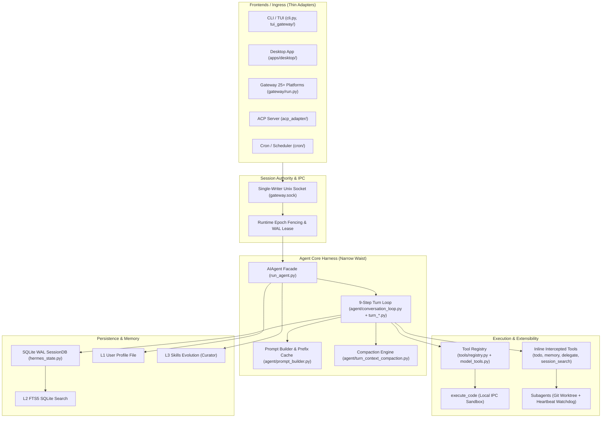

# Repository Guidelines

## Project Overview

Hermes Agent (`hermes-agent`) is an open-source, production-grade autonomous AI agent harness built by Nous Research. Its primary architectural role is serving as an **Agent Harness (Control Engine & Runtime)** that wraps stateless foundation model inference into a robust, observable, resilient, and multi-tenant agent execution system across multiple frontends (CLI, TUI, Electron Desktop, Web, ACP IDE protocol, and 25+ messaging platforms).

The core philosophy follows the **"Narrow Waist (单核窄腰)"** architectural paradigm:
- **A narrow, platform-agnostic core** (`run_agent.py`, `agent/`, `model_tools.py`, `hermes_state.py`) that strictly enforces synchronous turn state machines, message alternation invariants, and byte-stable prompt caching.
- **Rich capability at the edges** (providers, toolsets, execution sandboxes, memory engines, and platform adapters) wired via ABCs and import-time registries without touching the core.

---

## Architecture & Data Flow



### High-Level Data Flow & The 9-Step Turn Lifecycle

Each interaction runs through `agent/conversation_loop.py` using modular step handlers in `agent/turn_*.py`:
1. **Preflight (`turn_preflight*.py`)**: Acquires session turn lease, checks `_interrupt_requested`, and validates token/iteration budget.
2. **Iteration Prep (`turn_iteration_prep.py`)**: Assembles message history; injects ephemeral context (dynamic directory hints, battery, timestamps) via user/tool bypass channels without mutating the system prompt.
3. **Request Assembly (`turn_request_assembly.py`, `turn_api_request.py`)**: Converts Canonical IR into provider-specific payloads (OpenAI, Anthropic, Bedrock, etc.).
4. **API Call (`turn_api_call.py`)**: Executes streaming completion in background daemon thread while main thread monitors interrupts and stream watchdog timers.
5. **Response Intake (`turn_response_intake.py`, `turn_response_check.py`)**: Detects empty responses, thinking-only loops, and extracts `tool_calls`.
6. **Tool Round (`turn_tool_round.py`, `turn_tool_validation.py`)**:
   - Inline tools (`todo`, `memory`, `session_search`, `delegate_task`) are intercepted directly by `agent/inline_tool_executors.py`.
   - General tools execute concurrently via `ThreadPoolExecutor` and write back strictly in original caller sequence.
   - Interactive tools (`clarify`) act as serial barriers.
7. **Compaction Check (`turn_context_compaction.py`)**: Triggers micro-compaction (folding stale tool outputs) or 4-stage LLM-assisted summary compaction with deterministic fallbacks.
8. **Finalizer (`turn_finalizer.py`, `turn_final_response.py`)**: Sanitizes control tokens, commits batch messages to SQLite, and issues client completion callbacks.
9. **Evolution & Memory (`agent/curator.py`, `agent/memory_manager.py`)**: Runs background asynchronous extraction of durable memories and newly learned skills.

---

## Key Directories

| Directory | Purpose |
|---|---|
| `run_agent.py`, `agent/` | Core harness facade (`AIAgent`), 9-step turn loop (`agent/turn_*.py`), prompt assembly, context compaction, and auxiliary LLM routing. |
| `model_tools.py`, `toolsets.py`, `tools/` | Tool orchestration, registry (`tools/registry.py`), environment sandbox backends (`tools/environments/`), and core tool implementations. |
| `hermes_state.py`, `hermes_state_*.py` | SQLite state storage (`SessionDB`), schema migrations, message persistence, and corruption recovery. |
| `hermes_constants.py`, `hermes_platform/` | Profile-aware paths (`get_hermes_home()`), platform abstraction layer, and machine facts. |
| `cli.py`, `hermes_cli/` | Terminal interactive REPL, slash command dispatcher, configuration backend, and profile management. |
| `gateway/` | Long-running messaging gateway supporting 25+ chat platforms (Telegram, Discord, Slack, etc.), message guards, and single-writer authority. |
| `tui_gateway/`, `ui-tui/` | JSON-RPC gateway service and terminal UI backend. |
| `apps/desktop/` | Electron desktop client integration and desktop gateway bridges. |
| `acp_adapter/` | Agent Client Protocol (ACP) server implementation for IDE editor integration. |
| `skills/`, `optional-skills/` | Curated skill definitions and SOP playbooks. |
| `scripts/` | Developer tooling (`scripts/check`, `scripts/run_tests.sh`, code health linters). |
| `docs/harness/` | Comprehensive Harness deep-dive architecture and developer implementation notes. |

---

## Development Commands

All development tasks rely on the hermes PM-managed virtual environment and pinned tooling:

```bash
# Environment Activation
source ./activate          # Provisions/activates PM virtualenv (fish: activate.fish, ps1: activate.ps1)

# Code Quality & Health Checks (blocking lint & rule enforcement)
python scripts/check       # Runs complete blocking CI checks (ruff, format, type-check, HX rules)
just check                 # Equivalent shortcut via justfile

# Pre-push git hook installation
python scripts/check --install-hook pre-push

# Testing (always run through runner script, never bare pytest)
./scripts/run_tests.sh                           # Run full test suite with environment guards
./scripts/run_tests.sh tests/agent/              # Run agent loop and turn lifecycle tests
./scripts/run_tests.sh tests/tools/              # Run tool registry and dispatch tests
./scripts/run_tests.sh tests/gateway/            # Run gateway adapter and contract tests

# Dependency & Lockfile Management
hermes pm lock             # Re-resolve and update uv.lock after editing pyproject.toml
```

---

## Code Conventions & Common Patterns

### 1. Invariants & Rules
- **Prompt Caching is Sacred**: System prompt is byte-stable for the life of a session. NEVER mutate past context, reload memories, or alter the system prompt mid-turn. Inject dynamic state strictly via user messages or tool results.
- **Strict Role Alternation**: Always enforce `user -> assistant -> user -> assistant`. Tool requests must immediately follow with paired `tool` result messages.
- **Discard-on-Interrupt**: On user interruption, discard incomplete partial assistant responses. If tool calls were initiated, synthesize structured cancellation errors to ensure tool pairs are closed.
- **Single-Writer Authority**: Never access SQLite files with ad-hoc writers. In multi-tenant/gateway modes, write access goes through `gateway.sock` with epoch fencing.
- **Profile-Aware Paths**: Never hardcode `~/.hermes`. Always resolve configuration and state paths using `get_hermes_home()` (code) and `display_hermes_home()` (UI display).
- **No Defensive Clutter**: Avoid unnecessary `try/except: pass` wrappers or unconfigured flags. Code must be verifiable and failures fail-closed.

### 2. Implementation Conventions
- **Language Level**: Strictly Python 3.11+ compatible (avoid PEP 695 type statement syntax).
- **Import Rules**: Imports must remain at the top of topic modules; never import from package facades (`__init__.py`) internally.
- **Complexity Limits**: Functions CC $\le$ 20, $\le$ 300 lines, nesting $\le$ 6; files $\le$ 2,000 lines.
- **Table-Driven Dispatch**: Prefer dictionary routing tables over long `if/elif` chains.

---

## Important Files

- `run_agent.py`: Public entry point and assembly facade for `AIAgent`.
- `agent/conversation_loop.py`: Master turn execution loop driving the 9-step orchestration cycle.
- `agent/turn_*.py`: Modular phase implementations (preflight, API request, tool round, compaction, finalizer).
- `agent/prompt_builder.py`: Base system prompt builder maintaining prefix cache stability.
- `model_tools.py` & `tools/registry.py`: Central tool catalog, schema generator, and dispatch engine.
- `hermes_state.py`: SQLite session database with WAL mode, epoch fencing, and crash-recovery handlers.
- `hermes_constants.py`: Profile-aware path and environment resolution.
- `gateway/run.py`: Messaging gateway runner managing platform multiplexing, single-writer sockets, and dual message guards.
- `docs/harness/harness-deep-dive.md`: Comprehensive theoretical deep dive into AI agent harness design.
- `docs/harness/harness-developer-notes.md`: Concrete implementation specifications, parameters, and architectural decisions.

---

## Runtime & Tooling Preferences

- **Python Runtime**: Supported on Python 3.11 through 3.14 (exact pins in `pyproject.toml`).
- **Package Management**: Managed strictly through `hermes pm` / `uv`. Never mutate environments with raw `pip`.
- **Node / TypeScript**: Node.js and Bun for desktop (`apps/desktop/`) and TUI (`ui-tui/`) components. State managed via feature-owned nanostores with table-driven dispatch.
- **Shell Tools**: Platform detection and executable lookup funneled strictly through `hermes_platform`.

---

## Testing & QA Expectations

- **Framework**: Standard `pytest` orchestrated via `./scripts/run_tests.sh`.
- **Contract-Based Assertions**: Tests must assert behavioral contracts and message-shape invariants (e.g., prompt caching stability, paired tool call closures), not literal text snapshotting.
- **Isolation**: Tests MUST NOT write to real `~/.hermes/` directories; use isolated temporary fixtures (`temp_hermes_home`).
- **Platform Specificity**: Mark OS-dependent behavior with `@pytest.mark.platforms(...)`; never mock `sys.platform`.
- **Boundary Checks**: Core-to-plugin boundaries are strictly enforced by `scripts/boundary_lint.py`.
