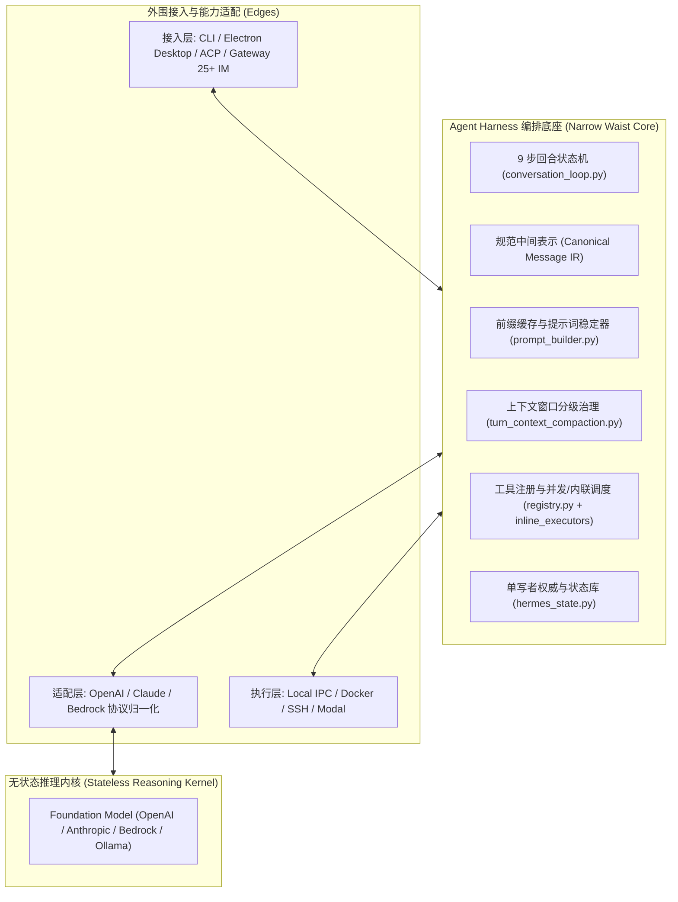
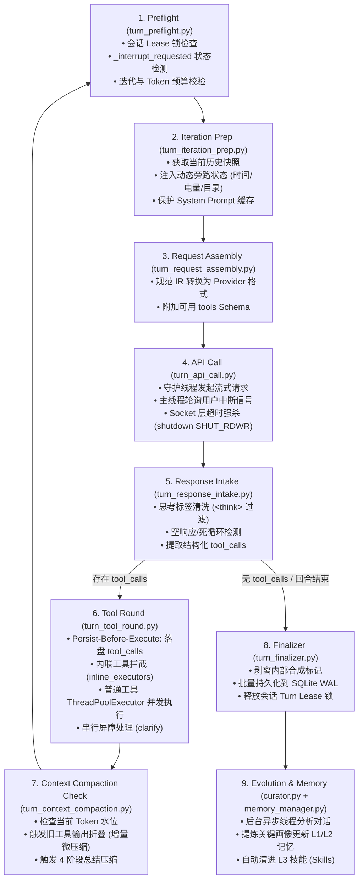

# 卷一：AI Agent Harness 核心编排回路与快速上手指南

> **文档定位**：本系列文档面向从零设计自研 Agent Harness 或在 Hermes Agent 源码基础上二次开发的系统架构师与工程师。卷一聚焦于智能体控制底座的核心定位、目录骨架设计、9 步回合状态机（Turn State Machine）、最小可用闭环（Minimal Viable Harness）从零实现与单步断点调试实战。

---

## 1. 为什么需要 AI Agent Harness

### 1.1 无状态推理内核 vs 有状态控制底座

在现代大模型应用工程中，**大语言模型（LLM）本身并非自主智能体，而是一个无状态的概率推理内核（Stateless Reasoning Kernel）**。模型对世界的认知仅限于当前上下文窗口输入的 Token 序列；它没有物理时间概念，无法维持长程生命周期，不能安全操作本地宿主，也不会在网络中断或机器宕机后自我修复。

**AI Agent Harness（智能体控制底座/运行框架）**本质上是包裹在这一无状态推理内核之上的**专用操作系统内核（Agent OS Kernel）**：



### 1.2 “单核窄腰（Narrow Waist）”架构范式

如果为每一个接入端（CLI、桌面、IDE、IM 机器人）各写一套与 LLM 交互的 Prompt 和循环逻辑，系统必然迅速陷入灾难：
1. **Prompt 分裂**：不同入口拼装的时间戳、环境规则不一致，导致模型行为不可预测。
2. **缓存穿透**：微小的 Prompt 差异会导致服务商 KV Cache（前缀缓存）全部失效，首字延迟（TTFT）激增，API 账单翻倍。
3. **安全与状态失控**：某些入口遗漏危险命令审批或中断清理，引发死锁或状态污染。

**单核窄腰范式**的核心要求是：
- **内核做减法（Narrow Core）**：会话状态机、消息角色交替、工具派发与中断处理收敛在单一平台无关的核心（如 `AIAgent` 与 `conversation_loop.py`）。
- **边缘做加法（Rich Edges）**：所有上层交互入口（CLI REPL、Electron、Gateway IM 适配器）与底层外部能力（沙箱、大模型厂商插件）通过抽象接口接入，绝对禁止内核反向依赖边缘。

### 1.3 三大核心不变式（Invariants）

在设计与实现 Harness 时，必须在架构层面强制保证三大黄金不变式：
1. **严格角色交替不变式（Strict Role Alternation）**：
   - 对话历史必须满足 `user -> assistant -> user` 的交替序列，严禁出现连续同角色消息。
   - 工具调用链路必须严格对齐：每一个包含 `tool_calls` 的 `assistant` 消息，必须紧随对应数量且 `tool_call_id` 一一匹配的 `tool` 结果消息，严禁孤立悬挂。
2. **提示词逐字节稳定不变式（Byte-Stable Prompt Caching）**：
   - System Prompt 在整个会话生命周期内必须保持逐字节不变。
   - 动态变量（当前时间、工作区目录提示、外部状态）严禁注入 System Prompt，必须通过单次 User 消息附加通道或 Tool 返回值回填。
3. **中断即丢弃不变式（Discard-on-Interrupt）**：
   - 当用户在流式生成期间发出中断信号时，丢弃不完整的残缺 Assistant 文本。
   - 若模型已生成部分 `tool_calls`，Harness 必须合成标准的结构化取消错误回填到对应的 `tool` 消息中闭合链条，严禁残留无应答的工具调用。

---

## 2. 推荐工程目录骨架（Directory Layout）

以 Nous Research Hermes Agent 为生产级参考范本，推荐采用如下分层清晰的模块目录组织：

```
my-agent-harness/
├── agent/                       # 【窄腰核心】编排状态机与上下文治理
│   ├── conversation_loop.py     # 9 步回合状态机主循环 (run_conversation)
│   ├── turn_preflight.py        # Step 1: 预算、租约锁与中断检查
│   ├── turn_iteration_prep.py   # Step 2: 动态旁路注入与上下文拼装
│   ├── turn_request_assembly.py # Step 3: 协议归一化与模型请求参数装配
│   ├── turn_api_call.py         # Step 4: 守护线程流式调用与套接字监控
│   ├── turn_response_intake.py  # Step 5: 响应校验、思考标签清洗与 tool_calls 提取
│   ├── turn_tool_round.py       # Step 6: 工具并发派发、串行屏障与持久化
│   ├── turn_context_compaction.py # Step 7: 上下文超限检测、增量微压缩与总结压缩
│   ├── turn_finalizer.py        # Step 8: 控制标记剥离、最终状态持久化与回调
│   ├── prompt_builder.py        # 静态提示词组装（前缀缓存保活）
│   ├── context_compressor.py    # 4 阶段滑动窗口压缩器
│   └── inline_tool_executors.py # 有状态内联工具分发器（todo, memory, delegate）
├── tools/                       # 【能力边缘】工具生态与沙箱
│   ├── registry.py              # 工具注册表（装饰器自注册、Schema 动态抽取）
│   ├── execute_code.py          # 编程式代码卸载执行器（Local IPC 沙箱）
│   ├── file_tools.py            # 文件读写与差异比对工具
│   └── environments/            # 执行环境后端（Local / Docker / SSH）
├── storage/                     # 【持久化层】会话状态与多层记忆
│   ├── hermes_state.py          # SQLite WAL 会话库、运行时纪元栅栏（Runtime Epoch）
│   └── memory/                  # L1 静态画像、L2 FTS5 语义检索、L3 技能提炼
├── frontends/                   # 【接入边缘】外围瘦适配器
│   ├── cli.py                   # 终端交互 REPL
│   ├── gateway/                 # 多平台消息网关（Telegram/Discord/Slack/飞书等）
│   └── acp/                     # IDE Agent Client Protocol 适配层
├── run_agent.py                 # 【核心门面】AIAgent 公共入口类，集成状态机与工具
├── hermes_constants.py          # 平台抽象、路径解析（Profile-aware HERMES_HOME）
└── pyproject.toml / uv.lock     # 依赖与环境版本锁定
```

### 架构依赖倒置规则
- **单向单核依赖**：`frontends/` 依赖 `run_agent.py`；`agent/` 仅依赖抽象的 `tools/registry.py`。内核严禁导入具体的前端 UI 库（如 readline、prompt_toolkit、rich）或平台网关代码。
- **状态根隔离（Profile-Aware）**：严禁硬编码 `~/.myagent`。所有配置、数据库、记忆统一通过 `get_hermes_home()` 获取，受环境变量 `HERMES_HOME` 控制，保证多实例与测试环境完全隔离。

---

## 3. 9 步回合状态机生命周期详解

每一次用户交互触发，Harness 驱动一次完整的回合（Turn）状态流转。各阶段在 `agent/turn_*.py` 中独立解耦实现：



### 关键环节工程决策
- **Persist-Before-Execute（落盘先于副作用）**：在调用外部工具（特别是文件删除、进程启动等有副作用的命令）之前，必须先将模型输出的 `assistant(tool_calls)` 持久化到 SQLite。若工具执行导致进程异常杀死，重启后系统能准确获知上次中断点。
- **Socket 级超时与中断强杀**：云端提供商有时会产生静默挂起（持续发送 SSE Ping 维持 TCP 连接，但不输出任何有效 Token）。Harness 监听空闲计时器，一旦超过阈值，在监控线程中对正在读取的 Socket 执行 `shutdown(SHUT_RDWR)`，安全唤醒被阻塞的 worker 线程，绝不使用危险的 `pthread_kill`。

---

## 4. 最小可用闭环（Minimal Viable Harness）从零实现

以下是一份完整、自包含且可直接执行的教学级 Harness 实现（`minimal_harness.py`）。代码涵盖了工具注册、Schema 抽取、规范中间表示、思考-动作-观察循环与角色交替对齐：

```python
"""minimal_harness.py - 最小可用 AI Agent Harness 实现"""

import inspect
import json
from typing import Any, Callable, Dict, List, Optional
from openai import OpenAI


# ── 1. 工具注册表与 Schema 抽取 ──────────────────────────────────────────

class ToolRegistry:
    """轻量级工具注册表：支持类型注解解析与 JSON Schema 自动生成"""

    def __init__(self):
        self._tools: Dict[str, Callable] = {}
        self._schemas: List[Dict[str, Any]] = []

    def register(self, func: Callable) -> Callable:
        name = func.__name__
        doc = inspect.getdoc(func) or "No description provided."
        sig = inspect.signature(func)

        properties = {}
        required = []
        for param_name, param in sig.parameters.items():
            param_type = "string"
            if param.annotation == int:
                param_type = "integer"
            elif param.annotation == float:
                param_type = "number"
            elif param.annotation == bool:
                param_type = "boolean"

            properties[param_name] = {
                "type": param_type,
                "description": f"Argument: {param_name}",
            }
            if param.default == inspect.Parameter.empty:
                required.append(param_name)

        schema = {
            "type": "function",
            "function": {
                "name": name,
                "description": doc.strip().split("\n")[0],
                "parameters": {
                    "type": "object",
                    "properties": properties,
                    "required": required,
                },
            },
        }
        self._tools[name] = func
        self._schemas.append(schema)
        return func

    def execute(self, name: str, arguments_json: str) -> str:
        """执行工具调用，严禁向外抛出异常，错误必须封装为结构化回执供 LLM 自愈"""
        if name not in self._tools:
            return json.dumps({"error": f"Tool '{name}' not found."})
        try:
            kwargs = json.loads(arguments_json) if arguments_json else {}
            result = self._tools[name](**kwargs)
            return json.dumps(result, ensure_ascii=False) if not isinstance(result, str) else result
        except Exception as exc:
            return json.dumps({"error": f"Execution failed: {type(exc).__name__}: {exc}"})

    @property
    def schemas(self) -> List[Dict[str, Any]]:
        return self._schemas


# ── 2. 核心编排状态机 (Narrow Waist Kernel) ──────────────────────────────

class MinimalHarness:
    """单核窄腰架构编排器"""

    def __init__(
        self,
        api_key: Optional[str] = None,
        base_url: Optional[str] = None,
        model: str = "gpt-4o-mini",
        system_prompt: str = "You are a dependable, engineering-focused assistant.",
    ):
        self.client = OpenAI(api_key=api_key, base_url=base_url)
        self.model = model
        self.system_prompt = system_prompt
        self.registry = ToolRegistry()
        # 规范对话历史 (Canonical IR)
        self.messages: List[Dict[str, Any]] = [
            {"role": "system", "content": self.system_prompt}
        ]

    def run_turn(self, user_input: str, max_iterations: int = 10) -> str:
        """执行单次完整交互回合（涵盖多步工具调用）"""
        # 1. 注入用户消息
        self.messages.append({"role": "user", "content": user_input})

        for iteration in range(max_iterations):
            print(f"\n[Iteration {iteration + 1}] 发起模型推理请求...")

            # 2. 调用模型 API (非流式基础形态)
            response = self.client.chat.completions.create(
                model=self.model,
                messages=self.messages,
                tools=self.registry.schemas if self.registry.schemas else None,
            )
            message = response.choices[0].message

            # 3. 构造 Assistant 消息 (对齐角色交替不变式)
            assistant_msg: Dict[str, Any] = {
                "role": "assistant",
                "content": message.content or "",
            }
            if message.tool_calls:
                assistant_msg["tool_calls"] = [
                    {
                        "id": tc.id,
                        "type": "function",
                        "function": {
                            "name": tc.function.name,
                            "arguments": tc.function.arguments,
                        },
                    }
                    for tc in message.tool_calls
                ]

            # 4. 持久化前置：在产生任何外部环境副作用前，先将 assistant_msg 入栈
            self.messages.append(assistant_msg)

            # 5. 若无工具调用，思考循环收敛，返回最终回复
            if not message.tool_calls:
                return message.content or ""

            # 6. 工具执行轮次：执行模型请求的工具并回填 tool 消息
            for tc in message.tool_calls:
                tool_name = tc.function.name
                tool_args = tc.function.arguments
                call_id = tc.id

                print(f"  -> 执行工具: {tool_name}({tool_args})")
                tool_result = self.registry.execute(tool_name, tool_args)
                print(f"  <- 工具结果: {tool_result[:80]}...")

                # 严格对齐角色交替：每个 tool_call 紧随一条对应的 tool 结果消息
                self.messages.append({
                    "role": "tool",
                    "tool_call_id": call_id,
                    "content": tool_result,
                })

        return "Error: Maximum iteration budget reached without final answer."


# ── 3. 使用演示 ──────────────────────────────────────────────────────────

if __name__ == "__main__":
    harness = MinimalHarness()

    # 注册示例工具
    @harness.registry.register
    def add_numbers(a: int, b: int) -> int:
        """Add two integers and return the sum."""
        return a + b

    @harness.registry.register
    def get_weather(city: str) -> str:
        """Get the current weather for a specified city."""
        return f"Weather in {city}: Sunny, 24°C"

    # 执行对话测试
    print("=== 测试 1: 直接回复 ===")
    ans1 = harness.run_turn("你好，你是谁？")
    print("模型输出:", ans1)

    print("\n=== 测试 2: 多步工具调用 ===")
    ans2 = harness.run_turn("请帮我计算 456 + 789 等于多少，另外查一下深圳的天气。")
    print("模型输出:", ans2)
```

---

## 5. 本地开发与单步断点调试实战

不要依赖外层庞大的 CLI 或 IM 网关进行内核调试。直接通过独立 Python 脚本单步追踪 `AIAgent`。

### 5.1 隔离开发环境配置
```bash
# 1. 激活虚拟环境
source ./activate

# 2. 配置独立的调试主目录，彻底隔离宿主 ~/.hermes
export HERMES_HOME="$PWD/.hermes_dev"
export HERMES_DEBUG=1

# 3. 设置模型接口密钥
export OPENAI_API_KEY="sk-..."
```

### 5.2 编写单步调试驱动脚本（`debug_harness.py`）
在项目根目录创建 `debug_harness.py`：

```python
"""debug_harness.py - 单步断点调试 Harness 核心"""
import logging
from run_agent import AIAgent

logging.basicConfig(level=logging.INFO)

# 1. 实例化核心智能体门面
agent = AIAgent(
    model="gpt-4o-mini",
    temperature=0.0,
    max_iterations=5,
    quiet_mode=False,
)

# 2. 建议打断点的核心位置：
#    - agent/conversation_loop.py -> run_conversation() (回合主循环入口)
#    - agent/turn_api_call.py -> interruptible_streaming_api_call() (流式请求分发)
#    - agent/turn_tool_round.py -> run_tool_round() (工具校验与并发派发)
#    - agent/turn_context_compaction.py -> run_turn_start_compaction() (上下文压缩)

print(">>> 启动调试交互...")
result = agent.run_conversation("请查看当前目录下有哪些文件并做简要汇总")

print("\n--- 调试执行指标 ---")
print("最终输出:", result.get("final_response"))
print("历史消息总数:", len(result.get("messages", [])))
print("总 Token 消耗:", result.get("total_tokens"))
```

### 5.3 调试命令与质量检查
```bash
# 使用 Python 内置 pdb 断点调试
python -m pdb debug_harness.py

# 运行窄范围契约测试（验证单模块行为）
./scripts/run_tests.sh tests/agent/test_turn_lifecycle.py
./scripts/run_tests.sh tests/tools/test_registry.py

# 提交前运行代码健康检查（包含 HX 架构健康规则与边界检查）
python scripts/check
```

---

## 6. 进阶演练：为 Harness 增加自定义扩展

### 6.1 演练 1：增加一个无状态自定义工具
在 `tools/` 目录下创建新模块（如 `tools/my_custom_tool.py`），使用 `@registry.register` 注册：

```python
# tools/my_custom_tool.py
import subprocess
from tools.registry import registry

@registry.register(
    name="query_git_status",
    description="Query git status of the current workspace repository.",
    category="system",
)
def query_git_status(short: bool = True) -> str:
    """Run git status and return formatted output.
    
    Args:
        short: If True, returns short-format git status (-s).
    """
    cmd = ["git", "status", "-s"] if short else ["git", "status"]
    res = subprocess.run(cmd, capture_output=True, text=True)
    if res.returncode != 0:
        return f"Git error: {res.stderr}"
    return res.stdout or "Working tree clean."
```
> **生效原理**：`tools/registry.py` 会在导入期自动自省提取该函数的参数类型注解与 docstring，在 `turn_request_assembly.py` 请求装配阶段自动转换为模型厂商兼容的 JSON Schema。

### 6.2 演练 2：增加一个有状态内联工具（以只读用户环境为例）
若工具需要直接感知或读取 `AIAgent` 实例的运行时内部状态，在 `agent/inline_tool_executors.py` 中挂载内联拦截执行器：

```python
# 1. 编写内联执行函数
def _inspect_runtime_state(agent, args: dict, ctx: InlineToolContext) -> str:
    return json.dumps({
        "current_turn": getattr(agent, "_current_turn_id", None),
        "session_id": getattr(agent, "session_id", None),
        "messages_count": len(ctx.messages or []),
        "model": agent.model,
    })

# 2. 挂载到 _RAW_INLINE_TOOL_EXECUTORS 路由映射表中
_RAW_INLINE_TOOL_EXECUTORS["inspect_runtime"] = _inspect_runtime_state
```

---

## 7. 自检清单与常见陷阱

| 故障现象 | 根本原因 | 规避与修复方案 |
|---|---|---|
| **首字延迟（TTFT）极高，API 账单飙升** | 在 System Prompt 中动态拼接当前时间戳或动态目录，导致厂商前缀缓存（Prefix Cache）彻底失效。 | 坚决执行三层静态组装准则：System Prompt 冻结，动态变量一律通过 User 消息附加通道或 Tool 结果注入。 |
| **下一次请求报 HTTP 400 Bad Request** | 用户在工具执行途中中断，导致历史中存在 `assistant(tool_calls)` 却没有后续的 `tool` 结果消息，角色链条断裂。 | 中断时执行 Discard-on-Interrupt 机制：若 tool_calls 已发出，Harness 必须合成标准取消响应闭合链条。 |
| **Agent 进程硬退出/崩溃** | 工具执行发生未捕获异常（如 `FileNotFoundError`、网络超时），直接向上抛出。 | 工具执行器必须用 `try/except` 包裹，将异常信息转为 `{"error": "..."}` 文本回执反馈给模型，允许模型自愈重试。 |
| **多线程调试报 SQLite 锁死** | 多个线程直接持有并读写同一个 SQLite 连接句柄。 | 数据库必须启用 WAL 模式，读写操作统一走后台网关单写者通道（`gateway.sock`）或受 `runtime_epoch` 栅栏保护。 |
| **死循环与无限工具调用** | 模型产生幻觉或工具持续返回相同报错，未设置有效退出条件。 | 严格设置 `max_iterations` 预算上限；配合空响应守卫与重复工具调用检测器主动熔断。 |

---

## 8. 系列导航与架构专栏

- 📘 **[卷一：核心编排回路与快速上手指南 (`01_core_loop_and_quickstart.md`)](./01_core_loop_and_quickstart.md)**（当前篇）
- 📗 **[卷二：提示词工程、上下文压缩与多层记忆体系 (`02_prompt_context_and_memory.md`)](./02_prompt_context_and_memory.md)**
- 📙 **[卷三：工具系统、编程式代码卸载与子智能体编排 (`03_tools_execution_and_subagents.md`)](./03_tools_execution_and_subagents.md)**
- 📕 **[卷四：多模型适配、网关单写权威、容灾自愈与纵深防御 (`04_providers_gateway_disaster_recovery_and_security.md`)](./04_providers_gateway_disaster_recovery_and_security.md)**

进阶专题延伸：
- 🧠 **[Harness 架构理论深度解析 (`harness-deep-dive.md`)](./harness-deep-dive.md)**：操作系统类比（CPU ALU vs OS Kernel）与核心子系统深度剖析。
- 🛠️ **[Harness 开发者实施手册 (`harness-developer-notes.md`)](./harness-developer-notes.md)**：开发公理与 10 个子系统的工程决策及避坑速查表。
- 📋 **[仓库工作指南 (`AGENTS.md`)](../../AGENTS.md)**：架构总览、核心不变式与代码质量规则。
