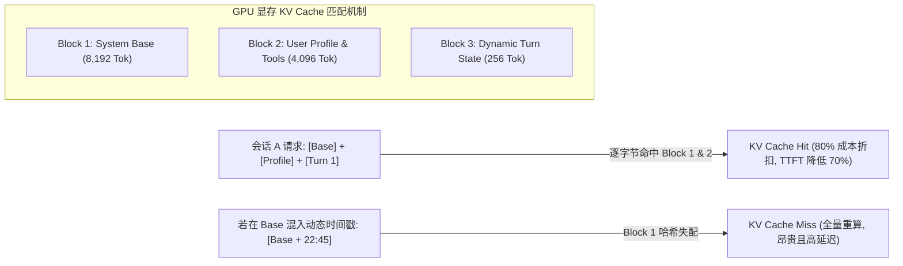
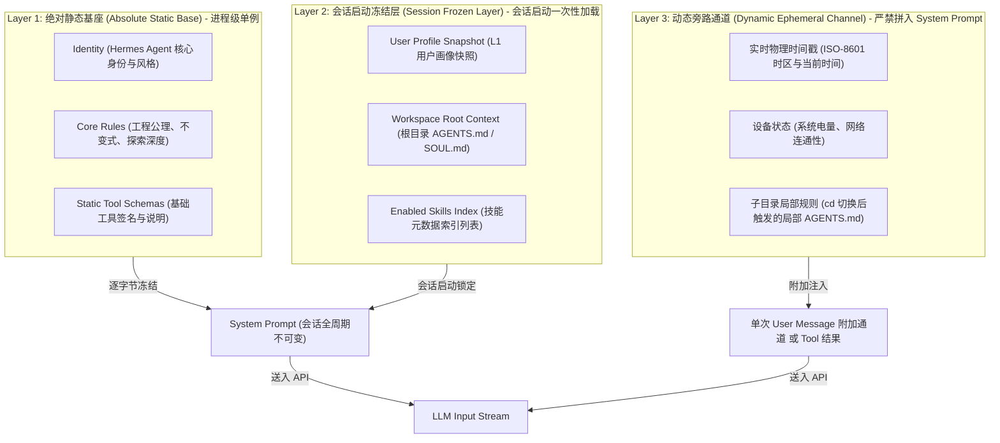
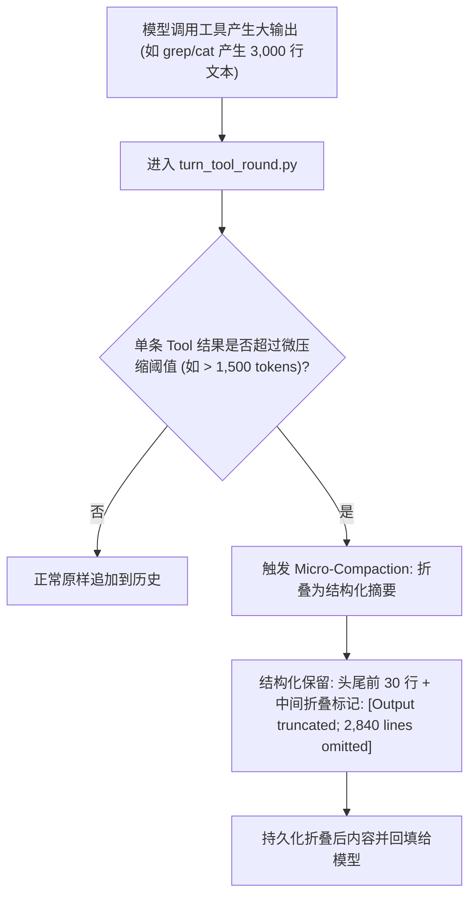
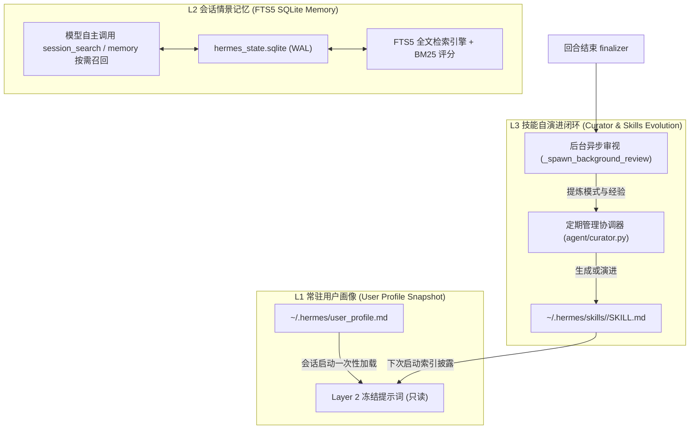

# 卷二：提示词工程、上下文治理与多层记忆体系

> **文档定位**：聚焦于长程自主智能体（Long-Horizon Autonomous Agent）的核心生命线——如何通过三层静态提示词保活厂商前缀缓存（Prefix Caching）、如何通过增量微压缩与深度总结实现上下文窗口的无损治理，以及如何设计兼顾常驻画像、会话情景检索与自演进技能的 L1-L3 三层记忆体系。

---

## 1. 提示词工程与前缀缓存保活（Prompt & Prefix Cache Stability）

### 1.1 服务商 KV Cache 原理与性能/成本杠杆

在现代 LLM 推理架构（如 Anthropic Prompt Caching、OpenAI Prefix Caching、DeepSeek/vLLM Chunked KV Cache）中，模型厂商会对输入 Token 序列计算哈希键，并在 GPU 显存中持久化对应的 Key-Value 缓存（KV Cache）：



- **缓存命中收益**：命中前缀缓存通常能享受 **50% ~ 80% 的 Token 计费折扣**，且首字延迟（TTFT，Time-To-First-Token）可从数秒骤降至数百毫秒。
- **失效硬伤**：KV Cache 的匹配要求**严格逐字节完全一致（Byte-for-Byte Match）**。只要 System Prompt 的第 10 个字符发生了一处微小变动（例如动态拼接了秒级时间戳、电量、临时子目录），后续数万 Token 的缓存哈希全部失效。

---

### 1.2 三层提示词组装架构（`agent/prompt_builder.py`）

为了在保证提示词丰富度的同时达成 100% 缓存命中，Hermes 采用严格的三层提示词分离模型：



#### 各层工程实现规范
1. **Layer 1（绝对静态基座）**：
   - 包含代理角色定位、工具调用协议、代码编写规则。无论用户是谁、在哪个目录运行，内容逐字节不可变。
2. **Layer 2（会话启动冻结层）**：
   - 在会话启动（`AIAgent.__init__`）时由 `prompt_builder.py` 一次性读取并合并入 `_cached_system_prompt`。
   - **冷读安全防护**：对云同步文件（iCloud Drive / OneDrive / NFS），使用守护线程配合超时器（如 5.0 秒超时）执行读取，超时则退避，防止网络文件挂起导致启动死锁。
   - 提取后永久冻结：在多回合交互中，绝不因用户在终端中 `cd` 切换了目录而重新组装修改 System Prompt。
3. **Layer 3（动态旁路注入通道）**：
   - 当代理在工作区中进入新子目录发现有局部的 `.hermes.md` 或 `AGENTS.md` 时，必须作为文件操作工具（如 `read_file`）的附加返回值带给模型，或者由 `turn_iteration_prep.py` 作为当前轮次单次 User 消息的前置临时上下文（Ephemeral Context）注入。

---

## 2. 上下文窗口分级治理与动态压缩（Context Compaction Engine）

### 2.1 上下文膨胀问题与 "Lost in the Middle" 效应

长程任务（如仓库级重构、故障排查）通常经历 20 ~ 50 轮工具交互。在此过程中，`cat` 大型文件、执行 `git diff` 或 `grep` 往往一次性产生数万 Token 的输出。
- **物理硬顶（Context Window Overflow）**：直接超出模型最大上下文长度，触发 API 报 400 错误。
- **注意分散（Lost in the Middle）**：上下文被大量过时的编译输出、冗长日志填满，模型注意力分散，遗忘最早的用户指令或初始规划。

---

### 2.2 增量微压缩机制（Micro-Compaction）

在 Hermes 中，压缩并非等到上下文完全爆满时才孤注一掷地进行，而是在每轮工具执行后执行轻量级的**增量微压缩（Micro-Compaction）**：



#### 微压缩的关键不变式
1. **保留工具调用拓扑**：必须保留 `assistant(tool_calls)` 与 `tool(tool_call_id)` 的配对结构，绝不能直接物理删除消息节点。
2. **语义保真度**：保留输出的前 $N$ 行与后 $M$ 行（通常头尾各 25-50 行），保留关键退出码与错误堆栈尾部，仅折叠中间重复的数据行。

---

### 2.3 四阶段深度总结压缩（Full Compaction）

当会话在经历数轮微压缩后，累计 Token 仍然逼近安全水位线（如模型最大容量的 75%）时，由 `agent/context_compressor.py` 触发基于辅助小模型的四阶段深度压缩：

```mermaid
sequenceDiagram
    autonumber
    participant Loop as conversation_loop
    participant Comp as context_compressor
    participant Aux as Auxiliary Small LLM
    participant DB as hermes_state (SQLite)

    Loop->>Comp: 检测到上下文超阈值 (Trigger Full Compaction)
    Comp->>Comp: 划分区域: Head (系统/首问) + Middle (待压缩) + Tail (活跃窗口)
    Comp->>Aux: Stage 1: 提炼用户核心目标与当前主攻任务
    Comp->>Aux: Stage 2: 抽取已确认事实、环境变量与关键发现
    Comp->>Aux: Stage 3: 提取已完成的关键操作与阻碍点
    Aux-->>Comp: 返回各维度结构化提炼信息
    Comp->>Comp: Stage 4: 使用统一模板重构 System/User 总结卡片
    Comp->>DB: 归档被剔除的 Middle 消息块并打上压缩标记
    Comp-->>Loop: 返回精简后的 messages (释放 60%~80% 窗口)
```

#### 确定性降级路径（Deterministic Fallback）
若辅助压缩小模型调用发生超时、限流或提供商故障，系统绝不能直接崩溃：
- **确定性滑动窗口截断（Deterministic Sliding Window Fallback）**：
  Harness 自动回退至纯规则截断——保留全局 System Prompt 与用户最初的第一个需求消息（Head Anchor），保留最近的最后 3~5 回合（Tail Active Window），将中间的历史消息直接裁剪，并注入确定性占位标记：
  `[NOTICE: Earlier conversation history was pruned due to context limits.]`。

---

## 3. 多层记忆体系（Multi-Tier Memory Architecture）

生产级 Agent 需要在多会话之间记住用户的偏好、过往排查结论与定制化操作规程。单纯依赖传统的向量数据库 RAG 无法支撑高精度的工具调度。Hermes 建立了 **L1 / L2 / L3 三层记忆架构**：



### 3.1 L1：常驻用户画像（Profile Snapshot File）
- **存储介质**：受 `HERMES_HOME` 管辖的独立 Markdown 文件（如 `user_profile.md`）。
- **内容范式**：记录用户技术栈偏好（如“倾向于使用 UV 管理 Python 依赖”、“编写代码严格使用类型注解”、“UI 颜色偏好暗色”）。
- **生命周期**：在启动时由 `prompt_builder.py` 一次性读取拼入 Layer 2 冻结层；回合运行期间**只读**，绝不进行原地动态改写。

---

### 3.2 L2：会话级情景检索（FTS5 SQLite Memory）
- **核心定位**：解决“几天前我解决过一个类似的 Docker 网络配置错误，具体怎么配的？”这类跨会话历史检索。
- **技术实现**：
  - 基于 SQLite 虚拟表 `fts5` 对所有历史回合的输入、最终输出与工具调用关键结果建立倒排索引。
  - 通过 `tools/session_search_tool.py` 向模型披露 `session_search` 工具。
  - **按需自主召回**：Harness 绝不在每轮交互前盲目做全局向量注入（那会消耗大量 Token 并干扰注意力），而是让模型在发现需要历史信息时，像使用外部搜索引擎一样自主调用 `session_search(query="docker network fix")`。

---

### 3.3 L3：技能自演进闭环（Curator & Skills Evolution）
- **核心定位**：当 Agent 经历多次试错、成功解决一个复杂工程问题（如适配了某个冷门 SDK）后，如何将这次成功沉淀为可复用的 SOP（Standard Operating Procedure）？
- **后台异步审视（Background Review）**：
  在回合主循环结束时（`agent/turn_finalizer.py`），主线程将回复交付给用户后，由后台线程调用 `_spawn_background_review()`，克隆当前回合的历史消息快照，调用辅助模型审视当前对话中是否存在值得沉淀的模式。
- **技能协调管理器（`agent/curator.py`）**：
  - 将新技能保存为 `skills/<name>/SKILL.md`，包含前置匹配条件（Environment / Platform）、调用规范与示例。
  - **生命周期状态机**：
    `Active（活跃） -> Stale（闲置 14 天） -> Archived（归档 30 天，移出激活集）`。
    具备软归档保护，绝不物理删除，防止技能库无限膨胀导致提示词溢出。

---

## 4. 关键实现与避坑指南

### 4.1 核心代码映射表

| 功能子系统 | 关键源码文件 | 核心函数 / 类 | 学习重点 |
|---|---|---|---|
| **前缀缓存稳定器** | `agent/prompt_builder.py` | `_build_system_prompt()`, `DEFAULT_AGENT_IDENTITY` | 观察如何通过三层结构阻断动态时间戳进入 System Prompt |
| **旁路动态注入** | `agent/turn_iteration_prep.py` | `prepare_iteration()`, `_maybe_inject_iteration_budget_warning` | 观察动态临时变量如何作为单次 User 附加信息透传 |
| **增量微压缩** | `agent/micro_compaction.py` | `MicroCompactionMixin.maybe_micro_compact()` | 观察大工具输出的就地结构化折叠算法 |
| **四阶段深度压缩** | `agent/context_compressor.py` | `ContextCompressor.compress()` | 观察 Head/Middle/Tail 划分与确定性滑动窗口降级 |
| **会话历史全文检索** | `tools/session_search_tool.py` | `session_search()` | 观察 FTS5 倒排索引的高效查询与过滤 |
| **后台技能提炼** | `agent/curator.py` | `maybe_run_curator()`, `apply_automatic_transitions()` | 观察技能生命周期（Active/Stale/Archived）的状态迁移机制 |

---

### 4.2 架构自检与避坑准则

| 潜在隐患 | 危害程度 | 根因与规避规范 |
|---|---|---|
| **System Prompt 注入实时时间** | 🔴 严重 | 导致全量前缀缓存失效。当前时间、系统电量等高频变化因子一律由 `turn_iteration_prep.py` 注入当前回合的 User 消息中。 |
| **微压缩破坏 tool_calls 结构** | 🔴 严重 | 若微压缩直接删除了中间的某个 `tool` 结果消息，下游 API 将抛出 `tool_call_id not found in history`。必须就地保留节点，仅折叠 `content` 字符串内容。 |
| **全量压缩无降级机制** | 🔴 严重 | 若辅助模型发生限流或超时，全量压缩如果直接报错，会导致整个交互硬中断。必须实现确定性的本地滑动窗口规则截断作为 Fallback。 |
| **无界技能库击穿 System Prompt** | 🟠 重要 | 若每次探索都生成新技能且不做淘汰，技能索引文件会不断膨胀。必须通过 Curator 实施严格的状态跃迁与冷门归档机制。 |

---

## 5. 系列导航

- 📘 **[卷一：核心编排回路与快速上手指南 (`01_core_loop_and_quickstart.md`)](file:///Users/fx/wk/github/hermes-agent-0.23.2/docs/harness/01_core_loop_and_quickstart.md)**
- 📗 **[卷二：提示词工程、上下文压缩与多层记忆体系 (`02_prompt_context_and_memory.md`)](file:///Users/fx/wk/github/hermes-agent-0.23.2/docs/harness/02_prompt_context_and_memory.md)**（当前篇）
- 📙 **[卷三：工具系统、编程式代码卸载与子智能体编排 (`03_tools_execution_and_subagents.md`)](file:///Users/fx/wk/github/hermes-agent-0.23.2/docs/harness/03_tools_execution_and_subagents.md)**
- 📕 **[卷四：多模型适配、网关单写权威、容灾自愈与纵深防御 (`04_providers_gateway_disaster_recovery_and_security.md`)](file:///Users/fx/wk/github/hermes-agent-0.23.2/docs/harness/04_providers_gateway_disaster_recovery_and_security.md)**
