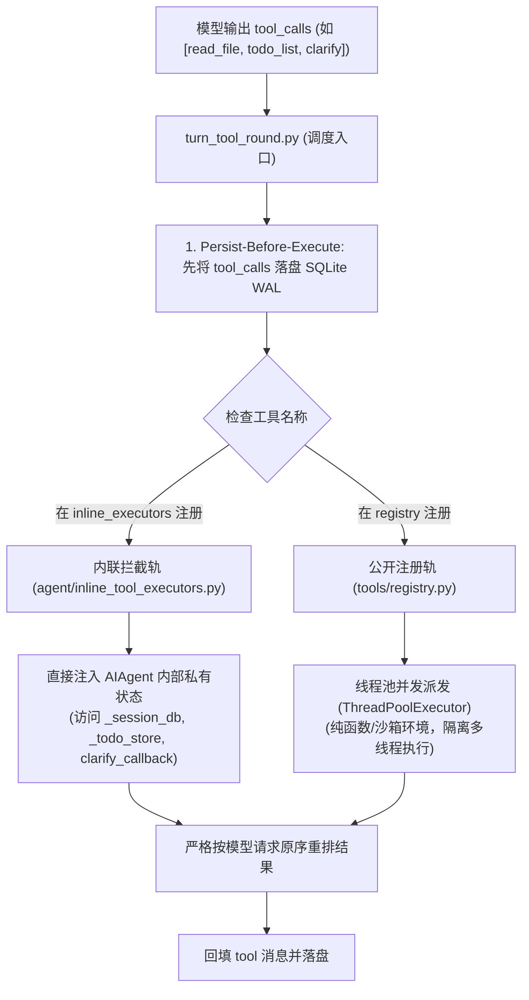
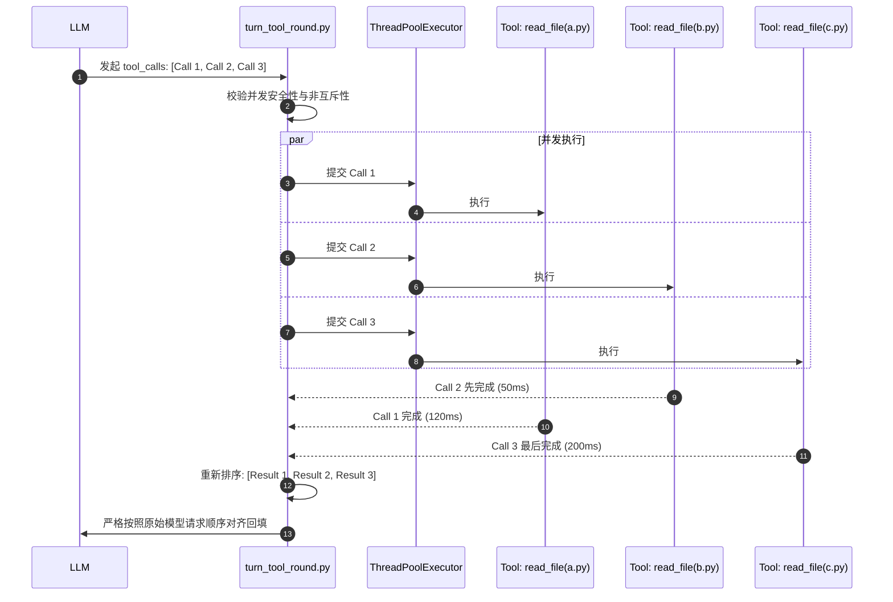
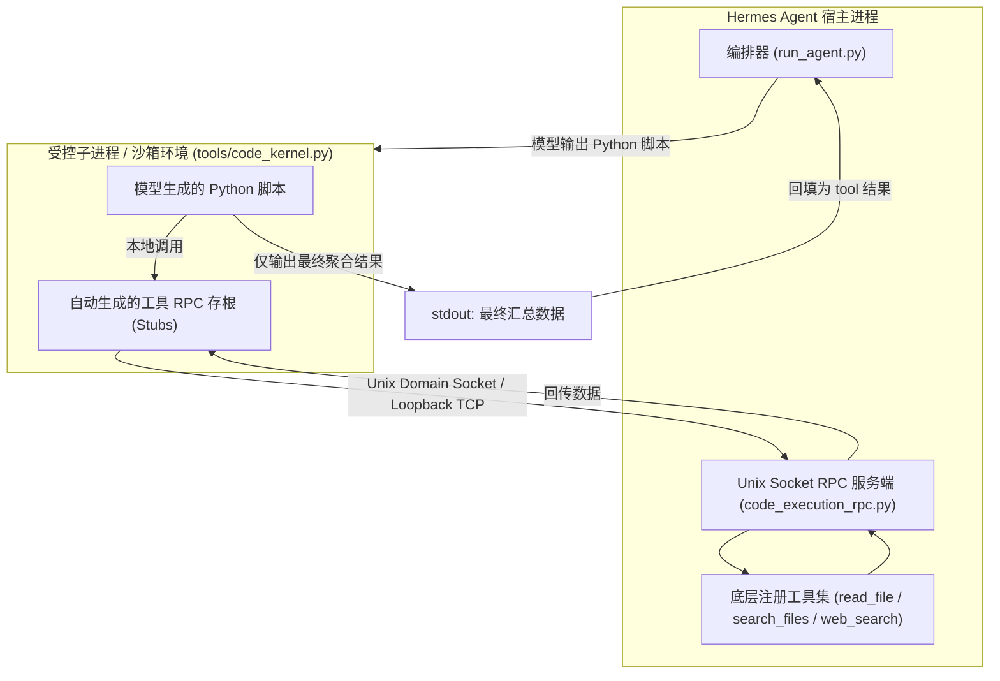
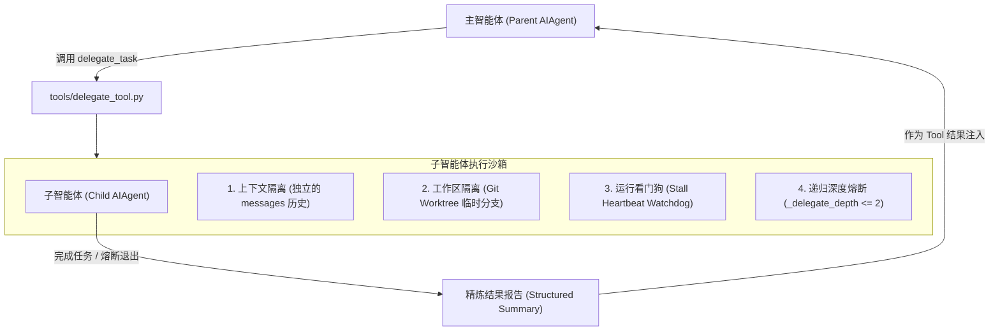

# 卷三：工具系统、编程式代码卸载与子智能体编排

> **文档定位**：探讨 AI Agent Harness 如何打破传统 LLM 逐步调用的低效瓶颈。深入剖析工具静态注册与有状态内联拦截的双轨制调度、`ThreadPoolExecutor` 并发派发与串行屏障、通过 Programmatic Tool Calling（编程式工具调用）实现认知卸载，以及基于 Git Worktree 和独立上下文的子智能体（Subagent）隔离编排。

---

## 1. 工具系统架构与注册发现（Tool System Architecture）

### 1.1 双轨制工具调度架构

在工业级 Harness 中，工具并非千篇一律的纯函数。Hermes 创造性地采用了**双轨制调度架构（Dual-Track Tool Architecture）**：



---

### 1.2 公开注册轨：静态自发现与 Schema 抽取（`tools/registry.py`）

普通业务工具（如文件检索、网络提取、终端执行）采用声明式装饰器注册。
- **循环安全导入（Cycle-Safe Import）**：`tools/registry.py` 绝不反向依赖具体的工具实现文件。各工具模块在导入期调用 `@registry.register` 将自身注入注册表单例。
- **动态 Schema 抽取**：通过 `inspect.signature` 解析 Python 类型注解（`int` $\rightarrow$ `integer`, `str` $\rightarrow$ `string`, `bool` $\rightarrow$ `boolean`），并解析函数的 Google/Sphinx 风格 Docstring，自动转换为符合 OpenAI / Anthropic 规范的 JSON Schema：

```python
# tools/registry.py 核心注册原理示意
class ToolRegistry:
    def register(self, name: Optional[str] = None, **metadata):
        def decorator(func: Callable):
            tool_name = name or func.__name__
            schema = self._extract_schema(func, tool_name, metadata)
            self._entries[tool_name] = ToolEntry(
                name=tool_name,
                handler=func,
                schema=schema,
                toolset=metadata.get("toolset", "default"),
            )
            return func
        return decorator
```

- **工具集作用域隔离（Toolset Scoping）**：并非所有工具都会在每一轮回合中全部暴露。支持通过 `enabled_toolsets` 按需披露（例如只开启 `filesystem` 与 `web`，关闭 `desktop_gui`），节省系统提示词中的 Schema Token。

---

### 1.3 内联拦截轨：有状态工具直连（`agent/inline_tool_executors.py`）

有些工具**必须直接读写 `AIAgent` 的内部私有状态**，不能作为孤立的静态函数运行：

| 内联工具名称 | 访问的 AIAgent 内部私有状态 | 为什么必须走内联拦截轨 |
|---|---|---|
| `todo_list` | `agent._todo_store` | 维护会话生命周期内的任务看板状态，无需反复序列化到磁盘 |
| `session_search` | `agent._session_db` | 借用宿主绑定的 SQLite 连接执行跨会话 FTS5 倒排检索 |
| `clarify` | `agent.clarify_callback` | 阻塞当前回合，向前端终端/GUI 挂起并等待用户输入表单 |
| `setup_beat` | `agent.setup_beat_callback` | 触发桌面端/IDE 的卡片式用户确认交互 |
| `delegate_task` | `agent._dispatch_delegate_task` | 派生子智能体并挂载为当前主任务的下属节点 |

内联拦截表 `_RAW_INLINE_TOOL_EXECUTORS` 通过统一的 `(agent, args, ctx) -> result` 签名，彻底消除了历史上庞大且容易漂移的 `if/elif` 分支链。

---

## 2. 工具调度模型与并发/屏障机制

### 2.1 `ThreadPoolExecutor` 并发派发与结果原序重排

当模型在单次回合中一次性发起多个工具调用时（如并发读取 3 个不同文件的内容），逐个串行执行会导致网络/IO 延迟线性叠加。Harness 采用**受控线程池并发派发**：



> **确定性不变式（Determinism Invariant）**：无论线程池中各个工具任务谁先完成，Harness **必须严格按照模型在 `tool_calls` 中给出的原始调用顺序**将 `tool` 结果消息重新排布入栈。严禁按完成时间乱序插入，否则会导致提供商前缀缓存哈希扰动。

---

### 2.2 串行屏障机制（Serial Barrier）

当工具列表中包含**交互式工具**（如 `clarify` 询问用户意图，或 `setup_beat` 请求权限审批）时，该工具充当**强行串行屏障（Serial Barrier）**：
1. 暂停后续所有未启动的工具执行；
2. 将当前执行挂起，通过回调将卡片或表单推送至前端交互通道；
3. 直到操作者在界面上完成提交或超时拒绝，才允许推进后续操作。

---

### 2.3 持久化前置保证（Persist-Before-Execute）

在执行可能改变外部世界状态的操作（如执行 Bash 命令、写入文件、修改数据库）之前，Harness 必须先将模型的 `assistant(tool_calls)` 消息提交持久化至 SQLite WAL：
- **灾难场景**：假设模型调用了一个会导致宿主断电重启或崩溃的命令 `sudo reboot`。
- **若未落盘**：重启后数据库中只有最初的 User 提问，Agent 完全不知道自己刚才尝试重启了系统。
- **若落盘前置**：系统重启后重新加载会话，能精确还原“模型计划执行重启 $\rightarrow$ 执行未完成中断”的现场，确保具备一致性的崩溃自愈能力。

---

## 3. 编程式认知卸载（Programmatic Tool Calling - PTC）

### 3.1 传统逐步调用的工程困境

传统的 Function Calling 方式在面对批处理或多步操作时存在严重的性能与成本缺陷：

| 交互模式 | 示例任务：在 20 个文件中查找某个配置并统计总行数 | 交互回合数 | 上下文 Token 膨胀 | 总耗时 |
|---|---|---|---|---|
| **传统逐步调用** | 模型调一次 `read_file`，看内容，再调下一次 `read_file`，循环 20 次 | 20 次推理轮次 | 包含 20 次中间文件内容的完整文本，消耗数万 Token | 60 ~ 90 秒 |
| **编程式工具卸载 (PTC)** | 模型编写一段 Python 脚本，在沙箱里循环调 RPC 读取，本地做聚合，仅 `print(result)` | **1 次推理轮次** | 仅返回聚合统计结果，无冗余中间文本 | 2 ~ 3 秒 |

---

### 3.2 编程式工具调用架构（`tools/code_execution_tool.py`）

Hermes 引入了 **Programmatic Tool Calling（PTC）** 机制。模型通过调用 `code_execution` 工具编写一段 Python 脚本，脚本在独立沙箱内核中运行，并通过本地 Unix Socket 反向调用 Hermes 的底层工具：



#### PTC 核心安全与资源门禁（Resource Limits）
1. **沙箱白名单（`SANDBOX_ALLOWED_TOOLS`）**：仅允许安全、无毁坏性的读操作（如 `web_search`、`read_file`、`search_files`）通过 RPC 暴露给沙箱脚本。
2. **标准输出硬截断（Byte-Capped Truncation）**：
   - `MAX_STDOUT_BYTES = 50,000`（50 KB）：脚本输出过大时，自动执行头尾切分（40% 头部 + 60% 尾部），中间截断部分溢出落盘至临时缓存文件，避免内存爆满。
3. **单脚本调用预算（`DEFAULT_MAX_TOOL_CALLS = 50`）**：限制单次脚本运行内最多调用 50 次底层 RPC 工具，防止死循环爬虫耗尽系统文件描述符。

---

## 4. 子智能体编排与隔离（Subagent Orchestration）

### 4.1 核心定位与使用场景

当任务极其庞大、充满不确定性（例如：探索一个全新开源库的用法、进行广泛的代码安全审计、重构大型模块）时，主智能体如果直接在当前对话中反复试错，会产生大量的错误堆栈与噪声，彻底污染主会话上下文。

**子智能体（Subagent）**设计用于将此类任务**委派隔离执行**：
- **主智能体**扮演“调度长/架构师（Dispatcher）”；
- **子智能体**扮演“专业工人（Worker）”，领命后在沙盒中独立探索，最终只将精简的结论汇报回主干。

---

### 4.2 四重隔离机制



1. **上下文隔离（Transcript Isolation）**：
   子智能体被分配全新的 `AIAgent` 实例与独立的 `messages` 队列。子智能体经过 15 轮报错、查错产生的几十万字中间废话随子智能体销毁而销毁，最终仅以一条 Markdown 总结回填给父会话。
2. **工作区隔离（Git Worktree Isolation）**：
   对于涉及代码修改的高危探索任务，子智能体在临时独立的 `git worktree` 分支中进行。即使子智能体搞砸了本地代码库，也不会破坏主分支上的未提交变更。
3. **心跳停滞看门狗（Stall Watchdog）**：
   子智能体长时间未发起任何工具调用或网络请求时，看门狗计时器超时，触发带外干预（Out-of-band Interrupt）强行回收资源，避免子智能体后台死锁挂起。
4. **递归深度熔断（Depth Guard）**：
   通过 `_delegate_depth` 显式计数。子智能体派生下属时深度递增，达到最大阈值（通常为 1 或 2）时，严禁再次暴露 `delegate_task` 工具，坚决杜绝“智能体无限自生”引发资源耗尽。

---

## 5. 源码导读与实战清单

### 5.1 核心模块对应表

| 核心功能 | 源码实现位置 | 核心类 / 函数 | 关注点 |
|---|---|---|---|
| **工具静态注册** | `tools/registry.py` | `ToolRegistry.register()`, `_extract_schema()` | 观察 AST/类型注解自动转换 JSON Schema 的过程 |
| **有状态内联拦截** | `agent/inline_tool_executors.py` | `_RAW_INLINE_TOOL_EXECUTORS`, `_coerced()` | 观察内联工具如何安全读写 `AIAgent` 内部私有属性 |
| **工具轮次调度** | `agent/turn_tool_round.py` | `run_tool_round()` | 观察 `ThreadPoolExecutor` 并发与结果原序重排逻辑 |
| **编程式工具调用 (PTC)** | `tools/code_execution_tool.py` | `code_execution_tool()`, `tools/code_kernel.py` | 观察 Unix Domain Socket 上的双向 RPC 协议 |
| **子任务委派** | `tools/delegate_tool.py` | `delegate_task()`, `delegate_tool_child_run.py` | 观察子智能体独立实例的构建、生命周期与回执捕获 |

---

### 5.2 开发者避坑准则

| 常见失误 | 严重级别 | 后果与防护方案 |
|---|---|---|
| **工具并发乱序入栈** | 🔴 严重 | 若线程池执行结果谁先完成就先追加谁，导致输入消息顺序在多次运行时随机变化，不仅引发前缀缓存失效，还会导致依赖先前执行结果的工具逻辑出错。必须用请求索引对齐。 |
| **子智能体无限套娃** | 🔴 严重 | 子智能体在执行困难任务时若又调用 `delegate_task` 派发孙智能体，会呈指数级消耗系统进程与 Token。必须强制校验 `_delegate_depth`。 |
| **PTC 沙箱泄漏私钥** | 🔴 严重 | 编程式执行沙箱如果直接继承宿主父进程的全部环境变量，可能导致模型执行恶意脚本读取并外发 `OPENAI_API_KEY`。必须在沙箱派生前调用 `clean_env()` 清洗凭据。 |
| **工具报错抛出未捕获异常** | 🟠 重要 | 工具函数如果因文件不存在直接抛出 `FileNotFoundError`，整个回合状态机会硬崩溃中断。必须由注册表统一拦截并封装为结构化错误文本回填给模型。 |

---

## 6. 系列导航

- 📘 **[卷一：核心编排回路与快速上手指南 (`01_core_loop_and_quickstart.md`)](./01_core_loop_and_quickstart.md)**
- 📗 **[卷二：提示词工程、上下文压缩与多层记忆体系 (`02_prompt_context_and_memory.md`)](./02_prompt_context_and_memory.md)**
- 📙 **[卷三：工具系统、编程式代码卸载与子智能体编排 (`03_tools_execution_and_subagents.md`)](./03_tools_execution_and_subagents.md)**（当前篇）
- 📕 **[卷四：多模型适配、网关单写权威、容灾自愈与纵深防御 (`04_providers_gateway_disaster_recovery_and_security.md`)](./04_providers_gateway_disaster_recovery_and_security.md)**
