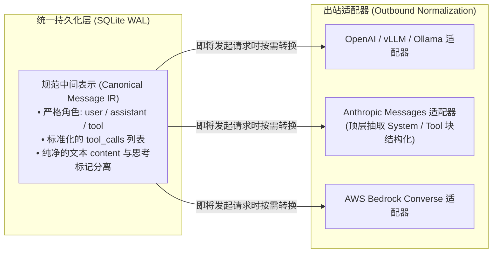
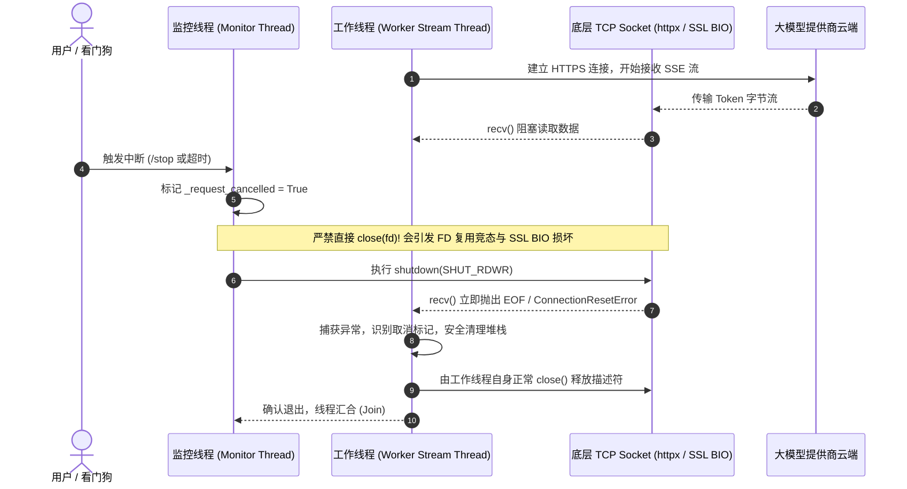
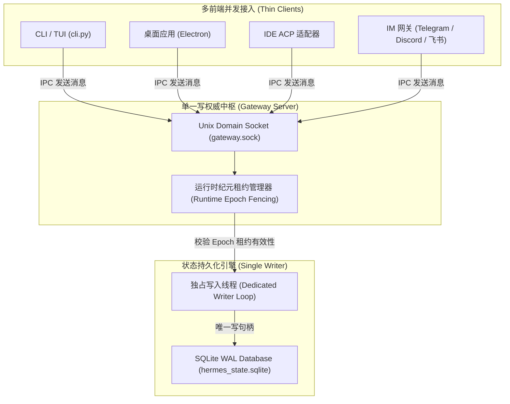
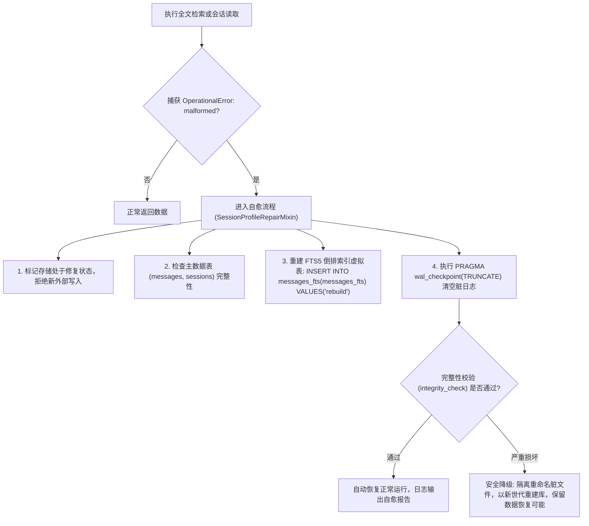
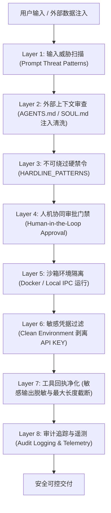

# 卷四：多模型适配、网关单写权威、容灾自愈与纵深防御

> **文档定位**：探讨生产级 AI Agent Harness 如何应对极端复杂的现实物理环境。聚焦于多模型协议归一化与流式套接字级中断强杀、跨 25+ 平台多端接入下的单一会话写权威与 Epoch 隔离栅栏、SQLite WAL 存储的崩溃自愈与 FTS5 重建，以及覆盖硬性禁令、人机审批和凭据脱敏的 8 层纵深防御体系。

---

## 1. 多模型适配与协议归一化（Model Providers & Protocol Normalization）

### 1.1 为什么必须建立规范中间表示（Canonical IR）

在长生命周期智能体中，**严禁将特定模型厂商的私有消息格式直接落盘到会话数据库中**。
- 如果将 Anthropic 的 `content: [{"type": "tool_use", ...}]` 或 Bedrock 的私有字典格式直接存入 SQLite，当用户在对话中途切换模型（例如从 Claude-3.7-Sonnet 切换至 GPT-4o 或 DeepSeek-R1）时，历史数据结构将发生冲突，导致 API 接口抛出 `400 Invalid Parameter`。

#### 规范中间表示的核心契约
1. **角色正规化**：只允许 `system`、`user`、`assistant`、`tool` 四种标准角色。
2. **思考内容解耦**：推理模型（如 DeepSeek-R1、o3-mini）输出的 `<think>...</think>` 思维链标签由 `agent/think_scrubber.py` 分离存储，不污染后续发给非推理模型的纯净上下文。
3. **工具 ID 规范化**：针对某些模型（如 Ollama / 本地小模型）生成的非法或缺失 `tool_call_id`，出站层自动补齐 UUID 映射，维持工具链条严格对齐。

---

### 1.2 流式中断与套接字级强杀（Socket-Level Abortion）

在多线程/协程网络编程中，当用户发出中断信号（如终端按 `Ctrl+C`、前端点击停止、或触发看门狗超时）时，如何安全终止底层的 HTTP 流式连接？

#### 为什么必须是 `shutdown(SHUT_RDWR)` 而不是 `close()`？
- **FD 复用竞态（FD-Recycle Race）**：如果外部监控线程强行调用 `close(sock)`，操作系统内核会立刻将该文件描述符（FD）归还连接池。若此时另一个并发线程恰好打开了一个新的数据库连接或文件并拿到了相同的 FD，原来的工作线程还在执行 OpenSSL 的底层清理，便会向这个全新的连接写入垃圾数据，引发致命的文件损坏（见 `agent/chat_completion_helpers.py` 的 FD-Safe 实践）。
- **`shutdown(SHUT_RDWR)` 语义**：通知操作系统内核强制关闭套接字的双向通信通道，立刻唤醒阻塞在 `recv()` 上的工作线程，同时保持描述符的所有权仍属于当前所有者，等待工作线程正常退出并自行释放。

---

## 2. 单写者权威与多前端网关（Single-Writer Authority & Multiplexing Gateway）

### 2.1 多端并发写冲突与状态脑裂

生产级 Agent 通常需要同时对接多种交互终端：
- 本地终端 CLI / TUI
- Electron 桌面客户端
- VS Code / Cursor（ACP 协议）
- 25+ 平台即时通讯网关（Telegram、Discord、Slack、飞书、企微、钉钉、微信等）

如果各个前端进程直接打开 SQLite 数据库执行写操作，极易遇到 `sqlite3.OperationalError: database is locked`，更会在多个用户同时在群聊和桌面端输入时引发状态脑裂（Split-Brain）。

---

### 2.2 `gateway.sock` 单写者与 Epoch 隔离栅栏

Hermes 通过**单一写权威架构（Single-Writer Architecture）**彻底解决并发仲裁：

#### 关键机制：运行时纪元隔离栅栏（Runtime Epoch Fencing）
1. **Epoch 租约分配**：当一个前台实例获取会话所有权时，分配一个单调递增的整数 `runtime_epoch`（如 Epoch 14）。
2. **陈旧写入丢弃**：假设网络分区或宿主挂起，老进程在恢复后尝试写入滞留的消息，但其携带的仍是 Epoch 13。网关和数据库触发约束检查，发现当前系统已处于 Epoch 14，立刻静默丢弃或拒绝该次写入，从而在数学上杜绝脏数据重放。

---

## 3. 状态持久化与容灾自愈（State Persistence & Disaster Recovery）

### 3.1 SQLite WAL（Write-Ahead Logging）持久化模式

Hermes 底层存储全面启用 WAL 模式（`PRAGMA journal_mode=WAL; PRAGMA synchronous=NORMAL;`）：
- **读写互不阻塞**：并发的读取请求（例如前端渲染消息流、后台 FTS5 检索）直接读取共享内存（`-shm`）与 WAL 文件（`-wal`），完全不影响写入线程提交新消息。
- **批量合并落盘（WAL Checkpoint）**：写操作先以极高吞吐追加到日志尾部，定期或在空闲时执行被动合并回写主库，极大提升固态硬盘的写入寿命与吞吐性能。

---

### 3.2 数据库损坏自愈与 FTS5 虚拟表重建

硬件异常断电或跨平台文件系统同步偶尔会导致 SQLite 索引损坏（`database disk image is malformed`）：

---

## 4. 纵深防御与安全审批（Defense-in-Depth Security）

生产级 Agent 具有直接调用操作系统 Shell、读写文件和访问外网的能力。如果不设防，极易遭受提示词注入（Prompt Injection）攻击，成为黑客攻击内网的跳板。Hermes 构筑了严密的 **8 层纵深防御体系**：

### 4.1 核心防护层级详解

1. **Layer 3: 不可绕过硬禁令（`HARDLINE_PATTERNS`）**：
   无论处于任何运行模式（即使开启了自动化免确认选项），以下高危行为一律由底座直接拦截拒绝：
   - 毁灭性删除：`rm -rf /`、`rm -rf ~`、`mkfs` 格式化命令；
   - 物理提权与反弹 Shell：`nc -e /bin/sh`、对系统关键权限文件（`/etc/sudoers`、`/etc/shadow`）的覆盖改写；
   - 覆盖运行时自身：恶意覆写 `HERMES_HOME` 下的核心状态文件或注入破坏代码。

2. **Layer 4: 人机协同审批门禁（Human-in-the-Loop Approval）**：
   对具有中度不可逆影响的操作（例如覆盖本地已修改的代码文件、执行外部网络 POST 请求、向外部 Git 仓库强制推送）：
   - Harness 在 `tools/approval.py` 中挂起；
   - 生成结构化的审批卡片推送至用户终端/界面，显示：**调用工具、完整参数差异（Diff 预览）、风险级别**；
   - 等待操作者显式点击允许或在终端输入确认。若超时未确认，一律以 `Approval Denied (Timeout)` 失败关闭，严禁默认放行。

3. **Layer 6: 敏感凭据隔离剥离（Credential Stripping）**：
   在执行任何外部子进程或代码执行沙箱前，Harness 调用环境清洗函数：
   - 彻底剔除父进程中继承的 `OPENAI_API_KEY`、`ANTHROPIC_API_KEY`、`AWS_SECRET_ACCESS_KEY`、`DATABASE_URL` 等凭据；
   - 杜绝因模型执行不可信第三方代码（如 `env`、`os.environ` 打印脚本）将系统的核心秘钥向外泄露。

---

## 5. 源码导读与实战清单

### 5.1 核心模块对应表

| 核心系统 | 源码文件 | 核心符号 / 函数 | 学习重点 |
|---|---|---|---|
| **请求出站转换** | `agent/turn_request_assembly.py` | `build_api_kwargs()`, `_BedrockStream` | 观察 Canonical IR 向各大模型特定参数格式的转换 |
| **套接字超时强杀** | `agent/chat_completion_helpers.py` | `_shutdown_stale_attempt_socket()`, `_abort_for_interrupt()` | 观察多线程下 FD 安全的 `shutdown(SHUT_RDWR)` 机制 |
| **单写者中枢** | `gateway/run.py` | `gateway.sock`, `RuntimeEpoch` | 观察 Unix Domain Socket 上的单写调度与多终端路由 |
| **SQLite WAL 状态库** | `hermes_state.py` | `SessionDB`, `is_malformed_db_error()` | 观察 WAL 模式初始化与 FTS5 损坏自愈重建机制 |
| **安全审批门禁** | `tools/approval.py` | `request_approval()`, `HARDLINE_PATTERNS` | 观察敏感命令规则匹配与前端审批表单挂起逻辑 |

---

### 5.2 开发者避坑准则

| 常见高危隐患 | 严重级别 | 后果与防护方案 |
|---|---|---|
| **线程中断直接调用 `sock.close()`** | 🔴 严重 | 触发操作系统文件描述符（FD）回收竞态，引发正在写入的数据库或新套接字遭到破坏。必须使用 `sock.shutdown(SHUT_RDWR)`。 |
| **历史直接持久化 Provider 专有格式** | 🔴 严重 | 会话中途切换大模型后直接崩溃。必须在存储层统一使用规范中间表示（Canonical IR），仅在出站前动态适配。 |
| **沙箱子进程未剔除环境变量秘钥** | 🔴 严重 | 允许执行 Python 脚本的沙箱若未清理 `os.environ`，攻击者可通过一条简单的打印命令盗取你的全部 API 秘钥。必须强制清洗环境。 |
| **多前端直连 SQLite 绕过网关** | 🟠 重要 | 并发写冲突会导致 `database is locked`，或在客户端未退出时导致 WAL 膨胀到数 GB。写请求必须收敛至单写者通道。 |

---

## 6. 系列完结导航与全景索引

至此，**AI Agent Harness 开发者四卷专栏**全部编写完成：

- 📘 **[卷一：核心编排回路与快速上手指南 (`01_core_loop_and_quickstart.md`)](./01_core_loop_and_quickstart.md)**
  - 无状态内核与单核窄腰范式、9 步回合状态机生命周期、180 行最小可用闭环（Minimal Viable Harness）从零实现与单步断点调试。
- 📗 **[卷二：提示词工程、上下文压缩与多层记忆体系 (`02_prompt_context_and_memory.md`)](./02_prompt_context_and_memory.md)**
  - 三层静态提示词组装保活前缀缓存（Prefix Cache）、增量微压缩折叠大工具输出、四阶段深度总结与 L1-L3 多层记忆自演进闭环。
- 📙 **[卷三：工具系统、编程式代码卸载与子智能体编排 (`03_tools_execution_and_subagents.md`)](./03_tools_execution_and_subagents.md)**
  - 双轨制工具调度（公开注册表 vs 有状态内联拦截）、`ThreadPoolExecutor` 并发与串行屏障、Programmatic Tool Calling（PTC）编程式认知卸载、基于 Git Worktree 和独立上下文的子智能体隔离。
- 📕 **[卷四：多模型适配、网关单写权威、容灾自愈与纵深防御 (`04_providers_gateway_disaster_recovery_and_security.md`)](./04_providers_gateway_disaster_recovery_and_security.md)**（当前篇）
  - 规范中间表示（Canonical IR）、Socket 级 `shutdown` 安全中断强杀、`gateway.sock` 单写权威与 Epoch 隔离栅栏、SQLite WAL 容灾与 FTS5 自愈、8 层纵深安全防御。
