# AI Agent Harness 架构与工程实现全景解析（以 Nous Research Hermes Agent 为参考范本）

> **文档定位**：本文是 AI Agent Harness 的**全景架构总纲（Panoramic Architecture & Engineering Master Document）**。它从底层心智模型与操作系统隐喻出发，完整覆盖**单核窄腰拓扑、9 步回合状态机、三层提示词与前缀缓存保活、增量微压缩与 4 阶段深度压缩、L1-L3 多层记忆与技能自演进、双轨制工具调度、编程式代码卸载（PTC）、多环境沙箱、子智能体四重隔离、多模型协议归一化、Socket 级流式中断强杀、`gateway.sock` 单写权威与 Epoch 纪元栅栏、多端接入生态（CLI/TUI/Desktop/ACP/IM/Cron）、SQLite WAL 分级容灾自愈与 8 层纵深防御体系**，并提供完整的源码级映射矩阵。

---

## 一、 核心定位、操作系统隐喻与“单核窄腰”拓扑

### 1.1 Model 与 Harness 的本质分野（CPU ALU vs OS Kernel）

在现代自主智能体（Autonomous Agent）工程中，**大语言模型（LLM）本身并不是一个完整的 Agent，而是一个无状态的概率推理内核（Stateless Reasoning Kernel）**。模型只负责在给定上下文 Token 序列的条件下预测下一段文本或结构化工具调用请求；它没有物理时间感知，无法跨越网络中断维持生命周期，不能直接安全地操作宿主资源，也不会在崩溃后自我恢复。

将这一无状态推理内核封装为具备持久记忆、长程规划、环境感知、工具执行、故障自愈与安全边界的运行时控制底座，即为 **AI Agent Harness（智能体运行时框架 / 控制底座）**。如果用计算机体系结构作类比，**LLM 相当于 CPU 的算术逻辑单元（ALU），而 Harness 则是完整的操作系统内核（Agent OS Kernel）**：

| 操作系统内核子系统 | AI Agent Harness 对应子系统 | 解决的核心工程问题 | Hermes Agent 参考实现 |
|---|---|---|---|
| **进程调度器（Scheduler）** | **编排控制回路（Orchestration Loop）** | 管理“思考 $\rightarrow$ 动作 $\rightarrow$ 观察”的 9 步回合状态机、流式中断、空转抑制与预算熔断 | `AIAgent.run_conversation()`、`agent/conversation_loop.py`、`agent/turn_*.py` |
| **L1/L2 高速缓存控制器** | **提示词与前缀缓存引擎（Prefix Cache Engine）** | 防止动态时间/目录状态击穿服务商 KV Cache，降低首字延迟（TTFT）与 50%~80% 推理成本 | 三层静态组装 + 单次用户/工具消息旁路通道（`agent/prompt_builder.py`） |
| **虚拟内存与分页管理（MMU）** | **上下文窗口治理引擎（Context Compaction）** | 在有限上下文窗口内平衡历史保真度与信噪比，消除“中间迷失”与窗口物理溢出 | 增量微压缩 + 4 阶段单次总结压缩 + 确定性降级（`agent/micro_compaction.py`, `agent/context_compressor.py`） |
| **文件系统与持久存储（VFS）** | **多层记忆与技能自演进（Memory & Evolution）** | 区分常驻核心画像、跨会话情景检索与可复用操作规程（SOP），实现经验沉淀与防膨胀淘汰 | L1 画像快照 + L2 SQLite FTS5 + L3 Curator 技能闭环（`agent/memory_manager.py`, `agent/curator.py`） |
| **系统调用与设备驱动（Syscalls）** | **双轨工具运行时与认知卸载（Tool Runtime & PTC）** | 上百个工具的按需披露、并发派发与原序重排、交互串行屏障、多步循环向沙箱脚本卸载 | 公开注册轨 `tools/registry.py` + 内联拦截轨 `agent/inline_tool_executors.py` + RPC 卸载 `tools/code_execution_tool.py` |
| **多进程派生与 IPC（Fork/Wait）** | **子智能体并发编排（Subagent Orchestration）** | 将高噪探索任务拆解给隔离上下文与独立工作区的子智能体，处理停滞看门狗与递归熔断 | `delegate_task` + Git Worktree 隔离 + 心跳停滞看门狗（`tools/delegate_tool.py`, `agent/async_delegation.py`） |
| **网络协议栈与套接字（Net Stack）** | **多模型适配与流式中断控制（Provider Normalization）** | 屏蔽不同大模型厂商 API 差异，支持会话中途无损切模型，安全强杀挂起的流式 TCP 连接 | 规范中间表示 Canonical IR + FD 安全 `shutdown(SHUT_RDWR)`（`agent/turn_request_assembly.py`, `agent/chat_completion_helpers.py`） |
| **分布式锁与事务日志（WAL）** | **单一会话权威与分级容灾（Single-Writer Authority）** | 多终端（CLI/桌面/IDE/25+ IM）并发附着同一会话时的写仲裁、防脑裂栅栏与数据库损坏自愈 | `gateway.sock` 单写中枢 + `runtime_epoch` 栅栏 + SQLite WAL 分级自愈（`gateway/run.py`, `hermes_state.py`） |
| **内核安全模块（LSM / SELinux）** | **纵深防御与权限审批（Defense-in-Depth Security）** | 拦截毁灭性指令、防范提示词注入反弹、剥离沙箱敏感环境变量与人机协同审批 | 8 层防御流水线 + 不可绕过 `HARDLINE_PATTERNS` + 审批挂起（`tools/approval.py`, `tools/security.py`） |

---

### 1.2 六大开发公理与三大黄金不变式

#### （1）六大开发公理（Engineering Axioms）
1. **提示词绝对稳定**：System Prompt 在会话启动时一次构建即冻结，中途绝不原地修改——厂商前缀缓存命中要求逐字节完全一致。
2. **执行过程全可观测**：通过结构化钩子与无副作用回调暴露内部状态，核心编排回路绝不依赖任何特定 UI 渲染库。
3. **任意时刻安全可中断**：流式生成途中、并发工具执行途中均可随时中断，且消息历史必须自动闭合配对，绝不残留脏状态。
4. **核心彻底平台无关**：编排内核不知道自己运行在 CLI、Electron 桌面端、IDE 插件还是 IM 网关中，仅按能力元数据调整交互行为。
5. **注册表松耦合自发现**：工具、沙箱环境、记忆引擎与平台适配器全部基于导入期注册表自发现，严禁修改核心编排文件来硬编码新插件。
6. **配置与状态全隔离（Profile-Aware）**：配置、凭据、SQLite 状态库、技能目录全部通过 `get_hermes_home()` 收敛进单一 Profile 根目录，天然支持多租户/多实例并行隔离。

#### （2）三大黄金不变式（Golden Invariants）
- **不变式 1：严格角色交替与工具配对（Strict Role Alternation & Tool Pairing）**
  - 消息序列必须严格满足 `user -> assistant -> user -> assistant`，严禁连续同角色消息。
  - 凡是包含 `tool_calls` 的 `assistant` 消息，后续紧邻的消息必须全部为 `tool` 角色，且 `tool_call_id` 数量、顺序、ID 必须与请求 1:1 严格对齐闭合。
- **不变式 2：提示词逐字节稳定（Byte-Stable Prefix Caching）**
  - 会话存续期间 System Prompt 逐字节只读；所有高频动态变量（物理时间戳、电量、工作目录变更、局部 `AGENTS.md`）一律走单次 User 消息旁路或 Tool 结果回填。
- **不变式 3：中断即丢弃与合成闭合（Discard-on-Interrupt）**
  - 用户触发中断时，未完成的残缺 `assistant` 流式文本立即丢弃，不写入持久历史；若模型已发出 `tool_calls` 但工具被中断，Harness 必须合成结构化取消响应（`{"error": "Execution interrupted by user"}`）回填至对应 `tool` 消息中强制闭合调用链，杜绝下一轮 API 报 `400 Bad Request`。

---

### 1.3 “单核窄腰（Narrow Waist）”全景拓扑

如果为 CLI、桌面端、IDE、25+ IM 机器人各自编写一套 Prompt 组装、上下文截断和安全审批逻辑，系统将迅速陷入 **Prompt 碎片化、KV Cache 穿透、安全门禁漏出** 的维护灾难。Hermes 严格遵循 **“单核窄腰（Narrow Waist）”** 架构范式：**内核做减法（收敛唯一状态机与不变式），边缘做加法（插件化扩展接入端与底层能力）**。

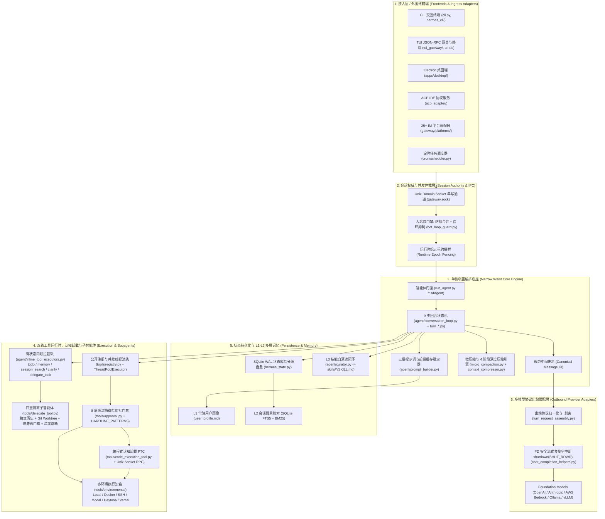

#### 架构依赖倒置红线（Boundary Lint 强制校验）
- `agent/` 与 `run_agent.py`（核心层）**绝对禁止**反向 `import` 任何外围接入层模块（`cli.py`、`gateway/`、`tui_gateway/`、`acp_adapter/`、`apps/desktop/`）。
- 所有跨层交互（如流式 Token 推送、请求用户在界面确认审批弹窗、弹出澄清表单）必须通过实例化 `AIAgent` 时注入的回调函数（`stream_callback`、`clarify_callback`、`approval_callback`）完成。
- 该架构边界由 `scripts/boundary_lint.py` 在 CI 与 `python scripts/check` 中静态强制守护。

---

## 二、 编排内核与 9 步回合状态机（Orchestration Loop Internals）

### 2.1 9 步回合生命周期全景流转

每一次用户输入、定时触发或网关消息到达，`agent/conversation_loop.py` 协同 `agent/turn_*.py` 模块化处理器驱动一次确定性的 9 步回合状态机循环：

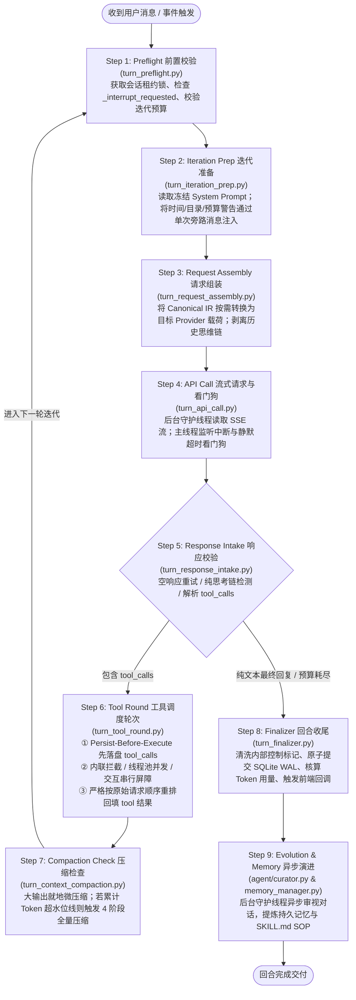

### 2.2 关键环节工程机制详解

1. **Step 1 & 2（前置校验与无污染旁路注入）**：
   - 校验当前迭代轮数是否逼近 `max_iterations`。当剩余轮数不足时，由 `turn_iteration_prep.py` 生成预算收敛警告（Iteration Budget Warning），作为临时旁路信息附加到当轮消息中，督促模型停止发散并总结输出。
2. **Step 4（流式看门狗与带外中断监听）**：
   - HTTP 流式调用运行在独立后台守护线程中，主线程以短周期轮询 `_interrupt_requested` 标志与流式心跳计时器（Stream Watchdog）。一旦超时或收到用户中断，立即对底层 Socket 执行 `shutdown(SHUT_RDWR)` 毫秒级终止阻塞读取。
3. **Step 5（空响应与纯思考链自愈）**：
   - 部分推理模型在高负载下可能仅输出 `<think>...</think>` 思考块而未输出正文或 `tool_calls`（Thinking-only Loop），或返回空内容。`turn_response_intake.py` 捕获此类伪完成状态，自动注入温和的修正提示词触发受控重试，避免向用户直接交付空白气泡。
4. **Step 6（持久化前置原则 Persist-Before-Execute）**：
   - 在真正调用任何工具函数（尤其是可能引发系统重启、网络变更或进程崩溃的 Shell 命令）**之前**，必须先将模型的 `assistant(tool_calls)` 消息写入 SQLite WAL。
   - 若工具执行途中宿主断电宕机，重启后恢复引擎能够精确识别“已发出 `tool_calls` 但缺失 `tool` 结果”的未决现场，并合成崩溃恢复回执闭合历史链条。

---

## 三、 提示词工程、前缀缓存保活与上下文分级治理

### 3.1 服务商 KV Cache 原理与三层提示词组装架构

主流模型厂商（Anthropic、OpenAI、DeepSeek 等）的 GPU 显存 KV Cache 采用**严格的前缀字节哈希匹配（Byte-for-Byte Prefix Match）**。命中前缀缓存可降低 **50% ~ 80% 的输入 Token 成本**，并将首字延迟（TTFT）缩短 **70% 以上**；但只要 System Prompt 开头或中部改变了哪怕一个字符（如拼入秒级时间戳），其后数万 Token 的缓存将全量失效。

Hermes 在 `agent/prompt_builder.py` 中实施严格的**三层提示词分离架构**：

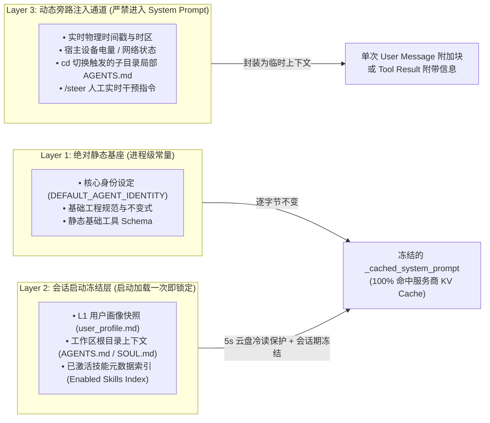

- **云同步目录冷读死锁防护**：在读取 Layer 2 的工作区文件（如位于 iCloud Drive、OneDrive、NFS 挂载点上的 `AGENTS.md`）时，若文件处于云端未下载状态，主线程直接 `open()` 会引发无限期内核 I/O 挂起。`prompt_builder.py` 采用独立守护线程配合 5.0 秒硬超时读取，超时即安全退避跳过，保障启动绝对不死锁。

---

### 3.2 增量微压缩（Incremental Micro-Compaction）

长程任务中，`grep`、`cat` 或测试日志极易在单轮工具调用中产生数千行输出。Hermes 不会等到上下文爆满才处理，而是由 `agent/micro_compaction.py` 在回合间执行**增量微压缩**：

1. **触发条件**：扫描已过活跃使用期的历史 `tool` 结果消息，当单条内容超过微压缩阈值（如 `> 1,500 tokens`）时触发。
2. **就地结构化折叠**：
   - **严禁删除消息节点**（删除节点会破坏 `assistant(tool_calls)` 与 `tool(tool_call_id)` 的 1:1 配对拓扑，导致 API 报 400 错误）。
   - 保留输出文本的**头部前 $N$ 行与尾部后 $M$ 行**（通常各 25~50 行，确保保留命令参数回显、末尾退出码与异常堆栈底部），将中间冗长数据行折叠替换为 `[Output truncated by micro-compaction; N lines omitted]`，就地回收 30%~60% 的上下文空间。

---

### 3.3 四阶段深度总结压缩（4-Stage Full Compaction）

当经历微压缩后，累计上下文 Token 仍逼近模型窗口安全水位线（如最大容量的 75%）时，`agent/context_compressor.py` 启动**四阶段深度压缩**。

> **单次辅助调用铁律（One-Call Summarization Principle）**：四阶段是上下文治理的**四个工程处理阶段**，绝非向辅助模型串行发起多次请求。整个压缩周期内，**辅助小模型（Auxiliary LLM）至多只调用 1 次**，若超时或失败则立即降级为纯规则截断，彻底杜绝多轮串联带来的高延迟与复合故障率。

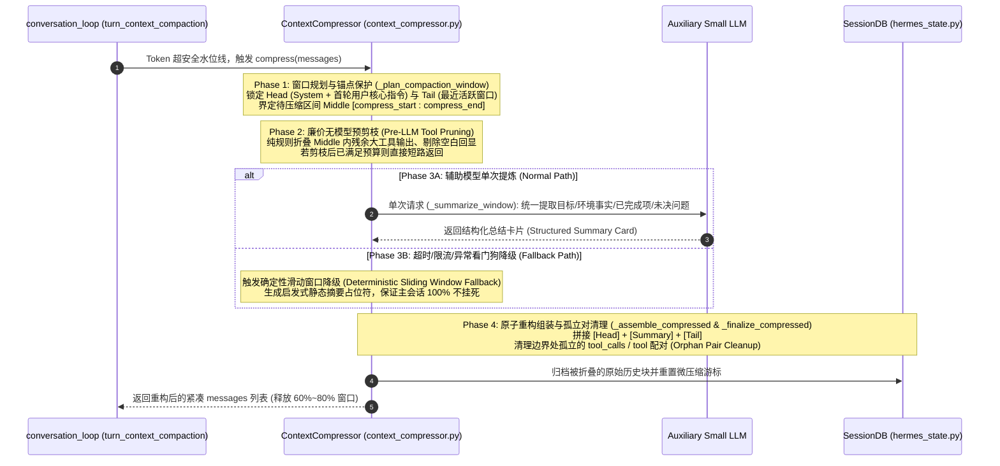

---

## 四、 多层记忆体系与技能自演进闭环（Multi-Tier Memory L1-L3）

单纯依赖传统向量数据库（Vector RAG）在每轮对话前盲目塞入检索片段，既会破坏前缀缓存，又容易因噪声片段干扰工具调用精度。Hermes 构建了职责分明的 **L1 / L2 / L3 三层记忆与自演进体系**：

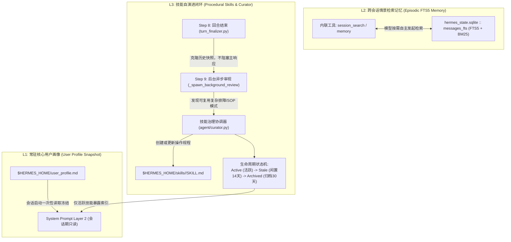

1. **L1 常驻用户画像（User Profile）**：
   - 存储用户的核心工程偏好（如语言规范、包管理器偏好、禁止事项）。在会话启动时加载进 Layer 2 冻结，会话中途通过 `memory` 工具产生的更新写入磁盘，在下一次会话启动时生效，绝不中途篡改当前会话的 System Prompt。
2. **L2 跨会话情景检索（SQLite FTS5）**：
   - 所有历史会话的消息与工具摘要实时同步至 SQLite `fts5` 虚拟表。模型在遇到似曾相识的报错或用户提及“参照上周的方案”时，**自主按需调用** `session_search(query=...)` 进行 BM25 全文检索，实现零闲置开销的精准召回。
3. **L3 技能自演进与防膨胀淘汰（Curator & Skills Evolution）**：
   - 当 Agent 经历多轮试错解决了一个复杂问题后，回合结束时后台守护线程启动 `agent/curator.py` 异步审视对话，将成功路径提炼为标准化的 `SKILL.md`（包含触发条件、步骤规程、避坑提示）。
   - **防膨胀状态机**：为防止技能库无限增长撑爆提示词，`curator.py` 自动维护 `Active（活跃） -> Stale（14 天未命中） -> Archived（30 天未命中移出激活索引，软归档保留文件）` 的自动淘汰闭环。

---

## 五、 双轨制工具运行时、编程式代码卸载（PTC）与多环境沙箱

### 5.1 双轨制工具调度架构（Dual-Track Tool Dispatch）

Hermes 将工具严格划分为**公开注册轨（无状态/外部环境工具）**与**有状态内联拦截轨（内核状态直连工具）**：

| 维度 | 公开注册轨（Public Registry Track） | 有状态内联拦截轨（Inline Intercepted Track） |
|---|---|---|
| **核心源码** | `tools/registry.py`、`model_tools.py` | `agent/inline_tool_executors.py` |
| **注册与路由方式** | 各工具模块导入期调用 `@registry.register` 自注册，通过 AST/签名与 Docstring 自动生成 JSON Schema | 表驱动路由映射 `_RAW_INLINE_TOOL_EXECUTORS`，签名统一为 `(agent, args, ctx) -> str` |
| **涵盖工具范围** | `terminal`、`read_file`、`write_file`、`patch`、`web_search`、`browser`、`execute_code` 等上百个工具 | `todo`、`memory`、`session_search`、`clarify`、`setup_beat`、`delegate_task` |
| **执行上下文** | 不接触 `AIAgent` 内部私有属性；通过 `ThreadPoolExecutor` 多线程并发执行 | 直接读写 `AIAgent` 实例内部状态（如 `_todo_store`、`_session_db`、`clarify_callback`） |
| **按需披露机制** | 支持 `Toolset` 作用域裁剪与 `tool_search` / `tool_describe` 渐进式披露 | 按会话配置与递归深度（如子智能体达深度上限时隐藏 `delegate_task`）动态启停 |

---

### 5.2 受控并发派发、结果原序重排与串行屏障

在 `agent/turn_tool_round.py` 中，当模型单次请求发起多个工具调用（例如同时读取 4 个源码文件并调用 1 次 `clarify`）时，调度器执行以下确定性编排：

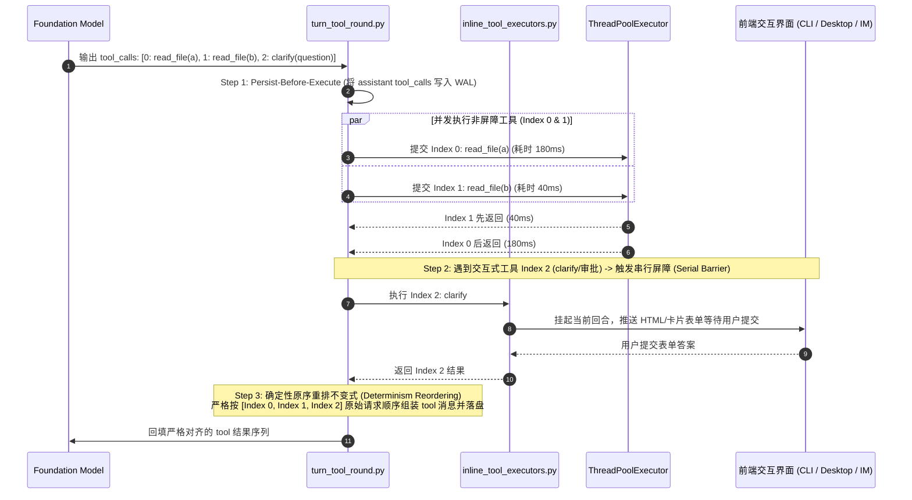

- **原序重排不变式（Determinism Invariant）**：即便并发线程池中 Index 1 比 Index 0 早完成 140ms，Harness 也**绝不能按完成先后顺序乱序入栈**，必须严格按照模型请求时的索引 `[0, 1, 2]` 对齐回填，否则会破坏消息序列确定性并引发前缀缓存抖动。
- **异常软封装（Never Crash on Tool Error）**：任何工具内部抛出的未捕获异常（如 `FileNotFoundError`、命令超时、JSON 解析失败）均由调度器统一拦截，封装为结构化错误文本 `{"error": "..."}` 作为正常的 `tool` 结果返回给模型，赋予模型自我修正重试的机会，严禁向上抛出击穿主循环。

---

### 5.3 编程式认知卸载（Programmatic Tool Calling - PTC）

当面临“扫描 30 个配置文件、提取特定字段并交叉比对”这类批处理任务时，传统的 ReAct 逐步调用需要往返 LLM 30 余次，耗时近百秒且中间原始文件内容会迅速撑爆上下文窗口。

Hermes 通过 `tools/code_execution_tool.py` 与 `tools/code_kernel.py` 提供 **编程式认知卸载（PTC）**：

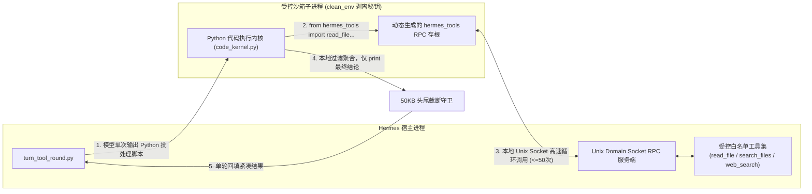

#### PTC 三大安全与资源护栏
1. **工具白名单隔离（`SANDBOX_ALLOWED_TOOLS`）**：沙箱脚本内的 RPC 存根仅暴露安全、低风险的探测与读取工具，高危写操作或二次派生被严格屏蔽。
2. **调用次数硬预算（`DEFAULT_MAX_TOOL_CALLS = 50`）**：单次脚本执行最多允许发起 50 次底层 RPC 工具调用，防止模型编写死循环脚本耗尽宿主句柄。
3. **输出字节硬截断（`MAX_STDOUT_BYTES = 50,000`）**：若脚本标准输出超过 50KB，自动按 **40% 头部 + 60% 尾部** 执行切分保留，中间溢出部分转储至临时文件并附带路径提示，彻底杜绝单次输出撑爆上下文。

---

### 5.4 多后端执行沙箱抽象（`tools/environments/`）

为了支持从本地开发机到云端无服务器集群的无缝迁移，所有命令执行与文件操作均通过 `tools/environments/base.py` 的抽象基类路由至具体沙箱后端：

| 沙箱后端 | 源码模块 | 适用场景与核心隔离特性 |
|---|---|---|
| **Local Environment** | `tools/environments/local.py` | 本地直接子进程执行；强制经过 `local_env_policy.py` 清洗敏感 API 秘钥，支持进程组信号清理。 |
| **Docker Sandbox** | `tools/environments/docker.py` | 容器级隔离；支持 `docker_egress.py` 出站网络白名单管控与 `docker_ownership.py` 宿主机 UID/GID 文件权限对齐。 |
| **SSH Remote** | `tools/environments/ssh.py` | 远程开发机/服务器通过复用 SSH 控制通道执行指令与同步文件（`file_sync.py`）。 |
| **Modal / Managed Modal** | `tools/environments/modal.py`, `managed_modal.py` | 云端 Serverless 容器沙箱，按需秒级冷启动弹性算力。 |
| **Daytona & Vercel** | `tools/environments/daytona.py`, `vercel_sandbox.py` | 标准化云开发工作区与前端/全栈临时预览沙箱集成。 |

---

## 六、 子智能体并发编排与四重隔离机制（Subagent Orchestration）

当主智能体面临高噪声、长链条的探索或并行编码任务时，通过内联工具 `delegate_task`（`tools/delegate_tool.py` & `agent/async_delegation.py`）派生子智能体（Subagent）。Hermes 对子智能体实施严格的**四重隔离与治理机制**：

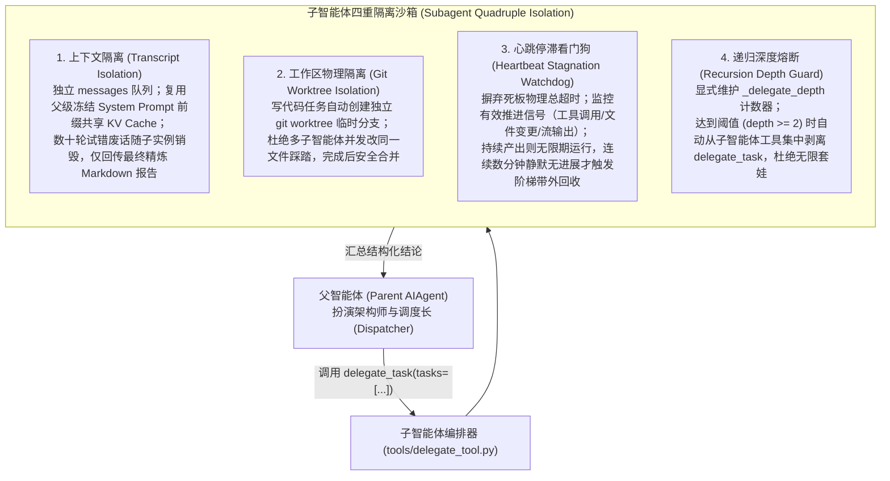

---

## 七、 多模型协议归一化与流式套接字级中断强杀

### 7.1 规范中间表示（Canonical Message IR）与出站适配

在长生命周期会话中，用户可能随时在 CLI 或界面中切换模型（例如从 `claude-3-7-sonnet` 切换至 `gpt-4o`、`deepseek-r1` 或 AWS Bedrock 模型）。**如果将某一厂商专有的消息结构直接存入 SQLite，切换模型时历史消息将立刻触发 `400 Invalid Parameter` 崩溃。**

Hermes 在存储层与内存状态机中强制使用唯一的**规范中间表示（Canonical Message IR）**，仅在 Step 3（`agent/turn_request_assembly.py`）发送网络请求前夕执行出站动态转换：

1. **角色与结构正规化**：持久层仅允许 `system`、`user`、`assistant`、`tool` 四类标准角色与统一的 `tool_calls` 数组。
2. **思维链无损剥离（`agent/think_scrubber.py`）**：推理模型生成的 `<think>...</think>` 或 `reasoning_content` 在入库与跨模型出站时被自动分离清洗，防止非推理模型因历史中包含未知标签而报协议错误或模仿输出乱码。
3. **工具 ID 自动修补**：针对部分开源模型或本地 Ollama 接口生成的缺失/非法格式 `tool_call_id`，出站适配器自动生成确定性 UUID 映射表，确保请求与回执严格配对。

---

### 7.2 为什么流式中断必须用 `shutdown(SHUT_RDWR)` 而严禁跨线程 `close(fd)`？

当后台工作线程正在阻塞读取 HTTPS SSE 流（`sock.recv()`），而主监控线程收到用户 `Ctrl+C` 或看门狗超时信号时，如何安全强杀网络连接是系统稳定性的分水岭（实现位于 `agent/chat_completion_helpers.py`）：

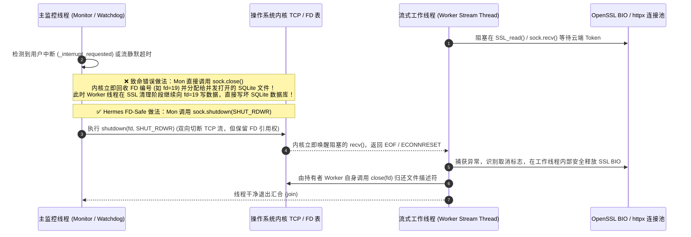

---

## 八、 单一会话权威、多端接入网关与外围生态适配

### 8.1 全景多端接入生态（Frontends & Edge Adapters）

围绕单核窄腰，Hermes 在外围提供了完整的全场景接入适配器：

| 接入端形态 | 核心目录 / 入口 | 协议与架构职责 |
|---|---|---|
| **CLI 交互终端** | `cli.py`, `hermes_cli/` | 终端交互式 REPL、斜杠命令分发器（`/compact`, `/skills`, `/model`）、Profile 管理；检测到网关在线时自动退化为薄客户端。 |
| **TUI Gateway 服务** | `tui_gateway/`, `ui-tui/` | 基于 JSON-RPC 与 WebSocket 的本地网关服务（`tui_gateway/server.py`, `rpc_dispatch.py`），驱动现代化终端 UI 与多房间协同（Hosted Rooms）。 |
| **Electron 桌面端** | `apps/desktop/` | 跨平台桌面 GUI 应用，通过本地网关桥接会话流、可视化卡片审批、工作区目录树与子智能体看板。 |
| **ACP IDE 协议服务** | `acp_adapter/` | 实现 **Agent Client Protocol (ACP)** 标准服务端（`acp_adapter/server.py`, `session.py`, `edit_approval.py`），无缝嵌入 VS Code / Cursor / Zed 等 IDE 执行代码编辑审批与上下文协同。 |
| **25+ IM 多平台网关** | `gateway/run.py`, `gateway/platforms/` | 统一接入 Telegram、Discord、Slack、飞书、企微、钉钉、微信、WhatsApp 等 25+ 消息平台，提供富媒体转译、语音转写与跨平台会话镜像（`gateway/mirror.py`）。 |
| **Cron 定时调度引擎** | `cron/scheduler.py`, `cron/` | 持久化的定时与事件触发守护引擎，支持蓝图任务（Blueprints）、漏跑补发（`missed_runs.py`）、独立 Worktree 维护与结果多端投递（`scheduler_delivery.py`）。 |

---

### 8.2 `gateway.sock` 单写权威、Epoch 纪元栅栏与入站双门禁

当 CLI、桌面端、IDE 和飞书机器人同时附着到同一个会话时，若各进程直接写 SQLite，必然引发 `SQLITE_BUSY` 锁死或状态脑裂。Hermes 通过 `gateway/run.py` 实施**单一会话写权威（Single-Writer Session Authority）**：

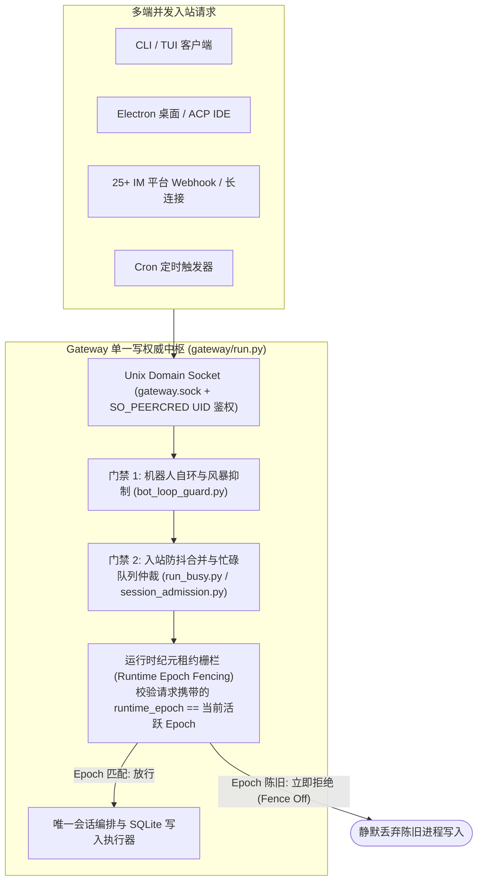

1. **Runtime Epoch 纪元隔离栅栏**：
   - 每当会话控制权发生切换或网关重启接管时，系统分配一个单调递增的整数 `runtime_epoch`（如从 Epoch 12 升至 Epoch 13）。
   - 若某个因休眠或网络分区卡住的旧线程/旧子进程苏醒后尝试向数据库写入滞留消息，其携带的 Epoch 12 会被底层持久化栅栏当场拦截拒绝，从根源上杜绝“僵尸进程覆写最新会话状态”。
2. **入站双门禁（Dual Message Guards）**：
   - **自环风暴抑制（`gateway/bot_loop_guard.py`）**：在多 Bot 群聊或跨平台桥接场景下，识别并阻断机器人之间的无限互相回复死循环。
   - **忙碌态消息仲裁（`gateway/run_busy.py` & `session_admission.py`）**：当会话正处于活跃推理回合中，新到达的用户消息可按策略转化为实时旁路引导（`/steer`）、合并入队等待下一回合，或触发安全中断重跑。

---

## 九、 状态持久化与分级容灾自愈（SQLite WAL & Tiered Self-Healing）

`hermes_state.py` 封装了生产级高并发 SQLite 状态引擎（`SessionDB`），在开启 `PRAGMA journal_mode=WAL; PRAGMA synchronous=NORMAL;` 实现读写并发无阻塞的基础上，内置了**两级崩溃自愈状态机**：

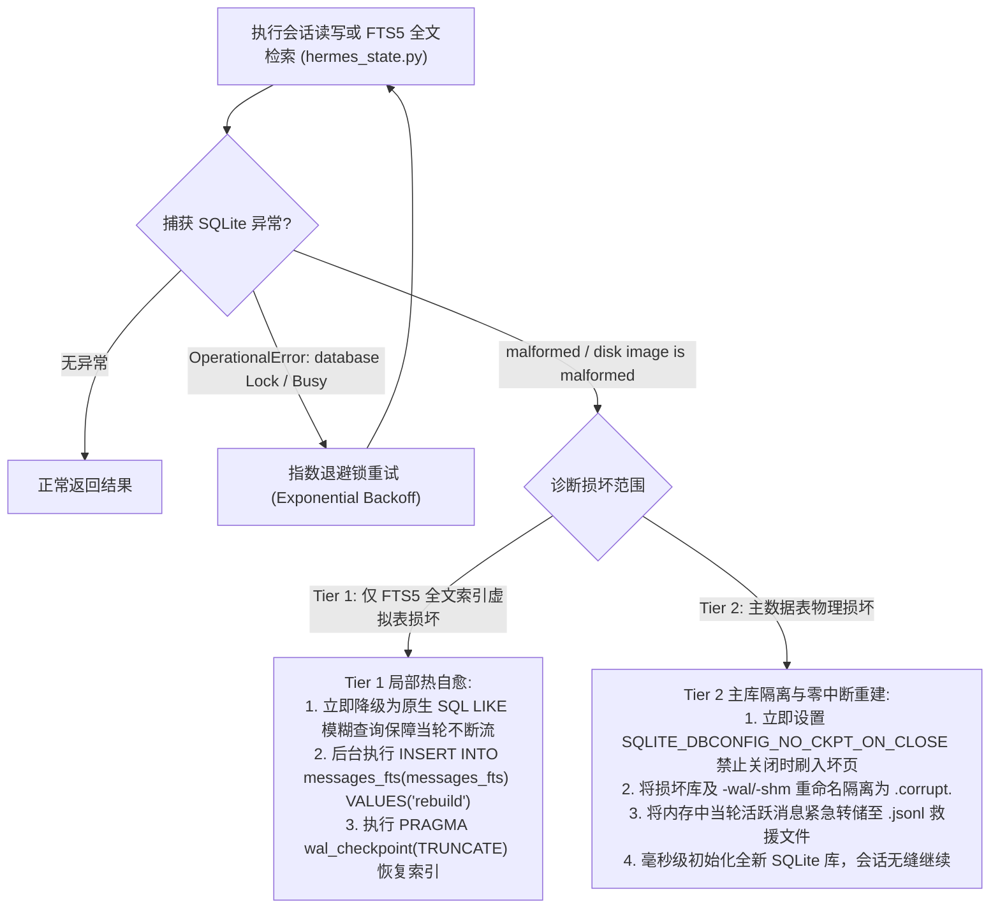

> **核心避坑细节**：当检测到主数据库文件损坏需要关闭句柄并隔离重命名时，**必须先配置 `SQLITE_DBCONFIG_NO_CKPT_ON_CLOSE`**。否则 SQLite 在 `close()` 时会默认尝试将 `-wal` 中的脏页 Checkpoint 刷回主库，不仅会导致二次异常崩溃，还会彻底破坏原本可救援的历史数据页。

---

## 十、 八层纵深安全防御体系（8-Layer Defense-in-Depth Security）

由于 Agent 拥有执行 Shell、读写文件系统和发起网络请求的高权限，任何单一的提示词约束都可能被间接提示词注入（Indirect Prompt Injection，如读取了恶意网页或含毒代码仓库的 `README`）击穿。Hermes 在代码层构筑了**物理强制的 8 层纵深防御流水线**：

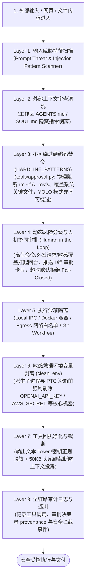

- **Fail-Closed（失败关闭）审批铁律**：在 Layer 4 人机审批挂起期间，若用户未在规定时间内响应或前端连接断开，系统一律按 **`Approval Denied (Timeout)`** 处理，严禁任何形式的“超时默认放行”。
- **YOLO 模式的物理边界**：即便开发者开启了免审批模式（Auto-approve），Layer 3 的 `HARDLINE_PATTERNS` 与 Layer 6 的 `clean_env()` 凭据剥离依然**无条件物理生效**。

---

## 十一、 核心子系统源码全景映射表与文档导航

### 11.1 全量源码模块映射总表

| 架构分层 | 子系统名称 | 核心源码文件 | 关键类 / 函数 / 符号 | 核心职责与阅读切入点 |
|---|---|---|---|---|
| **窄腰核心** | 智能体门面与装配 | `run_agent.py` | `AIAgent`, `run_conversation()` | 整个 Harness 的顶层入口，负责会话初始化、组件装配与生命周期托管 |
| **窄腰核心** | 9 步回合编排主循环 | `agent/conversation_loop.py` | `run_conversation_loop()` | 串联 Step 1 ~ Step 9 的状态机主干，处理迭代循环与退出条件 |
| **窄腰核心** | 前置校验与迭代准备 | `agent/turn_preflight.py`, `agent/turn_iteration_prep.py` | `run_turn_preflight()`, `prepare_iteration()` | 租约检查、中断检测、动态旁路上下文（时间/目录/预算警告）注入 |
| **窄腰核心** | 提示词与前缀缓存 | `agent/prompt_builder.py` | `_build_system_prompt()`, `DEFAULT_AGENT_IDENTITY` | Layer 1/2/3 三层分离组装与 5 秒云盘冷读死锁防护 |
| **窄腰核心** | 出站适配与思维链清洗 | `agent/turn_request_assembly.py`, `agent/think_scrubber.py` | `build_api_kwargs()`, `scrub_thinking()` | Canonical IR 转 OpenAI/Anthropic/Bedrock 格式，剥离 `<think>` 标签 |
| **窄腰核心** | 流式调用与套接字强杀 | `agent/turn_api_call.py`, `agent/chat_completion_helpers.py` | `interruptible_streaming_api_call()`, `_shutdown_stale_attempt_socket()` | 守护线程 SSE 流读取、看门狗监控与 FD 安全的 `shutdown(SHUT_RDWR)` |
| **窄腰核心** | 响应校验与空转自愈 | `agent/turn_response_intake.py`, `agent/turn_response_check.py` | `process_api_response()` | 检测空响应、纯思考链空转重试、解析结构化 `tool_calls` |
| **工具与执行** | 工具轮次并发与屏障 | `agent/turn_tool_round.py`, `agent/turn_tool_validation.py` | `run_tool_round()` | Persist-Before-Execute、`ThreadPoolExecutor` 并发、串行屏障与原序重排 |
| **工具与执行** | 有状态内联工具拦截 | `agent/inline_tool_executors.py` | `_RAW_INLINE_TOOL_EXECUTORS` | 表驱动拦截 `todo`, `memory`, `session_search`, `clarify`, `delegate_task` |
| **工具与执行** | 公开工具注册表 | `tools/registry.py`, `model_tools.py` | `ToolRegistry.register()`, `_extract_schema()` | 导入期自注册、类型注解转 JSON Schema、Toolset 按需披露 |
| **工具与执行** | 编程式代码卸载 (PTC) | `tools/code_execution_tool.py`, `tools/code_kernel.py` | `code_execution_tool()`, `SANDBOX_ALLOWED_TOOLS` | 本地 Unix Domain Socket RPC 桥接、50 次调用预算与 50KB 输出截断 |
| **工具与执行** | 多环境执行沙箱 | `tools/environments/base.py`, `local.py`, `docker.py`, `ssh.py`, `modal.py` | `BaseEnvironment` | 统一封装本地、Docker、SSH、Modal、Daytona、Vercel 执行环境 |
| **子智能体** | 子智能体派生与四重隔离 | `tools/delegate_tool.py`, `agent/async_delegation.py` | `delegate_task()`, `_delegate_depth` | 独立消息历史、Git Worktree 隔离、心跳停滞看门狗与递归深度熔断 |
| **上下文与记忆** | 增量微压缩与 4 阶段压缩 | `agent/micro_compaction.py`, `agent/context_compressor.py` | `maybe_micro_compact()`, `ContextCompressor.compress()` | 大工具输出就地折叠；Head/Middle/Tail 划分、单次辅助总结与滑动窗口降级 |
| **上下文与记忆** | L1-L3 记忆与技能演进 | `agent/memory_manager.py`, `tools/session_search_tool.py`, `agent/curator.py` | `session_search()`, `maybe_run_curator()` | L1 画像快照、L2 FTS5 全文检索、L3 `SKILL.md` 异步提炼与闲置归档状态机 |
| **持久与权威** | SQLite WAL 与分级自愈 | `hermes_state.py`, `hermes_state_*.py` | `SessionDB`, `SessionProfileRepairMixin` | WAL 并发读写、FTS5 在线重建、`NO_CKPT_ON_CLOSE` 主库损坏隔离与 `.jsonl` 救援 |
| **持久与权威** | 单写者网关与 Epoch 栅栏 | `gateway/run.py`, `gateway/bot_loop_guard.py`, `gateway/session_authority.py` | `gateway.sock`, `RuntimeEpoch` | 多端并发连接仲裁、单调纪元租约防脑裂栅栏、入站防抖与自环抑制 |
| **持久与权威** | 多租户路径与平台抽象 | `hermes_constants.py`, `hermes_platform/` | `get_hermes_home()`, `display_hermes_home()` | Profile-aware 状态隔离，严禁硬编码 `~/.hermes` |
| **安全防御** | 8 层防御与人机审批 | `tools/approval.py`, `tools/security.py` | `HARDLINE_PATTERNS`, `request_approval()` | 硬编码毁灭性指令阻断、前端 Diff 审批挂起、子进程敏感环境变量剥离 |
| **外围接入端** | CLI / TUI / Desktop / ACP / Cron | `cli.py`, `tui_gateway/`, `apps/desktop/`, `acp_adapter/`, `cron/scheduler.py` | 薄适配器入口 | 终端 REPL、JSON-RPC TUI 服务、桌面客户端、IDE ACP 协议与定时任务守护 |

---

### 11.2 配套分卷实战专栏与实施手册索引

本文提供完整的**全景架构蓝图**。若需查看**逐行可运行的最小内核原型代码（Minimal Viable Harness）**、**单步断点调试脚本**或各子系统的**专项代码走读与参数规程**，请直接跳转对应分卷：

1. 📘 **[卷一：核心编排回路与快速上手指南 (`01_core_loop_and_quickstart.md`)](file:///Users/fx/wk/github/hermes-agent-0.23.2/docs/harness/01_core_loop_and_quickstart.md)**
   - 包含 180 行零依赖可运行的 Minimal Viable Harness 完整 Python 实现、隔离调试环境配置、`debug_harness.py` 单步断点指南与自定义工具扩展演练。
2. 📗 **[卷二：提示词工程、上下文压缩与多层记忆体系 (`02_prompt_context_and_memory.md`)](file:///Users/fx/wk/github/hermes-agent-0.23.2/docs/harness/02_prompt_context_and_memory.md)**
   - 深入剖析三层提示词代码结构、微压缩与 4 阶段压缩内部方法实现、L1-L3 记忆与 Curator 状态机细节。
3. 📙 **[卷三：工具系统、编程式代码卸载与子智能体编排 (`03_tools_execution_and_subagents.md`)](file:///Users/fx/wk/github/hermes-agent-0.23.2/docs/harness/03_tools_execution_and_subagents.md)**
   - 深入剖析 `@registry.register` Schema 抽取、内联拦截器实现、PTC Unix Socket RPC 通信协议与 Subagent 隔离细节。
4. 📕 **[卷四：多模型适配、网关单写权威、容灾自愈与纵深防御 (`04_providers_gateway_disaster_recovery_and_security.md`)](file:///Users/fx/wk/github/hermes-agent-0.23.2/docs/harness/04_providers_gateway_disaster_recovery_and_security.md)**
   - 深入剖析 Canonical IR 出站转换、`shutdown(SHUT_RDWR)` 底层机制、`gateway.sock` 并发控制、SQLite 自愈流程与 8 层防御代码实现。
5. 🛠️ **[Harness 开发者实施手册 (`harness-developer-notes.md`)](file:///Users/fx/wk/github/hermes-agent-0.23.2/docs/harness/harness-developer-notes.md)**
   - 涵盖“缰绳工程（Harness Engineering）”演进与 OpenClaw 15 维对比、五层垂直架构与自学习闭环、四层温度记忆系统（热/温/冷/外部记忆与 Honcho 用户建模、`SOUL.md`/`USER.md`/`MEMORY.md` 协同规范）、12 大子系统“痛点 $\rightarrow$ 决策 $\rightarrow$ 规格 $\rightarrow$ 避坑红线”矩阵与高频故障排查 Runbook。
