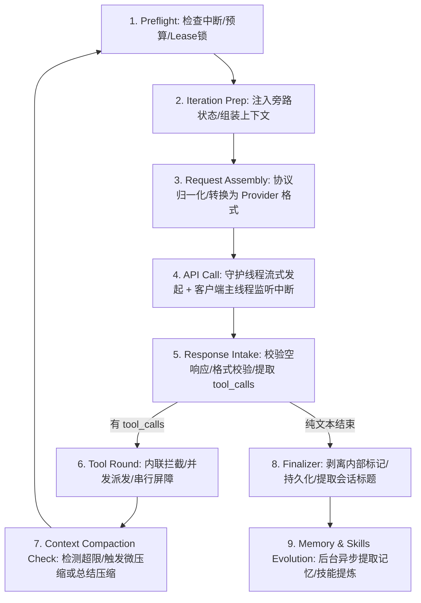

# 04_hermes_agent_harness_deep_dive.md
# 通用 AI Agent Harness 架构与工程实现深度解析（以 Nous Research Hermes Agent 为参考范本）

## 一、 什么是 AI Agent Harness：核心边界与“单核窄腰”范式

### 1.1 Model 与 Harness 的本质分野

在现代自主智能体（Autonomous Agent）工程中，**大语言模型（LLM）本身并不是一个完整的 Agent，而是一个无状态的概率推理内核（Stateless Reasoning Kernel）**。模型只负责在给定 Token 序列的条件下预测下一段文本或结构化工具调用请求；而将这一推理内核封装为具备持久记忆、长程规划、环境感知、工具执行、故障自愈与安全边界的运行时底座，即为 **AI Agent Harness（智能体运行时框架/控制底座）**。

如果用操作系统作类比，LLM 相当于 CPU 的算术逻辑单元（ALU），而 **Harness 则是完整的操作系统内核（OS Kernel）**：

| 操作系统概念 | AI Agent Harness 对应子系统 | 解决的核心工程问题 | 参考实现（Hermes Agent） | 
| ----- | ----- | ----- | ----- | 
| **进程调度器（Scheduler）** | **编排控制回路（Orchestration Loop）** | 管理“思考 $\rightarrow$ 动作 $\rightarrow$ 观察”的回合状态机、流式中断、重试退避与预算熔断 | `AIAgent.run_conversation()` 与 `agent/turn_*.py`（`conversation_loop.py`） | 
| **L1/L2 高速缓存控制器** | **提示词组装与前缀缓存引擎（Prompt & Prefix Cache Engine）** | 防止动态状态击穿服务商 KV Cache，降低首字延迟（TTFT）与推理成本 | 三层静态组装 + 单次用户消息旁路通道（`agent/prompt_builder.py`） | 
| **虚拟内存与分页管理（MMU）** | **上下文窗口治理引擎（Context Governance & Compaction）** | 在有限上下文窗口内平衡历史保真度与信噪比，避免“中间迷失”与窗口溢出 | 锚点计量 + 4 阶段压缩 + 增量微压缩（`agent/turn_context_compaction.py`, `context_compressor.py`） | 
| **系统调用与设备驱动（Syscalls）** | **工具运行时与认知卸载（Tool Runtime & Cognitive Offloading）** | 上百个工具的按需披露、并发/串行屏障调度、多步循环逻辑向沙箱脚本卸载 | 渐进式披露 `tool_search` + 本地 RPC `execute_code` + `tools/registry.py` | 
| **多进程派生与 IPC（Fork/Wait）** | **子智能体并发编排（Subagent Orchestration）** | 将复杂任务拆解给隔离上下文的子智能体，处理并发冲突、死锁检测与带外干预 | `delegate_task` + 心跳停滞检测器 + Worktree 隔离（`tools/delegate_tool.py`, `agent/async_delegation.py`） | 
| **文件系统与持久化存储（VFS）** | **多层记忆与自演进闭环（Multi-Tier Memory & Self-Improvement）** | 区分常驻核心画像、跨会话情景检索与可复用操作规程（SOP），实现经验沉淀与防膨胀治理 | L1 双文件快照 + L2 SQLite FTS5 + L3 Skills 闭环（`agent/memory_*.py`, `agent/curator.py`） | 
| **分布式锁与事务日志（WAL）** | **单一会话权威与状态恢复（Single-Writer Session Authority）** | 多终端（CLI/桌面/移动端/IM）附着同一会话时的并发写仲裁、崩溃防重放与损坏降级 | `gateway.sock` 单写者 + `runtime_epoch` 栅栏 + WAL（`gateway/run.py`, `hermes_state.py`） | 
| **内核安全模块（LSM / SELinux）** | **纵深防御与权限审批（Defense-in-Depth Security）** | 拦截毁灭性命令、防范提示词注入、隔离沙箱与过滤敏感凭据输出 | 8 层纵深防御 + 不可绕过 `HARDLINE_PATTERNS`（`agent/approval.py`, `tools/security.py`） | 

### 1.2 通用 Harness 的“单核窄腰（Narrow Waist）”架构模式

#### （1）通用工程痛点：多入口状态分裂与维护灾难
一个生产级 Agent 往往需要同时服务于本地终端（CLI/TUI）、桌面 GUI、IDE 插件（如 ACP 协议）、多平台即时通讯网关（Telegram、Discord、Slack、飞书、微信等）、Web 控制台与定时后台任务（Cron）。如果各个入口各自实现与 LLM 交互的驱动逻辑，势必引发严重问题：
1. **System Prompt 碎片化**：不同前端对系统提示词、工具声明、运行环境信息的拼接格式不一致，导致模型行为在不同入口间产生微妙分裂。
2. **上下文治理与缓存折扣失效**：各个前端各自维护对话历史截断策略，服务商的前缀缓存（Prefix Caching）命中率归零，大幅推高推理开销。
3. **安全拦截逻辑漏出**：如果在某些前端未能严格实施危险 Shell 审批拦截，整个系统最薄弱的一环将暴露给提示词注入反弹攻击。

#### （2）架构解法：极简核 + 边缘扩展
Hermes 坚守 **单核窄腰（Narrow Waist）** 范式：
- **核心（Core）做减法**：核心仅负责“单一会话回合状态机、统一工具注册与调度、上下文压缩与提示词缓存、严格角色交替校验”。模型发出的每一个 API 调用都共享相同的核心约束。
- **边缘（Edges）做加法**：所有的宿主适配器（CLI REPL、Electron 桌面、Gateway IM 适配器、ACP Server）、模型提供商插件（OpenAI、Anthropic、Bedrock 等）、执行沙箱环境（Docker、SSH、Modal 等）均作为外围插件挂载在窄腰两侧。

---

## 二、 编排回路与回合状态机（Orchestration Loop Internals）

### 2.1 状态机 9 步生命周期

每一次用户输入或事件触发，Harness 驱动一次完整的对话回合，内部状态机流转如下：

1. **Preflight（前置校验）**：检查 `_interrupt_requested`，校验 `max_iterations` 与消耗预算（Iteration Budget），获取该会话的独占执行锁。
2. **Iteration Prep（迭代准备）**：确定当前轮次的 System Prompt 与消息历史；将易变的运行时状态（如子目录 AGENTS.md 提示、动态工具结果）以用户消息或工具结果附加注入，绝对不修改 System Prompt。
3. **Request Assembly（请求组装）**：将规范内部中间表示（Canonical IR）转换为目标 Provider 所需的 API 格式（OpenAI / Anthropic / Codex responses 等）。
4. **API Call & Stream Watchdog（流式调用与看门狗）**：底层 HTTP 流式传输交由后台守护线程，主线程定时 poll 中断标志；支持流式卡死超时降级。
5. **Response Intake & Validation（响应接收与校验）**：处理空响应、纯思考链（Thinking-only）空转重试、解析 `tool_calls`。
6. **Tool Round Dispatch（工具调度轮次）**：
   - **内联核心工具拦截**：`todo`、`memory`、`session_search`、`delegate_task` 由主循环直接拦截执行，读写状态机。
   - **普通工具并发派发**：无状态/IO 读写工具通过 `ThreadPoolExecutor` 并发执行。
   - **交互与屏障工具**：`clarify`（交互式询问用户）、MCP 耗时工具作为串行屏障等待。
   - **严格顺序写回**：工具执行结果按模型原始请求顺序对齐插入，保证消息历史顺序绝对合法。
7. **Context Compaction Check（上下文压缩检查）**：比较当前 Token 量与设定的触发阈值；若超限，自动执行微压缩（Micro-compaction）或 4 阶段总结压缩，并原子替换历史消息。
8. **Finalizer（回合收尾）**：清空当轮临时标记，批量持久化消息到 SQLite WAL 库，触发 UI 完成回调与用量核算。
9. **Evolution & Memory Flush（演进与记忆刷盘）**：在会话结束或特定触发点，异步派生 Curator 与 Memory Provider 线程，提取重要事实与生成新 Skill。

### 2.2 角色交替不变量（Message-Flow Invariants）

主流大模型推理服务（尤其是 Anthropic Claude、Google Gemini 以及 OpenAI 结构化接口）对请求中的消息序列有严格校验：
1. **严禁连续同角色消息**：必须满足 `user -> assistant -> user -> assistant`。
2. **工具调用与返回强配对**：若前一条为包含 `tool_calls` 的 `assistant` 消息，后续**紧接着的若干条消息必须全部为 `tool` 角色**，且 `tool_call_id` 必须与请求中的 ID 一一对应、顺序闭合，之后才能再次出现 `assistant` 或 `user`。
3. **中断即闭合丢弃（Discard-on-Interrupt）**：若在模型流式输出或工具执行途中用户按下 Ctrl+C 或点击 Stop：
   - 绝不将未完成的半截 `assistant` 响应持久化到历史中；
   - 若模型已输出 `tool_calls` 但工具被中断未执行，合成结构化的错误占位响应（例如 `{"error": "Execution interrupted by user"}`）写入 `tool` 消息，强制闭合工具调用链，防止下一次进入对话时模型服务报 400 校验错误。

---

## 三、 提示词缓存与上下文治理（Prompt Caching & Context Compaction）

### 3.1 前缀缓存（Prefix Caching）的三层组装策略

服务商前缀缓存（如 Anthropic Prompt Caching、OpenAI Prompt Caching、DeepSeek Context Caching）要求**字节级的前缀完全一致**才能命中缓存并享受最高 90% 的成本与延迟折扣。

Hermes 将提示词严格分层：
- **Layer 1: 绝对静态前缀（Base System Prompt）**：包括身份设定、核心工具规范、安全协议。会话生命周期内绝对不发生逐字变动。
- **Layer 2: 启动时一次性冻结层（Session Context）**：启动时扫描的工作区 `.hermes/` 配置、根目录 `AGENTS.md`、用户全局画像。一旦会话开启，该层即刻冻结。中途执行 `/skills install` 等命令默认在下一次会话生效，除非显式指定 `--now`。
- **Layer 3: 动态易变状态旁路通道（Ephemeral Bypass Channel）**：
  - 当前时间戳、系统电量、实时网络状态；
  - 切换工作目录触发的子目录 `AGENTS.md` 提示；
  - 人工干预控制指令（`/steer`）。
  **实现规则**：这些动态信息**严禁追加或修改到 System Prompt**，必须以附加信息包裹在**单次用户消息**（User Message）或**工具返回消息**（Tool Result Message）中。

### 3.2 上下文分级压缩策略（4-Stage Compaction + Micro-Compaction）

当上下文接近模型物理上限或用户配置的上下文阈值时，若直接生硬截断，会导致 Agent 遗忘最初目标或丢失关键执行结果。

1. **增量微压缩（Incremental Micro-compaction）**：
   - 针对早先轮次中产生海量输出但已完成使命的工具调用（如 `read_file` 读入了几千行日志、`search_files` 返回了长列表），保留其调用元数据与摘要行，将正文替换为精简占位符，在不打破近期上下文连贯性的前提下回收 30%~60% 的 Token。
2. **四阶段全量压缩（4-Stage Compaction）**：
   - **Phase 1: 锚点保留**：提取首轮用户 Prompt、全局系统约束作为不可压缩核心。
   - **Phase 2: 结构化事实提取**：调用辅助轻量模型（Auxiliary LLM），将历史对话提炼为具备精确任务状态、已完成子任务清单、残留未决问题的结构化中间表。
   - **Phase 3: 上下文重建与原子置换**：生成包含压缩摘要的合成系统提示/历史消息，更新 SessionDB 中的活跃状态标记。
   - **Phase 4: 降级回退看门狗**：若辅助 LLM 总结过程超时或失败，自动启动基于规则的确定性降级截断，确保主会话永远不会因压缩失败而挂死崩溃。

---

## 四、 工具运行时与代码化卸载（Tools Runtime & Code Execution）

### 4.1 导入期自注册与拦截机制
- 内置工具通过 `@registry.register` 在导入时完成自发现，支持声明依赖环境变量、Schema 及可用性检查回调（`check_fn`）。
- **四类有状态核心工具在主循环直接拦截**：`todo`（任务看板）、`memory`（长期记忆提取/查询）、`session_search`（历史会话检索）、`delegate_task`（子任务派生），其余普通工具交由底层驱动执行。

### 4.2 编程式工具卸载（`execute_code`）
面对需要在数十个文件或复杂数据流中循环处理的任务，让大模型反复通过 ReAct 循环逐个调用单步工具会消耗数十轮 API 并极易迷失。
- Harness 提供 `execute_code` 工具，允许模型编写 Python 脚本；
- 脚本内可通过标准语法 `from hermes_tools import web_search, read_file, patch` 调用 Harness 暴露的所有工具；
- **IPC 桥接**：在本地通过 Unix Domain Socket RPC 与父进程 Harness 通信，将数十步繁重的过滤与重试逻辑卸载到本地沙箱解释器中运行，最后仅返回最终收敛结果，降低 90% 的交互轮次与延迟。

---

## 五、 多智能体派生与并发治理（Subagent Orchestration）

### 5.1 隔离性与上下文克隆
- 通过 `delegate_task` 派生子智能体（Subagent）。
- 子智能体拥有独立的上下文窗口与消息历史，绝不照搬父智能体的冗长历史；
- 子智能体复用父智能体冻结的 System Prompt 静态前缀，从而共享前缀缓存；
- 针对代码修改场景，通过 Git Worktree 实现文件系统工作区物理隔离，避免多个子智能体并发修改同一份代码造成冲突踩踏。

### 5.2 停滞检测与软超时（Heartbeat Stagnation Detection）
- 摒弃脆弱的固定物理总超时（Wall-clock Timeout）；
- 采用基于心跳与状态推进的**停滞看门狗（Stagnation Watchdog）**：只要子智能体在持续产生工具调用、文件变动或流式输出，即便运行数十分钟也绝不中断；仅当连续数分钟无任何状态变动或网络 IO 时，判定为死循环/挂死并执行阶梯回收。

---

## 六、 状态持久化、单写权威与容灾（Session Authority & Disaster Recovery）

### 6.1 单写权威（Single-Writer Authority）
- 多个客户端界面（CLI、桌面、IM、Web）允许同时附着到同一个会话查看实时进度；
- 仅有一个中央网关（Gateway）进程持有底层 SQLite 数据库的主写入权与核心编排回路；
- 本地 CLI 发现常驻网关在线时，自动退化为轻量 WebSocket 客户端；通过 Unix Domain Socket 凭据进行 UID 本地鉴权，保障跨进程通信绝对安全。

### 6.2 SQLite 事务与故障隔离
- 启用 SQLite WAL（Write-Ahead Logging）模式与合理的事务锁控制，支持并发安全读取；
- **分级损坏自愈**：
  - FTS5 全文索引表损坏时，捕获错误并自动降级为原生 `LIKE` 模糊查询，在后台静默异步重建索引；
  - 主数据库发生底层损坏时，立即设置连接安全标志禁止刷入坏页，将旧库重命名现场隔离，内存当轮消息转储为 `.jsonl` 救援文件，毫秒级初始化新库保障服务零中断。

---

## 七、 安全纵深防御（Defense-in-Depth Security）

### 7.1 八层防御体系与硬阻断
1. **硬编码不可绕过黑名单（`HARDLINE_PATTERNS`）**：
   - 彻底拦截 `rm -rf /`、格式化硬盘、覆写根设备等毁灭性指令；
   - 即使开启自动免审批模式（YOLO 模式），硬阻断规则依然物理强制生效。
2. **环境隔离与凭据脱敏**：
   - 执行脚本与沙箱容器内自动剥离 `OPENAI_API_KEY` 等核心敏感环境变量；
   - 工具执行日志与网络外发过滤器对敏感 Token 自动执行哈希与脱敏。
3. **交互式审批确认机制**：
   - 针对高危系统修改、文件批量覆盖或网络外发，触发 `ask_approval` 机制，在前端界面挂起等待操作者显式确认。
