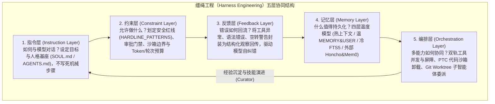
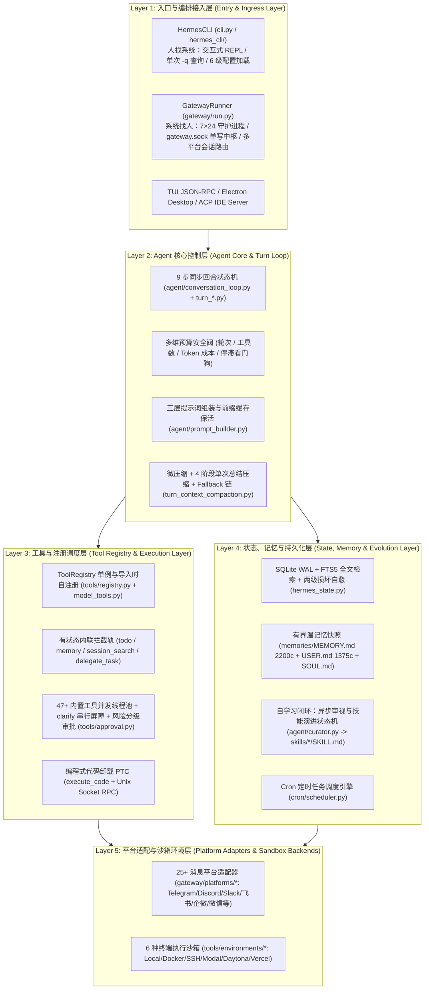
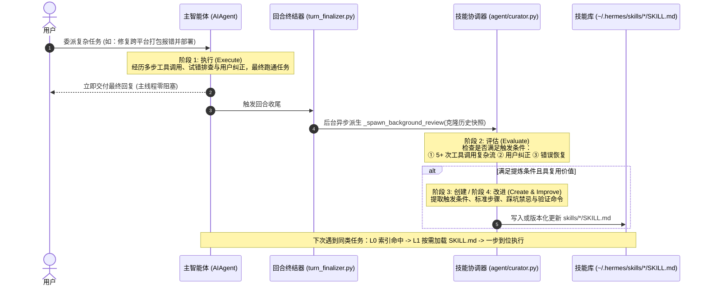
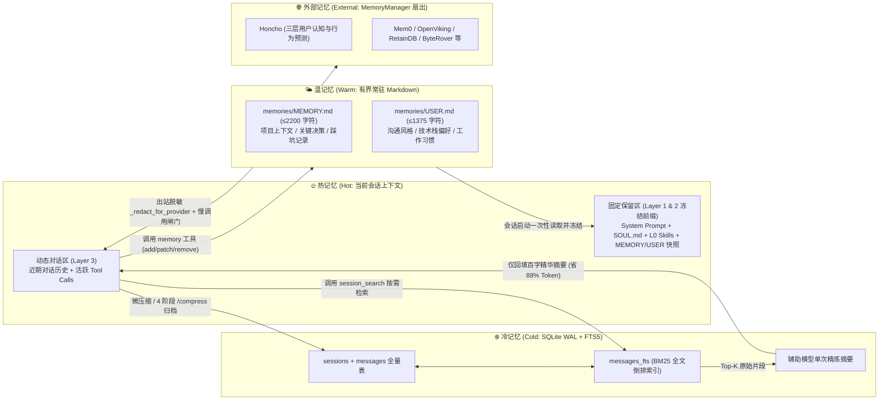

# Harness 开发者实施手册：缰绳工程演进、五层核心架构、四层温度记忆与工程决策规格

> **文档定位**：本文是与《[AI Agent Harness 架构与工程实现全景解析 (`harness-deep-dive.md`)](file:///Users/fx/wk/github/hermes-agent-0.23.2/docs/harness/harness-deep-dive.md)》配套的**工程实施与深度实战手册**。它系统整合了 **Hermes 诞生与“缰绳工程”（Harness Engineering）演进哲学**、**五层垂直架构深度拆解与自学习闭环**、**四层温度记忆系统（热/温/冷/外部记忆与 Honcho 用户建模）详解**，以及 **12 大核心子系统的“痛点 $\rightarrow$ 决策 $\rightarrow$ 实现规格 $\rightarrow$ 避坑指南”与排障手册（Troubleshooting Runbook）**。所有设计原则与参数规格均严格对齐 Nous Research Hermes Agent 生产代码库。

---

## 一、 范式演进：从 Prompt Engineering、OpenClaw 到“缰绳工程”（Harness Engineering）

### 1.1 传统 Prompt Engineering 的四大工程局限

早期 Agent 开发过度依赖提示词工程（Prompt Engineering），在单次短对话中尚可运作，但在长周期、多工具的生产环境中存在四个根本性瓶颈：

| 局限维度 | 工程表现与失效机理 | Harness 架构级解法 |
|---|---|---|
| **1. 提示词膨胀与注意力稀释** | 随着规则增加，System Prompt 从百字膨胀至数万字；挤占上下文窗口，触发大模型“中间迷失（Lost-in-the-Middle）”，首尾核心约束被遗忘 | **三层提示词分离 + 渐进式披露**：基础身份极简固定；技能与长尾工具仅暴露 L0 目录（~3k tokens），按需动态加载详情 |
| **2. 静态文本无法适应动态环境** | 真实世界的 API、目录结构、项目状态实时变化；静态写死的 Prompt 每次面对环境变更都需人工改写，无法规模化运维 | **运行时环境感知与自学习闭环**：通过旁路通道动态注入环境快照，并在任务完成后由 `curator.py` 自动沉淀/更新 `SKILL.md` |
| **3. 会话间彻底失忆（每次归零）** | 新开会话即回到“白纸状态”，用户不得不反复重申代码规范、架构背景与个人偏好，协作摩擦极高 | **四层温度记忆体系**：`USER.md`（用户画像）+ `MEMORY.md`（项目笔记）跨会话常驻冻结层，配合 SQLite FTS5 历史按需召回 |
| **4. 高度依赖个人手艺，缺乏工程确定性** | 提示词调优属于“玄学手艺”，不同开发者写出的指令效果方差极大，且无法防止模型幻觉导致的死循环或高危命令执行 | **确定性状态机与硬边界约束**：用 9 步回合状态机、配对闭合校验、预算安全阀与 `HARDLINE_PATTERNS` 替代脆弱的“口头叮嘱” |

---

### 1.2 什么是“缰绳工程”（Harness Engineering）？

如果将大语言模型（LLM）比作一匹聪明但容易跑偏的野马：
- **传统规则引擎 / 死板工作流**像是用**铁链锁死**：规定死每一步 if-else，虽然安全，但彻底丧失了模型的推理灵活性与涌现创造力；
- **裸模型自由放养（AutoGPT 式纯循环）**像是**毫无约束地放归荒野**：极易陷入无限死循环、打爆 API 账单，甚至执行 `rm -rf` 酿成生产事故；
- **缰绳工程（Harness Engineering）**则是为智能体**戴上缰绳（Harness）**：**不是死板控制每一步动作，而是划定不可逾越的边界与反馈回路；在边界之内赋予模型最大的自主探索空间，在越界或出错时精准拉回并引导其自我进化。**

#### 缰绳工程的五层核心结构



#### 缰绳工程的四大核心哲学
1. **不是控制 AI，而是引导 AI 自我成长**：给 Agent 一套可复盘的学习机制（自学习闭环），让它在实践中把踩坑经验固化为可复用的 `SKILL.md`。
2. **边界（Boundaries）比规则（Rules）更重要**：与其枚举一万条“你应该怎么做”，不如严守底线“你绝对不能越过哪些安全与预算边界”，边界之内由模型自主规划最优路径。
3. **错误是学习的原料而非崩溃的终点**：工具报错绝不直接抛出未捕获异常终止进程，而是转化为高信噪比的诊断上下文，让模型在当前回合修正参数重试，并在事后记录避坑指南。
4. **记忆与人格必须是有界且有机生长的**：拒绝无上限的垃圾数据堆积，通过有界容量（`2200` / `1375` 字符上限）倒逼模型做信息优先级整合。

---

### 1.3 从 OpenClaw 到 Hermes：架构痛点攻坚与代际演进

Hermes Agent 在吸取早期开源标杆项目（如 OpenClaw）工程经验的基础上，针对生产落地的五大核心痛点进行了底层重构：

| OpenClaw 核心痛点 | 根因分析 | Hermes Agent 架构级突破 | 对应源码实现 |
|---|---|---|---|
| **1. 资源占用重，低配机器跑不动** | 基于重型 Node.js 网关与多服务架构，常驻内存往往高达 1.5GB~2GB+ | **纯 Python 轻量单核窄腰架构**：零冗余中间件，空闲内存仅 **~50MB**，常规运行 **150~300MB**，5 美元 VPS 即可流畅托管 | `run_agent.py`, `gateway/run.py`, `hermes_state.py` |
| **2. 静态 `SOUL.md` 维护繁琐，不会随交互演进** | 人格与记忆耦合在静态配置文件中，不会根据日常交互自动更新用户偏好 | **静态基座与动态温记忆解耦**：`SOUL.md` 管核心人格基座，`USER.md`（1375 字符）与 `MEMORY.md`（2200 字符）随对话自动演进 | `hermes_cli/default_soul.py`, `tools/memory_tool.py` |
| **3. 缺乏自学习能力，重复任务每次从头试错** | 仅作为“超级工具调用器”，成功解决复杂问题后不会留存方法论 | **内置自学习闭环（Self-Learning Loop）**：完成复杂任务或经历纠错后，后台异步提炼生成/升级 `SKILL.md`，下次直接复用 | `agent/turn_finalizer.py`, `agent/curator.py` |
| **4. 技能生态数量庞大但良莠不齐、撑爆上下文** | 社区上万个技能若全量塞入 Prompt 会瞬间挤爆上下文且充满噪声 | **三级渐进式技能加载 + 四级信任体系 + 闲置归档状态机**：L0 仅暴露目录，按需加载 L1/L2；30 天不用自动软归档移出激活集 | `agent/prompt_builder.py`, `agent/curator.py`, `tools/skills_tool.py` |
| **5. 失控循环与 API 账单爆炸风险** | 缺乏细粒度的回合、工具调用次数与成本硬熔断机制 | **多维预算安全阀 + 阶梯告警 + Fallback 链**：在 70%/90% 阈值注入收敛提示，达上限强制优雅收尾；支持多模型故障无缝降级 | `agent/turn_preflight.py`, `agent/turn_iteration_prep.py` |

#### Hermes Agent vs OpenClaw 15 维架构全景对比

| 对比维度 | Hermes Agent（“养马”生态） | OpenClaw（“养虾”生态） | 选型与架构启示 |
|---|---|---|---|
| **核心语言与运行时** | Python 3.11+（93.6%），轻量级进程 + SQLite WAL | TypeScript / Node.js（90.3%），重型网关架构 | Python 天然契合 AI 工具链、科学计算与本地脚本卸载 |
| **架构范式** | **单核窄腰（Narrow Waist）** + 五层垂直解耦 | 多模块网关驱动架构 | 窄腰设计确保 25+ 平台与 CLI 共享完全一致的缓存与状态机 |
| **自学习与进化** | **自动创建、版本化演进并淘汰 `SKILL.md`** | 需手动编写或从 ClawHub 下载静态技能 | 从“工具调用器”跃迁为“会自创招式的数字搭档” |
| **记忆系统模型** | **四层温度模型**（热上下文 + 温有界 MD + 冷 FTS5 + 8 种外部扩展） | 模块化文件（`SOUL.md` + `USER.md` + Session） | 温度分层兼顾了 0 延迟常驻偏好与 GB 级历史秒级按需检索 |
| **人格与画像演进** | `SOUL.md`（静态基座）+ `USER.md` / `MEMORY.md`（动态生长）+ Honcho 认知建模 | `SOUL.md` 静态配置驱动 | 静态灵魂保底线，动态画像与行为推导实现“越用越懂你” |
| **技能加载机制** | **三级渐进式披露**（L0 索引 $\rightarrow$ L1 技能体 $\rightarrow$ L2 附属文件） | 静态注入或常规插件加载 | 彻底解决上百个技能并存时的 System Prompt 膨胀问题 |
| **认知卸载（PTC）** | **原生支持 `execute_code` 本地 Unix Socket RPC 批处理卸载** | 传统单步 ReAct 工具循环为主 | 20 步批处理文件/API 任务压缩为 1 次推理轮次，省 80%+ Token |
| **多端并发一致性** | **`gateway.sock` 单写者权威 + `runtime_epoch` 纪元隔离栅栏** | 网关中心化路由 | 数学级杜绝多终端同时操作引发的 `SQLITE_BUSY` 与状态脑裂 |
| **流式中断安全性** | **跨线程 FD 安全 `shutdown(SHUT_RDWR)` + 中断即丢弃/配对闭合** | 常规异步取消 | 彻底消除多线程 `close(fd)` 导致的描述符复用与数据库写坏竞态 |
| **成本与失控控制** | 轮次/工具数/成本预算安全阀 + 4 阶段压缩 + 模型 Fallback 链 | 模型 Fallback 链 | 生产环境 7×24 小时无人值守运行的必备防线 |
| **安全防御体系** | **8 层纵深防御**（`HARDLINE_PATTERNS` + 交互审批 + 6 类沙箱 + 凭据剥离） | 分级沙箱体系 | 兼顾本地开发的便利性与生产沙箱（Docker/Modal/Daytona）的严密隔离 |
| **外部记忆生态** | 原生插件接口（Honcho / Mem0 / OpenViking / RetainDB / ByteRover 等 8 种） | 社区插件对接 | 内置 `_StuckCallGate` 慢调用熔断与出站强制脱敏，防止外部服务拖垮主进程 |
| **数据库容灾自愈** | **SQLite WAL 两级自动修复**（FTS5 在线重建 + 主库损坏隔离与 `.jsonl` 救援） | 依赖人工修复或备份恢复 | 断电或云盘同步冲突导致数据库损坏时实现毫秒级无感自愈 |
| **平台与生态接入** | CLI / TUI / Electron Desktop / IDE ACP / 25+ IM 平台 / Cron | 26+ IM 平台 + iOS/Android 移动端 | 全覆盖开发者桌面工作流（IDE ACP + TUI）与即时通讯群组 |
| **跨框架无缝迁移** | 原生支持 `hermes migrate`（通过 `agent-importers` 一键迁移配置/记忆/技能） | 原生格式 | 极低迁移阻力，支持从 OpenClaw 等存量 Agent 平滑过渡 |

---

## 二、 五层垂直架构深度解析与“自学习闭环”实现机制

如果从垂直分层视角剖析 Hermes Agent，整个系统由上至下可划分为职责严密解耦的 **五层架构（5-Layer Architecture）**，其中 Layer 2 与 Layer 3/4 的核心交汇处构成了著名的“单核窄腰”：



---

### 2.1 Layer 1：入口与编排接入层（6 级配置优先级与三入口共存）

1. **三入口共存模型**：
   - **CLI 入口（`cli.py`, `hermes_cli/`）**：“人找系统”模式，适合本地开发调试、管道脚本自动化（`hermes -q "..."`）与交互式会话。当检测到本地 `gateway.sock` 活跃时，可协同退让写权。
   - **Gateway 入口（`gateway/run.py`）**：“系统找人”与 7×24 小时值守模式，同时监听 25+ 消息平台 Webhook / 长连接，将异构平台消息归一化为标准入站上下文，并作为**单一写权威（Single-Writer Authority）**统一调度会话。
   - **RPC / SDK 入口（`tui_gateway/`, `acp_adapter/`）**：面向 TUI 终端界面、Electron 桌面端与 VS Code / Cursor / Zed 等 IDE 的标准化协议服务。
2. **6 级配置优先级契约（由高到低）**：
   1. **环境变量（Environment Variables）**：如 `HERMES_HOME`、`OPENAI_API_KEY`、`HERMES_MAX_ITERATIONS`（适合容器化与 CI/CD 注入）；
   2. **CLI 命令行参数**：如 `--model`、`--profile`、`--ignore-rules`（适合单次临时覆盖）；
   3. **项目级配置（Project Config）**：当前工作区下的 `.hermes/config.yaml` 或 `.hermes.md` / `AGENTS.md`；
   4. **Profile 用户级配置（User Profile Config）**：`get_hermes_home() / "config.yaml"`（默认 `~/.hermes/config.yaml` 或 `~/.hermes/profiles/<name>/config.yaml`）；
   5. **系统级全局配置**：`/etc/hermes/config.yaml`；
   6. **内置默认 schema（`hermes_cli/config_defaults.py`）**：零配置启动保底。

---

### 2.2 Layer 2：Agent 核心层（预算安全阀、错误恢复与模型 Fallback 链）

除了 `harness-deep-dive.md` 详述的 9 步回合状态机外，Layer 2 在工程实施中必须落实三大稳定性机制：

1. **多维预算安全阀（Budget Safety Valve）**：
   防止模型在复杂任务中陷入无限工具调用死循环或打爆 Token 账单：
   - **迭代轮次预算（Iteration Budget）**：默认单回合最大循环轮次（如 50/90 轮）。在达到 **70%** 预算时，由 `agent/turn_iteration_prep.py` 通过旁路 User 消息注入温和收敛提示；达到 **90%** 时注入强制收尾警告；达到 **100%** 时平滑熔断并汇总当前进展返回用户。
   - **单脚本 RPC 预算**：在 `execute_code` 沙箱中硬限制最多调用 **50 次**（`DEFAULT_MAX_TOOL_CALLS = 50`）底层工具。
   - **停滞心跳看门狗（Stagnation Watchdog）**：监控有效进展信号（新 Token 产出、工具调用完成、文件写入），若连续无进展超时则触发中断回收。
2. **双层错误自愈机制（LLM API 容错 + 工具执行容错）**：
   - **LLM API 调用容错与 Fallback 链**：遇到 `429 Rate Limit`、`502/503` 或网络抖动时，先按指数退避（Exponential Backoff + Jitter）重试；若主模型持续不可用，自动按配置的 Fallback 链无缝切换至备用 Provider/模型（例如 `Claude-3.7-Sonnet -> GPT-4.1 -> DeepSeek-V3 -> 本地 Ollama`），由于历史采用 Canonical IR 存储，中途切模型零格式冲突。
   - **工具执行异常回流**：工具执行失败（如文件不存在、命令返回非零退出码、JSON 参数校验失败）时，**严禁抛出未捕获异常中断主循环**。必须捕获并格式化为结构化错误文本回填至 `role: "tool"` 消息中，交由模型在下一轮自主修正参数或切换方案。

---

### 2.3 Layer 3：工具与注册调度层（`ToolRegistry` 单例、自注册与三级审批）

1. **`ToolRegistry` 单例与模块导入自注册（`tools/registry.py`）**：
   - 采用全局注册表设计。每个工具模块在导入时通过 `@registry.register(...)` 声明名称、工具集分组（`toolset`）、JSON Schema 参数定义、处理器函数（`handler`）以及动态可用性检查钩子（`check_fn`，例如检测环境变量或二进制依赖是否就绪）。
   - **解耦收益**：新增内置工具或外部插件工具时，无需修改 `run_agent.py` 或 `conversation_loop.py` 的任何一行核心代码。
2. **47+ 内置工具的六大分类架构**：
   - **文件与代码编辑类**：`read_file`, `write_file`, `patch` / `edit_file`, `search_files` (ripgrep), `list_dir`
   - **终端与代码沙箱类**：`terminal` / `bash`（支持前台阻塞与后台常驻进程监控）, `execute_code`（PTC 编程式沙箱卸载）, `process_wait` / `process_kill`
   - **Web 与浏览器自动化类**：`web_search`, `web_extract`, `browser_*`（基于 CDP / Playwright 的真实浏览器交互）
   - **记忆与历史检索类**：`memory`（温记忆 `MEMORY.md` / `USER.md` 增删改批处理）, `session_search`（冷记忆 SQLite FTS5 跨会话全文检索）
   - **技能、规划与多智能体类**：`todo`（回合内任务清单追踪）, `skills_list` / `skill_view` / `skill_manage`, `delegate_task`（派生 Git Worktree 隔离的子智能体）
   - **人机协同、平台与定时调度类**：`clarify`（向用户发起阻塞式提问，作为并发轮次的串行屏障）, `send_message` / `cron_*`（跨平台主动通知与定时任务管理）
3. **三级风险分类与人机协同审批流（`tools/approval.py`, `tools/write_approval.py`）**：
   - **Level 1（Safe / 只读无副作用）**：如 `read_file`, `search_files`, `session_search`，默认直接静默放行；
   - **Level 2（Moderate / 受控变更）**：如普通工作区文件写入、常规网络请求、后台记忆更新，按配置直接执行或挂起分阶段写入（`_gate_or_stage`）并记录审计日志；
   - **Level 3（Dangerous / 高危副作用）**：如执行含破坏性风险的 Shell 命令、覆盖核心指令文件（`SOUL.md` / `AGENTS.md`）、外发敏感请求：
     - 先过 **`HARDLINE_PATTERNS` 硬禁令**（如 `rm -rf /`、`mkfs`、反弹 Shell），命中则**物理拒绝（哪怕开启了免审批 YOLO 模式也绝不放行）**；
     - 未命中硬禁令但属高危操作时，挂起当前执行线程，向当前活跃终端（CLI 终端、Desktop 弹窗或 Telegram/飞书交互卡片）推送**结构化审批请求（含命令全文、文件 Diff 预览、风险等级）**；超时未确认一律按 **Fail-Closed（默认拒绝）** 处理。

---

### 2.4 Layer 4 & Layer 5：持久化、Cron 调度、25+ 平台适配与 6 种沙箱后端

1. **Cron 定时任务调度器（`cron/scheduler.py`, `cron/jobs.py`）**：
   - 支持标准 Cron 表达式（如 `"0 9 * * 1-5"` 工作日早报）与一次性延迟任务（One-shot）。
   - **架构要点**：Cron 触发时绝不在调度线程内阻塞跑大模型，而是派生独立的受控执行上下文（`scheduler_detached_worker.py`），通过 `scheduler_authority.py` 校验纪元所有权，执行完毕后通过 `scheduler_delivery.py` 将结果精准投递回创建该任务的原始平台聊天室（Telegram / 飞书 / Slack 等）。
2. **25+ 平台适配器统一抽象（`gateway/platforms/`）**：
   - 每个平台适配器实现统一的入站监听与出站渲染接口：
     - **入站（Inbound）**：将 Telegram Update、Discord Event、飞书 Webhook、微信消息统一清洗为标准入站信封（提取文本、语音自动转写、图片多模态附件、引用回复上下文 `inbound_reply_context.py`）。
     - **出站（Outbound）**：将模型输出的统一 Markdown 自动转换为目标平台原生格式（例如 Telegram HTML/MarkdownV2 分块发送、飞书交互式富文本卡片、Discord Embeds），并处理长消息自动切分与媒体附件上传。
3. **6 种终端执行沙箱选型矩阵（`tools/environments/`）**：

| 沙箱后端 | 源码实现 | 隔离级别 | 启动延迟 | 适用场景与工程权衡 |
|---|---|---|---|---|
| **`local`** | `local.py` | 进程组隔离 + `clean_env()` 凭据剥离 | `< 10ms` | 个人本地开发首选；零容器开销，通过环境变量清洗防止 API Key 泄露 |
| **`docker`** | `docker.py` | 容器级文件系统/网络/PID 隔离 | `~0.5 - 2s` | 自托管生产网关推荐；支持自定义镜像与出站网络白名单（`docker_egress.py`） |
| **`ssh`** | `ssh.py` | 远程物理机 / 独立 VM 隔离 | 取决于网络 | 跨机运维与远程开发服务器操作；支持持久化控制连接复用 |
| **`modal`** | `modal.py` | 云端 Serverless 容器沙箱 | `~1 - 3s` | 需要按需弹性 GPU / 大内存的科学计算与大规模数据处理任务 |
| **`daytona`** | `daytona.py` | 云端标准化开发环境隔离 | `~1 - 3s` | 团队协作与标准化远程工作区代码执行 |
| **`vercel_sandbox`** | `vercel_sandbox.py` | 云端微虚拟机（Firecracker 级）隔离 | `~0.5 - 2s` | 多租户 SaaS 托管场景，提供强租户边界与瞬态销毁保证 |

---

### 2.5 自学习闭环（Self-Learning Loop）：Hermes 的灵魂机制

为什么大多数 Agent 用了三个月还是和第一天一样笨，而 Hermes 却能“越用越聪明”？核心在于其架构层内置的**四阶段自学习闭环（执行 $\rightarrow$ 评估 $\rightarrow$ 创建 $\rightarrow$ 改进）**：



#### 1. 自学习闭环的三大触发条件
后台审视线程（`_spawn_background_review`）并非每次简单闲聊都生成技能，仅在探测到以下高价值信号时触发提炼：
1. **复杂多步工作流（5+ Tool Calls）**：单次任务连续调用了 5 个以上工具才完成（表明任务具有多步骤编排复杂性，值得固化流程）；
2. **用户显式纠正（User Correction）**：对话中出现“不要用 X，我们项目一律用 Y”、“刚才那个参数错了，应该加 `--flag`”等纠正信号；
3. **错误恢复与试错突破（Error Recovery）**：模型在执行中遭遇了报错（如编译失败、环境缺失、API 参数错误），经过自主排查转换方案后最终成功。这正是提炼“避坑指南（Pitfalls）”的黄金时机。

#### 2. 技能的三级渐进式加载（Progressive Disclosure）
为了防止几百个技能撑爆 System Prompt，Hermes 严格执行三级按需披露：
- **Level 0（目录索引层，常驻 System Prompt Layer 2）**：仅加载激活技能的 `name` + 一句话 `description` + 触发标签（几百个技能仅占 `~2k-3k tokens`）；
- **Level 1（技能主体层，按需加载）**：当模型判断当前任务匹配某个技能时，调用 `skill_view(name)` 将完整的 `SKILL.md` 操作规程作为 Tool 结果载入当前回合；
- **Level 2（附属资产层，深度按需）**：若 `SKILL.md` 目录内附带了复杂的模板脚本或参考文档（`skills/<name>/templates/*`），仅在执行到对应步骤时由模型按路径读取。

#### 3. 技能的四个信任等级与生命周期状态机
- **四级信任边界**：
  1. `Built-in`（官方内置，`skills/`）：随仓库发布，经严格 CI 审计；
  2. `Audited / Optional`（官方可选市场，`optional-skills/`）：社区贡献并通过安全审查；
  3. `Auto-Generated`（本地自学习生成，`~/.hermes/skills/`）：由当前用户的 Agent 自动提炼，仅作用于当前 Profile；
  4. `Untrusted`（外部导入未验证）：受严格审批门禁与沙箱限制，禁止静默执行高危命令。
- **防膨胀生命周期状态机（`agent/curator.py`）**：
  - `Active（活跃）` $\xrightarrow{\text{连续 14 天未命中}}$ `Stale（陈旧待审）` $\xrightarrow{\text{连续 30 天未使用}}$ `Archived（软归档：移出 L0 提示词索引，但保留磁盘文件可随时唤醒）`。
- **工程实测收益**：在代码格式化、K8s 部署、数据库迁移、API 联调等重复任务上，复用自生成 `SKILL.md` 可将**工具调用轮次减少 70%~83%**，**首次成功率从 ~65% 提升至 ~88%+**，**人工干预次数减少 87%**。

---

## 三、 四层温度记忆系统详解（Hot / Warm / Cold / External & Honcho）

### 3.1 为什么摒弃“纯向量数据库 RAG”？主流记忆方案对比

很多 Agent 框架默认将所有对话切片塞入向量数据库（Vector DB），并在每轮对话前做 Top-K Embedding 检索注入。这种做法在工程实战中存在四大硬伤：① **无法精确匹配专有名词/错误码/文件名**（向量相似度擅长模糊语义，却经常漏掉精确的 `report_v2.py` 或 `ERR_CONNECTION_REFUSED`）；② **每轮强制注入污染注意力且破坏前缀缓存**；③ **冷启动差且运维重**。

Hermes 独创了基于信息访问频率与生命周期的 **四层温度记忆模型（Four-Tier Temperature Memory Model）**：

| 记忆层级 | 温度隐喻 | 核心存储介质 | 容量规模 | 访问延迟 | Token 计费成本 | 核心职责与源码锚点 |
|---|---|---|---|---|---|---|
| **第一层：会话记忆** | 🔥 **热记忆 (Hot)** | 内存上下文窗口 (`messages` 列表) | 取决于模型窗口 (`32K ~ 200K+` tokens) | `0 ms`（内存直读） | 每轮全量计费（静态前缀享缓存折扣） | 承载当前正在进行的推理、近期对话与活跃工具回执（`agent/conversation_loop.py`） |
| **第二层：持久记忆** | 🌤️ **温记忆 (Warm)** | 本地精选 Markdown (`memories/MEMORY.md` + `USER.md` + `SOUL.md`) | **严格有界**：`MEMORY.md` $\le$ **2200 字符**；`USER.md` $\le$ **1375 字符** | `< 1 ms`（启动加载一次并冻结） | 仅占 `~800 - 1200` tokens（100% 命中 Prefix Cache） | 跨会话常驻的“随身便签”：记录项目核心架构决策与用户个人偏好（`tools/memory_tool.py`） |
| **第三层：检索记忆** | ❄️ **冷记忆 (Cold)** | 本地 SQLite WAL + **FTS5 全文索引** (`hermes_state.sqlite`) | **海量无上限**（GB ~ TB 级全量历史会话） | `5 ~ 20 ms`（BM25 倒排检索） | **闲置 0 成本**；仅在按需检索并经 LLM 摘要后消耗百余 tokens | 跨月/跨年的完整历史档案库；模型通过 `session_search` 自主按需召回（`tools/session_search_tool.py`） |
| **第四层：外部记忆** | 🌐 **外部记忆 (External)** | 插件化记忆后端（Honcho / Mem0 / OpenViking / RetainDB 等 8 种） | 云端或独立知识图谱 / 向量库 | `50 ~ 500 ms`（受 `_StuckCallGate` 8s/30s 保护） | 按需预取或工具调用注入 | 深度认知用户心理建模（Honcho）、跨设备同步（Mem0）、企业级知识图谱（`agent/memory_manager.py`） |



---

### 3.2 第一层：热记忆（会话上下文治理与 `/compress` 四阶段压缩）

1. **热记忆的分区结构**：
   - **固定保留区（Fixed Prefix Zone）**：包含 `[System Prompt 基座] -> [SOUL.md 人格] -> [激活的 L0 Skill 目录] -> [MEMORY.md & USER.md 启动快照]`。该区域在单次会话生命周期内**逐字节冻结**，确保每次 API 调用均能命中大模型厂商的 KV Prefix Cache。
   - **动态对话区（Dynamic Conversation Zone）**：承载多轮 `user <-> assistant <-> tool` 消息流。
2. **两级自动降温与 `/compress` 机制**：
   - **第一级：增量微压缩（Micro-Compaction，`agent/micro_compaction.py`）**：无需调用 LLM，自动扫描数轮之前的旧工具大输出（如几千行的 `read_file` 或 `search_files` 回执），在保留 `tool_call_id` 配对结构的前提下，将 `content` 就地折叠为一行高信息密度的元数据摘要（如 `[Micro-compacted read_file: path=run_agent.py, lines=1-450]`）。
   - **第二级：四阶段深度总结压缩（Full Compaction，`agent/context_compressor.py` 或用户手动 `/compress`）**：
     - 当上下文达到窗口阈值的 **75%~85%** 时触发：
     - **Phase 1（锚点规划）**：锁定 Head（System Prompt + 首轮核心任务指令）与 Tail（最近活跃的 N 轮对话及未闭合工具链），划定中间待压缩区 `Middle`；
     - **Phase 2（无模型预剪枝）**：先剥离 `Middle` 区中的空白回显与冗余工具负载；
     - **Phase 3（单次辅助 LLM 结构化提炼 + 看门狗降级）**：仅发起 **1 次**辅助模型调用，按统一模板提取“① 核心目标、② 已完成项与产出文件、③ 关键技术发现、④ 待办与未决阻碍”。**若辅助模型超时或报错，立即无缝降级至确定性滑动窗口截断（Deterministic Fallback），绝不卡死主会话**；
     - **Phase 4（拓扑缝合与孤儿清理）**：拼合 `Head + Summary Card + Tail`，自动清除切割边界处孤立的 `tool_calls` 或 `tool` 消息，确保 100% 满足角色配对不变式。

---

### 3.3 第二层：温记忆（`MEMORY.md` 与 `USER.md` 的有界记忆哲学与冻结契约）

温记忆由 `tools/memory_tool.py` 与 `tools/memory_tool_store.py` 驱动，存储在 `$HERMES_HOME/memories/` 目录下：

#### 1. 为什么坚持“有界容量”（Bounded Memory Philosophy）？
在 `tools/memory_tool.py` 中，Hermes 硬编码了两个看似克制的默认字符上限：
- **`MEMORY.md` 上限：`memory_char_limit = 2200` 字符**（记录当前项目架构、关键技术决策、已知环境陷阱、当前冲刺焦点）；
- **`USER.md` 上限：`user_char_limit = 1375` 字符**（记录用户身份、沟通长短偏好、主力编程语言/工具链、厌恶的回复套路）。

> **核心工程洞见**：**有限容量不是缺陷，而是迫使 Agent 学会优先级管理的特性。**
> 如果允许温记忆无限追加，半年后文件将膨胀至数十万字——不仅每次会话启动直接吃掉上万 Token，更会充满过期冲突的旧信息（检索噪声）。设定 `2200` / `1375` 字符硬上限后，当空间接近饱和时，模型在调用 `memory` 工具写入新经验前，**被迫先审视存量条目，通过 `patch`（局部替换）或 `remove`（删除过期项）对知识进行合并提纯**，从而保证留存下来的永远是最高价值的精华。

#### 2. 温记忆的四大硬核实现机制（`tools/memory_tool.py`）
1. **启动冻结与写盘分离契约（Frozen Snapshot Contract）**：
   `MEMORY.md` 与 `USER.md` 在 `AIAgent` 初始化时一次性读入 System Prompt 的 Layer 2 冻结层。会话进行中，模型调用 `memory(action="add"|"patch"|"remove"|"batch", target="memory"|"user", ...)` 修改文件时，**修改立即落盘持久化（供下次会话生效），但绝对不修改当前正在运行会话的 System Prompt 字符串**——既保证了当前会话的 Prefix Cache 100% 不失效，又因为工具调用记录本身就在当前热记忆上下文中，模型在当前会话也天然知道自己刚刚记下了什么！
2. **跨平台文件锁（`fcntl` / `msvcrt`）**：
   多进程或子智能体并发读写 `MEMORY.md` 时，通过底层操作系统文件锁保证原子读写，杜绝文件截断损坏。
3. **审批门禁与目标条目锚定（`_gate_or_stage` & `_pin_matched_entries`）**：
   当后台会话或受控环境触发记忆修改需要审批时，`_pin_matched_entries` 会在挂起瞬间锁定 `old_text` 匹配到的完整原始条目（`matched_entry`）。如果用户在批准前该条目已被其他会话修改，恢复执行时会精准识别冲突并拒绝覆盖，防止误删新记忆。
4. **内容安全扫描（`_scan_memory_content`）**：
   写入温记忆前自动扫描是否存在隐藏的提示词注入载荷（如试图篡改系统指令的恶意文本），防止“持久型记忆投毒（Memory Poisoning）”。

---

### 3.4 第三层：冷记忆（SQLite WAL + FTS5 按需检索与摘要闭环）

冷记忆位于 `$HERMES_HOME/state.db`（或 `hermes_state.sqlite`），由 `hermes_state.py` 与 `tools/session_search_tool.py` 协同驱动：

1. **核心表结构与 FTS5 倒排索引**：
   - `sessions` 表：存储会话 ID、接入平台（`cli`/`telegram`/`feishu` 等）、创建时间、标题摘要、累计轮次与成本；
   - `messages` 表：以 Canonical IR 格式存储全量历史消息（`role`, `content`, `tool_calls`, `created_at`）；
   - `messages_fts` 虚拟表：基于 SQLite **FTS5（Full-Text Search 5）** 构建全文倒排索引，支持高性能 `BM25` 相关性排序、布尔操作符（`AND` / `OR` / `NOT`）与前缀匹配。
2. **“按需检索 $\rightarrow$ 辅助摘要 $\rightarrow$ 注入热记忆”三级闭环**：
   - **Step 1（自主触发）**：Hermes 绝不在每轮对话前盲目检索冷记忆，而是仅在用户提到“参照我们上个月调通的那个 Docker 网络方案”或模型发现缺乏历史背景时，由模型自主调用 `session_search(query="docker network host.docker.internal")`；
   - **Step 2（FTS5 秒级召回）**：从数万条历史消息中毫秒级定位 Top-K 相关会话上下文片段；
   - **Step 3（精炼加载）**：提取关键片段（或经轻量模型浓缩为高密度摘要）作为工具回执注入当前热记忆。相比把旧会话全量加载进上下文，**Token 消耗降低 88% 以上，检索信噪比提升数倍**。

---

### 3.5 第四层：外部记忆扩展与 Honcho 用户认知建模（`agent/memory_manager.py`）

当用户需要深度心理与行为画像推导、跨设备云端记忆同步或企业级大规模知识图谱时，Hermes 通过 `MemoryManager`（`agent/memory_manager.py`）提供标准化外部记忆插件架构：

#### 1. 单一外部插件槽位原则与 8 大官方生态插件
- **架构约束**：内置温/冷记忆（Built-in）始终开启；同时**最多只允许激活 1 个外部记忆插件**（防止多个外部记忆插件同时注入相似的检索工具导致 Schema 膨胀与后端数据冲突）。
- **支持的 8 大外部记忆提供方（`_LEFT_CORE` Catalog Plugins）**：

| 插件名称 | 核心定位 | 独特技术优势与适用场景 |
|---|---|---|
| **1. Honcho** | **深度用户认知与心理建模** | a16z 支持；从对话行为中推导“表面模式 $\rightarrow$ 认知风格 $\rightarrow$ 行为预测”，实现千人千面的回复自适应 |
| **2. Mem0** | **跨平台语义记忆层** | 自动提取实体关系与长期事实，支持多设备、多 Agent 实例间的云端语义记忆同步 |
| **3. OpenViking** | **知识图谱 + 向量混合检索** | 适合处理具有复杂实体关联的大型企业文档库与长期项目知识网络 |
| **4. RetainDB** | **结构化事实持久化记忆** | 专注于高精度的个人与团队结构化事实存储与低延迟增量召回（内置于 `plugins/memory/retaindb`） |
| **5. ByteRover** | **开发者代码库与工程经验记忆** | 针对软件工程场景优化，跨项目沉淀架构模式、Bug 修复轨迹与代码片段（内置于 `plugins/memory/byterover`） |
| **6. Hindsight** | **时序情景与反思记忆** | 按时间轴组织经历，强化长周期任务中的因果反思与历史脉络回溯 |
| **7. Supermemory** | **个人全量数字记忆中枢** | 支持网页书签、文档、对话的一站式向量化归档与跨源检索 |
| **8. Holographic** | **高维关联全息记忆** | 针对复杂创意写作与多跳推理的联想式记忆召回（此外亦可对接 Pinecone/Weaviate/Chroma/Qdrant/Milvus） |

#### 2. Honcho 用户建模的三层认知推导机制
为什么配置了 `USER.md` 还需要 Honcho？因为 `USER.md` 记录的是**显式声明的偏好**（用户主动说的），而 Honcho 推导的是**隐式行为特征**（用户没说但表现出来的）：
1. **第一层：表面模式（Surface Patterns）**：统计用户的平均提问长度、活跃时间段、是否高频使用专业术语、在什么情况下会打断（`/stop`）Agent；
2. **第二层：推断特质（Inferred Traits）**：推导用户的认知风格（如 `analytical` 先看全局架构 vs `example-driven` 先看可运行代码）、风险偏好（倾向激进重构 vs 保守最小改动）、各技术领域的熟练度矩阵（如后端专家、前端新手）；
3. **第三层：行为预测模型（Predictive Model）**：预测用户在当前场景下的潜在期望（例如：“当遇到报错时，该用户偏好直接看根因定位与最小 Patch，厌恶冗长的礼貌寒暄”），并在每轮请求前通过 `build_memory_context_block` 静默赋能给模型。

#### 3. 外部记忆的两大生产级防线（`agent/memory_manager.py` 源码级保护）
接入外部云端记忆服务最怕两件事：**① 泄露本地秘钥；② 外部服务卡死拖垮整个 Agent 主进程**。`agent/memory_manager.py` 对此实现了极其严密的防护：
- **防线一：出站全链路强制脱敏（Provider Egress Scrubbing，`_redact_for_provider`）**：
  - 无论用户在 `config.yaml` 中是否关闭了本地日志脱敏（`security.redact_secrets`），**只要数据离开 Agent 发往外部记忆插件**（包括回合同步 `sync_turn`、检索查询、压缩前快照 `on_pre_compress`、子智能体回执），一律强制经过 `redact_for_egress` 深度递归清洗！
  - 自动识别并掩码所有 API Key（`sk-...`）、Bearer Token、URL 查询参数中的签名凭据；且具备**上下文连带免疫（Learned Set）**：一旦在某处工具回执中识别出某个敏感 Token 值，哪怕模型在后续正文中裸写了该字符串，也会被一并全量掩码。
- **防线二：慢调用隔离与自愈熔断闸门（`_StuckCallGate`）**：
  - Python 无法强杀一个已经阻塞在第三方网络 I/O 上的线程。为了防止外部记忆服务宕机耗尽宿主线程池，`MemoryManager` 实施了严格的四重阈值控制：
    1. **预取硬超时**：`_EXTERNAL_PREFETCH_TIMEOUT_S = 8.0` 秒（超时立即放弃本轮外部记忆注入，主对话继续，绝不让用户干等）；
    2. **后台同步卡死判定**：`_BACKGROUND_CALL_STALL_S = 30.0` 秒；
    3. **连续卡死自动关闸熔断**：`_MAX_STUCK_CALLS = 4`（当某个外部插件在最近一次成功返回后有 4 个调用逾期未归，立即关闭闸门，后续请求零等待短路跳过）；
    4. **半开探针自愈与在途硬上限**：关闸期间每 `_PROBE_INTERVAL_S = 60.0` 秒仅放行 1 个探针请求测试后端是否恢复；若连探针也卡死，当单插件在途悬挂线程总数达到 `_MAX_INFLIGHT_CALLS = 16` 时彻底封死，从根本上杜绝外部插件内存/线程泄漏！

---

### 3.6 `SOUL.md`、`USER.md` 与 `MEMORY.md` 的职责边界与协同规范

在实际使用与二次开发中，开发者常混淆这三个核心 Markdown 文件。它们在 Harness 中的定位与生命周期截然不同：

| 配置文件 | 物理路径（Profile-Aware） | 默认上限 | 修改主体 | 核心职责与存放内容规范 |
|---|---|---|---|---|
| **`SOUL.md`** | `$HERMES_HOME/SOUL.md` | 单文件硬上限（`config_defaults.py` 控制） | **用户主导配置**（或首次启动由 `default_soul.py` 自动播种） | **Agent 的灵魂与人格基座**：定义 Agent 是谁、核心价值观、说话语气（如“极简硬核工程师，拒绝寒暄”）、领域角色（编程助手/投研顾问/写作者）与不可违背的行为准则 |
| **`USER.md`** | `$HERMES_HOME/memories/USER.md` | **1,375 字符** | **Agent 自动演进**（通过 `memory(target="user")`）+ 用户可审阅编辑 | **用户的个人画像**：记录“用户是谁”——姓名/称呼、所在时区、主力技术栈（如 Python 3.12 + uv + Ruff）、偏好的汇报格式、知识盲区与沟通雷区 |
| **`MEMORY.md`** | `$HERMES_HOME/memories/MEMORY.md` | **2,200 字符** | **Agent 自动演进**（通过 `memory(target="memory")`）+ 用户可审阅编辑 | **项目与工作区随身黑板**：记录“当前在做什么”——项目架构拓扑、数据库 Schema 约定、特殊环境变量、近期踩过的坑与当前迭代待办焦点 |

> **多角色隔离最佳实践（Named Profiles）**：
> 不要在同一个 `SOUL.md` 和 `MEMORY.md` 里混杂“量化交易研发”、“自媒体文案写作”与“家庭日常助理”。应使用 `hermes profile create <name>` 创建独立的 Profile（位于 `$HERMES_HOME/profiles/<name>/`），每个 Profile 拥有完全隔离的 `SOUL.md`、`memories/`、`state.db` 与 `skills/`。

---

## 四、 12 大核心模块工程决策与实现规格速查（Pain $\rightarrow$ Decision $\rightarrow$ Spec $\rightarrow$ Pitfall）

本节汇总从零构建或二次开发生产级 Harness 时的 **六条开发公理** 与 **12 大子系统工程决策清单**：

### 4.0 总则：六条开发公理

| # | 公理 | 开发者工程含义 |
|---|---|---|
| **1** | **提示词绝对稳定** | System Prompt 会话启动时一次构建即冻结，中途绝不原地改——前缀缓存命中要求逐字节一致 |
| **2** | **执行过程全可观测** | 用结构化钩子 + 无副作用回调暴露内部状态，核心编排回路不依赖任何特定 UI 库 |
| **3** | **任意时刻安全可中断** | 流式生成中、并发工具执行中都可安全中断，且消息历史保证配对闭合，不留脏状态 |
| **4** | **核心彻底平台无关** | 编排内核不知道自己在 CLI、桌面端还是 IM 网关里跑，只按能力元数据调整交互行为 |
| **5** | **注册表松耦合** | 工具/插件/记忆提供方/上下文引擎全部基于注册表自发现，严禁修改核心文件来适配新插件 |
| **6** | **配置与状态全隔离** | 配置、凭据、SQLite 数据库、技能库全部收敛进单一配置根目录（`get_hermes_home()`），支持多 Profile 并行 |

---

### 4.1 十二大子系统“痛点 $\rightarrow$ 决策 $\rightarrow$ 规格 $\rightarrow$ 避坑”全景表

| 子系统模块 | 核心工程痛点 (Pain Point) | 架构决策与实现规格 (Decision & Spec) | 致命踩坑与规避红线 (Pitfall & Guardrail) |
|---|---|---|---|
| **1. 拓扑结构：单核窄腰** | 多端（CLI/TUI/Desktop/25+ IM）各自拼接 Prompt、处理中断与裁剪上下文，导致行为分叉与维护灾难 | 上层入口纯粹薄化（仅管协议转换与渲染）；中层收敛至唯一编排内核（`AIAgent` + `conversation_loop.py`）；底层通过 ABC + 注册表插件化，由 `scripts/boundary_lint.py` 强制守护依赖方向 | ❌ **红线**：严禁在不同前端入口各自定义系统提示词拼接逻辑，哪怕多拼一行时间戳也会击穿全局 Prefix Cache |
| **2. 编排回路与消息不变式** | 简单 `while True` 面对突发中断、空响应、Thinking-only 循环或悬挂 `tool_call` 时污染历史，引发 API 抛 `400` 错误 | 采用 9 步同步回合状态机；存储层统一使用 **Canonical IR**；强制 `user -> assistant -> tool -> assistant` 角色交替；遵循 **Persist-Before-Execute** 与 **Discard-on-Interrupt** | ❌ **红线**：严禁在工具执行途中向历史强行插入合成的 `user` 消息；中断时若已发出 `tool_calls`，必须合成取消状态的 `tool` 消息闭合配对 |
| **3. 提示词与前缀缓存保活** | 将动态时间戳、电量、目录、临时状态直接拼入 System Prompt，导致云端 KV Cache 100% 失效，TTFT 延迟翻倍 | **三层架构**：Layer 1 绝对静态前缀；Layer 2 会话启动冻结层（含 5s 超时防云盘假死）；Layer 3 动态旁路通道（通过 `turn_iteration_prep.py` 注入当轮 `user` 或 `tool` 消息） | ❌ **红线**：子目录 `.hermes.md` / `AGENTS.md` 或会话中途对 `MEMORY.md` 的写入，绝不可回头修改已构建的 `self.system_prompt` |
| **4. 上下文治理：微压缩与 4 阶段压缩** | 长程任务工具输出撑爆上下文；传统逐轮摘要既贵又慢，且辅助模型超时会直接导致主会话崩溃 | **两级治理**：① `micro_compaction.py` 就地折叠旧工具大输出（保留 `tool_call_id`）；② 达 75%~85% 窗口时触发 4 阶段压缩（锁定 Head/Tail $\rightarrow$ 预剪枝 $\rightarrow$ **单次 LLM 结构化总结** $\rightarrow$ 孤儿配对清理） | ❌ **红线**：微压缩绝不能直接 `del` 掉中间的 `tool` 消息节点；全量压缩必须配备**确定性滑动窗口截断（Deterministic Fallback）**应对辅助模型限流超时 |
| **5. 双轨工具调度与串行屏障** | 所有工具走同一通道导致需要读写 `AIAgent` 内部状态的工具被迫传参耦合；并发执行打乱结果入栈顺序或与交互提问冲突 | **双轨分流**：公开注册轨（`tools/registry.py`）+ 有状态内联拦截轨（`inline_tool_executors.py`：`todo`/`memory`/`session_search`/`delegate_task`）；线程池并发执行后**严格按原始 `tool_calls` 索引顺序回填**；`clarify` 作为串行屏障 | ❌ **红线**：严禁“谁先跑完先 append 谁”，乱序回填既破坏前缀缓存又违反部分模型 API 的 `tool_call_id` 顺序契约 |
| **6. 编程式认知卸载 (PTC)** | 上百个工具全量塞 Schema 占数万 Token；批处理 20 个文件走 20 轮 ReAct 耗时数分钟且上下文充满中间废话 | 暴露 `execute_code`（`tools/code_execution_tool.py`）：模型编写 Python 脚本在受控子进程（`code_kernel.py`）中通过本地 Unix Domain Socket RPC 批处理调用白名单工具，仅 `print` 最终汇总结果 | ❌ **红线**：RPC 服务端分发调用前必须校验 `SANDBOX_ALLOWED_TOOLS` 白名单、限制单脚本最多 `50` 次调用、硬截断 `50KB` 输出（头 40% + 尾 60%），并在派生子进程前 `clean_env()` 剥离秘钥 |
| **7. 子智能体四重隔离与看门狗** | 主会话直接做高噪探索会污染主上下文；多子智能体并发改代码互相踩踏；固定总时长超时误杀正常长任务；无限递归派发耗尽机器资源 | `delegate_task` 实施**四重隔离**：① 独立 `messages` 上下文（共享静态前缀缓存）；② **Git Worktree** 独立工作区与临时分支；③ **心跳停滞看门狗（Stagnation Watchdog）**；④ `_delegate_depth` 递归深度熔断（上限 2） | ❌ **红线**：严禁把父会话冗长历史全量拷贝给子智能体；深度达阈值时必须从子智能体的可用工具集中物理移除 `delegate_task` |
| **8. 四层温度记忆与自学习闭环** | 向量库 RAG 无法精确匹配代码符号且每轮注入噪声；温记忆无限膨胀；重复任务每次从头试错 | **四层温度模型**：热上下文 + 温有界 Markdown（`MEMORY.md` 2200c / `USER.md` 1375c）+ 冷 SQLite FTS5 BM25 按需检索 + 外部 `MemoryManager`（含 `_redact_for_provider` 与 `_StuckCallGate`）；回合结束异步触发 `curator.py` 提炼 `SKILL.md` 并执行 `14d/30d` 归档状态机 | ❌ **红线**：记忆提炼与技能审视必须在 `turn_finalizer.py` 中后台异步派生，绝不可阻塞当前回合向用户的响应交付 |
| **9. 多模型适配与套接字级强杀** | 不同厂商（OpenAI/Anthropic/Bedrock）私有格式落盘导致中途切模型报 400；用户在流式输出时按 `Ctrl+C` 若跨线程直接 `close(fd)` 会引发 FD 复用竞态写坏 SQLite | 入库前统一剥离 `<think>` 标签（`think_scrubber.py`）并转为 Canonical IR，仅在 `turn_request_assembly.py` 出站前按需转换；流式中断由监控线程对底层 Socket 调用 **`sock.shutdown(SHUT_RDWR)`** 唤醒阻塞的 `recv()`，由工作线程自行 `close()` | ❌ **红线**：严禁监控线程跨线程直接 `sock.close()`！内核立即回收 FD 后若被并发开启的 SQLite 事务复用，残余 SSL BIO 清理会直接向数据库文件写入垃圾字节 |
| **10. 单写者权威与 Epoch 栅栏** | CLI、Desktop、IM 网关同时打开 SQLite 写入引发 `database is locked`；挂起恢复的僵尸进程延迟写回导致状态脑裂；多 Bot 群聊互相触发无限自环风暴 | **`gateway.sock` 单写权威**：网关常驻时独占写句柄，本地端降级为 IPC 客户端；分配单调递增的 **`runtime_epoch`** 隔离栅栏阻断陈旧写入；入站设 `bot_loop_guard.py`（自环抑制）与忙碌态仲裁（队列/打断/拒绝） | ❌ **红线**：禁止任何外围进程绕过会话权威租约直接裸写 SQLite 状态库 |
| **11. SQLite WAL 与两级容灾自愈** | 宿主机断电或云盘同步导致 FTS5 索引或主数据库损坏（`database disk image is malformed`），使整个 Agent 服务彻底瘫痪 | 启用 `PRAGMA journal_mode=WAL; synchronous=NORMAL;`；内置 `SessionProfileRepairMixin` **两级自愈**：Tier 1（FTS5 局部损坏）降级 `LIKE` 并在线 `rebuild`；Tier 2（主库物理损坏）重命名隔离为 `.corrupt.<ts>`，内存消息转储 `.jsonl`，毫秒级初始化新库 | ❌ **红线**：隔离损坏主库关闭连接前，必须设置 `SQLITE_DBCONFIG_NO_CKPT_ON_CLOSE`，防止自动触发 WAL Checkpoint 将残损页二次刷盘覆盖 |
| **12. 8 层纵深防御体系** | 外部网页/文档夹带 Prompt Injection 诱导模型执行删库、窃取 `~/.ssh` 或外发环境变量中的 `OPENAI_API_KEY` | 构建 **8 层防线**：L1 输入威胁扫描 $\rightarrow$ L2 上下文注入清洗 $\rightarrow$ L3 `HARDLINE_PATTERNS` 物理硬禁令 $\rightarrow$ L4 人机 Diff 审批门禁（超时默认拒绝） $\rightarrow$ L5 6 类沙箱隔离 $\rightarrow$ L6 `clean_env()` 凭据剥离 $\rightarrow$ L7 回执脱敏与截断 $\rightarrow$ L8 审计遥测 | ❌ **红线**：`HARDLINE_PATTERNS` 必须在最底层执行引擎前强制拦截，绝不允许被任何免确认配置（如 YOLO 模式）绕过 |

---

## 五、 记忆与架构高频故障排查手册（Troubleshooting Runbook）

在日常研发、部署与调优 Hermes Agent 时，遇到以下典型症状可按此速查表定位根因并一键修复：

### 5.1 症状一：Agent 似乎“记不住”我交代的偏好，或者温记忆写入失败
- **排查路径**：
  1. 检查温记忆容量是否已触及有界上限（`MEMORY.md` 2200 字符 / `USER.md` 1375 字符）：运行 `hermes memory status` 或检查 `$HERMES_HOME/memories/` 下文件的字符数。
  2. 检查是否启动时传了 `--ignore-rules` 参数（该标志会跳过 `SOUL.md`、`AGENTS.md` 与温记忆注入）。
  3. 检查写操作是否处于待审批暂存状态（`staged: true`）：在受控模式下，`memory` 工具写入会被 `tools/write_approval.py` 暂存，需批准后落盘。
  4. **注意冻结语义**：在**当前会话**中途写入 `MEMORY.md` 的内容会立即落盘，但为了保护 Prefix Cache 不会改写当前会话的 `system_prompt`；新开的下一个会话启动时会自动加载最新快照。
- **修复方案**：
  - 若容量已满，在对话中指示 Agent：“请审视并整理 `MEMORY.md`，用 `memory` 工具的 `patch` 或 `remove` 合并过期条目，腾出空间后再记录新规则”。

### 5.2 症状二：跨会话历史搜索（`session_search`）搜不到明明聊过的内容，或报 `malformed`
- **排查路径**：
  1. 检查搜索词是否过于宽泛或拼写不一致：FTS5 基于分词匹配（BM25），建议使用核心技术关键词（如精确的模块名、错误码 `ECONNREFUSED`）而非长句自然语言提问。
  2. 检查是否跨了不同的 Profile：通过 `hermes profile list` 确认当前所在的 `$HERMES_HOME` 是否与当时对话的 Profile 一致。
  3. 若日志出现 `sqlite3.OperationalError: database disk image is malformed`：说明非正常关机或网盘同步导致 FTS5 索引页损坏。
- **修复方案**：
  - Hermes 的 `SessionProfileRepairMixin` 会在捕获异常时自动执行 Tier 1 在线重建；也可手动对 `$HERMES_HOME/state.db` 执行：
    ```sql
    INSERT INTO messages_fts(messages_fts) VALUES('rebuild');
    PRAGMA wal_checkpoint(TRUNCATE);
    ```

### 5.3 症状三：长对话后响应变慢、Token 消耗激增或出现“遗忘早期指令”
- **排查路径**：
  1. 当前热记忆（会话上下文）累积了过多历史轮次与未折叠的工具回执，接近模型有效注意力衰减区。
  2. 检查是否存在每轮动态修改 System Prompt 的违规自定义插件，导致云端 Prefix Cache 命中率跌至 0%。
- **修复方案**：
  - 在交互终端直接输入 `/compress` 手动触发 4 阶段深度总结压缩，释放 60%~80% 上下文窗口；
  - 遵循“单一职责会话原则”：当一个独立子任务完结、准备切换到完全不相关的新主题时，优先将关键结论写入 `MEMORY.md` 并开启新会话，比在数万 Token 的老会话里无限续聊效率高数倍。

### 5.4 症状四：配置了外部记忆插件（如 Honcho / Mem0）后，启动或每轮对话卡顿数秒
- **排查路径**：
  1. 外部云端记忆服务网络不通或响应延迟超过 `_EXTERNAL_PREFETCH_TIMEOUT_S`（8 秒）。
  2. 查看日志是否触发了 `_StuckCallGate` 慢调用熔断（连续 4 次超时自动关闸 60 秒）。
- **修复方案**：
  - 检查外部服务的 API Key 与网络连通性；若在离线或高延迟内网环境使用，可将外部记忆切换为本地模式或仅启用内置记忆（`MEMORY.md` + `USER.md` + SQLite FTS5，纯本地零网络依赖）。

### 5.5 症状五：跨机器迁移或备份恢复后，记忆、技能或历史会话丢失
- **标准迁移与完整备份规范**：
  Hermes 的所有有状态资产严格收敛在 `$HERMES_HOME`（默认 `~/.hermes/`）下。跨机迁移或定期冷备时，必须完整打包以下 5 项核心资产：
  ```bash
  # 1. 完整打包配置、人格基座、温记忆、冷记忆数据库与自学习技能库
  tar czf ~/hermes-backup-$(date +%Y%m%d).tar.gz \
      ~/.hermes/config.yaml \
      ~/.hermes/SOUL.md \
      ~/.hermes/memories/ \
      ~/.hermes/state.db \
      ~/.hermes/skills/

  # 2. 在目标机器解压后，运行系统健康诊断与配置升级校验
  hermes doctor
  ```

---

## 六、 配套文档全景导航

- 🌐 **[AI Agent Harness 架构与工程实现全景总纲 (`harness-deep-dive.md`)](file:///Users/fx/wk/github/hermes-agent-0.23.2/docs/harness/harness-deep-dive.md)**：一文通览 CPU ALU vs Agent OS Kernel 对照矩阵、单核窄腰拓扑、9 步状态机、时序图与 20 大模块源码映射总表。
- 📘 **[卷一：核心编排回路与快速上手指南 (`01_core_loop_and_quickstart.md`)](file:///Users/fx/wk/github/hermes-agent-0.23.2/docs/harness/01_core_loop_and_quickstart.md)**：180 行零依赖可运行最小可用 Harness 原型实现与 `debug_harness.py` 单步断点调试实战。
- 📗 **[卷二：提示词工程、上下文压缩与多层记忆体系 (`02_prompt_context_and_memory.md`)](file:///Users/fx/wk/github/hermes-agent-0.23.2/docs/harness/02_prompt_context_and_memory.md)**：三层提示词代码走读、微压缩与 4 阶段压缩内部实现、L1-L3 记忆与 Curator 状态机细节。
- 📙 **[卷三：工具系统、编程式代码卸载与子智能体编排 (`03_tools_execution_and_subagents.md`)](file:///Users/fx/wk/github/hermes-agent-0.23.2/docs/harness/03_tools_execution_and_subagents.md)**：`@registry.register` Schema 抽取、内联拦截器、PTC Unix Socket RPC 协议与 Subagent 四重隔离细节。
- 📕 **[卷四：多模型适配、网关单写权威、容灾自愈与纵深防御 (`04_providers_gateway_disaster_recovery_and_security.md`)](file:///Users/fx/wk/github/hermes-agent-0.23.2/docs/harness/04_providers_gateway_disaster_recovery_and_security.md)**：Canonical IR 出站转换、`shutdown(SHUT_RDWR)` 底层机制、`gateway.sock` 并发控制、SQLite 自愈流程与 8 层防御代码实现。
