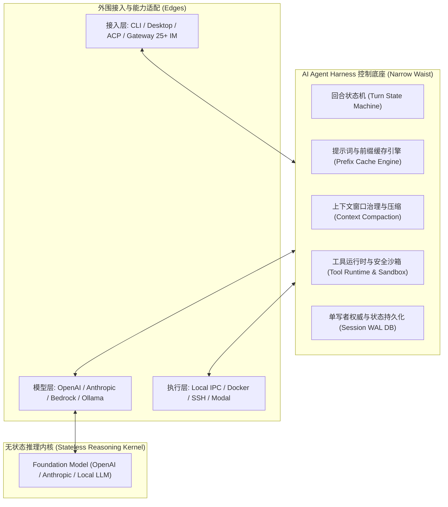

# AI Agent Harness 开发入门指南：从目录结构到最小可用内核

> **定位**：面向准备从零开发 AI Agent Harness 或在 Hermes Agent 源码基础上做二次开发的工程师。本文档从工程目录骨架、核心心智模型、最小可用闭环（Minimal Viable Harness）实现，到源码导航、断点调试与扩展开发，提供完整的工程化上手路径。

---

## 一、 为什么需要 Harness：核心定位与心智模型

大语言模型（LLM）本质是一个**无状态的概率推理内核（Stateless Reasoning Kernel）**。给定相同的上下文，它输出预测的 Token 或工具调用结构；它不具备持久生命周期，不知道外部世界的物理时间，无法直接操作文件或网络，也不会在崩溃后自行恢复。

**AI Agent Harness（智能体控制底座）**就是包裹在这一无状态内核之上的**专用操作系统（Agent OS Kernel）**：



### 三大核心心智模型
1. **单核窄腰（Narrow Waist）**：编排核心（Turn Loop、消息格式、工具调度、状态持久化）彻底与上层界面（CLI/IM/桌面）和底层模型平台解耦。核心只做减法，外围做加法。
2. **状态权威与持久优先（Persist-Before-Execute）**：任何工具执行产生的副作用之前，必须先将模型发起的 `tool_calls` 落盘。若机器突发宕机，重启后能基于已持久化的消息确定性恢复，严禁依赖进程内临时变量。
3. **三大黄金不变式（Invariants）**：
   - **严格角色交替**：对话历史必须满足 `user -> assistant -> user`；发出的每一个 `tool_call` 必须紧随对应的 `tool` 结果消息，严禁孤立悬挂。
   - **提示词绝对稳定**：System Prompt 在会话生命周期内逐字节不可变（保护厂商 KV Cache），动态变量一律通过单次 User 消息或 Tool 回执注入。
   - **中断即丢弃（Discard-on-Interrupt）**：用户中断时，未完成的残缺回复立即丢弃；未决的工具调用必须由 Harness 合成标准取消响应闭合链条。

---

## 二、 推荐工程目录骨架（Directory Layout）

开发一个生产级 Harness，推荐采用遵循“单核窄腰”范式的分层目录结构。以 Hermes Agent 为工业级参考范本：

```
my-agent-harness/
├── agent/                       # 【窄腰核心】编排状态机与上下文治理
│   ├── conversation_loop.py     # 9 步状态机主调度回路 (run_conversation)
│   ├── turn_preflight.py        # Step 1: 预算、租约与中断检查
│   ├── turn_iteration_prep.py   # Step 2: 动态旁路注入与上下文拼装
│   ├── turn_request_assembly.py # Step 3: 协议归一化与模型参数构建
│   ├── turn_api_call.py         # Step 4: 流式 API 守护线程与中断监听
│   ├── turn_response_intake.py  # Step 5: 响应校验、思考标签清洗与 tool_calls 提取
│   ├── turn_tool_round.py       # Step 6: 工具并发派发、串行屏障与持久化
│   ├── turn_context_compaction.py # Step 7: 上下文超限检测、微压缩与总结压缩
│   ├── turn_finalizer.py        # Step 8: 控制标记剥离、最终状态落盘与回调
│   ├── prompt_builder.py        # 静态提示词组装（保证 Prefix Cache 逐字节稳定）
│   ├── context_compressor.py    # 4 阶段滑动窗口压缩器
│   └── inline_tool_executors.py # 有状态内联工具分发器（内存、任务管理等）
├── tools/                       # 【能力边缘】工具生态与沙箱
│   ├── registry.py              # 工具注册表（装饰器注册、Schema 动态抽取）
│   ├── execute_code.py          # 编程式代码卸载执行器（Local IPC 沙箱）
│   ├── file_tools.py            # 文件读写、检索与差异比对工具
│   └── environments/            # 执行环境后端（Local / Docker / SSH）
├── storage/                     # 【持久化层】会话状态与多层记忆
│   ├── state_db.py              # SQLite WAL 会话库、运行时纪元栅栏（Runtime Epoch）
│   └── memory/                  # L1 静态画像、L2 FTS5 语义检索、L3 技能提炼
├── frontends/                   # 【接入边缘】外围瘦适配器
│   ├── cli.py                   # 终端交互 REPL
│   ├── gateway/                 # 多平台消息网关（Telegram/Discord/Slack/飞书等）
│   └── acp/                     # IDE Agent Client Protocol 适配层
├── run_agent.py                 # 【核心门面】AIAgent 公共入口类，集成状态机与工具
├── hermes_constants.py          # 平台抽象、路径解析（Profile-aware HERMES_HOME）
└── pyproject.toml / uv.lock     # 环境与依赖版本锁定
```

### 目录分工与依赖倒置规则
- **单向依赖原则**：`frontends/` 依赖 `run_agent.py`；`agent/` 依赖抽象的 `tools/registry.py`，**严禁** `agent/` 反向引入具体的前端 UI 或平台特定的代码。
- **环境隔离（Profile-Aware）**：所有状态文件（SQLite、记忆、缓存）不得硬编码在 `~/.myagent`，统一通过 `get_home()` 函数动态解析环境变量（如 `HERMES_HOME`），支持多实例、多测试用例完全隔离运行。

---

## 三、 最小可用闭环（Minimal Viable Harness）原型

为了深刻理解 Harness 内核的本质，以下是一份仅约 180 行、完整可运行的最小 Harness 原型。它完整实现了：
1. **基于 Type Hints 的工具注册与 JSON Schema 生成**；
2. **规范消息中间表示（Canonical IR）与持久化**；
3. **思考-行动-观察循环（Thought-Action-Observation Loop）**；
4. **流式与中断处理机制**；
5. **角色交替不变式自愈**。

```python
"""minimal_harness.py - 最小可用 AI Agent Harness 教学实现"""

import inspect
import json
from typing import Any, Callable, Dict, List, Optional
from openai import OpenAI


# ── 1. 工具注册表与 Schema 抽取 ──────────────────────────────────────────

class ToolRegistry:
    def __init__(self):
        self._tools: Dict[str, Callable] = {}
        self._schemas: List[Dict[str, Any]] = []

    def register(self, func: Callable) -> Callable:
        name = func.__name__
        doc = inspect.getdoc(func) or "No description provided."
        sig = inspect.signature(func)

        properties = {}
        required = []
        for param_name, param in sig.parameters.items():
            param_type = "string"
            if param.annotation == int:
                param_type = "integer"
            elif param.annotation == float:
                param_type = "number"
            elif param.annotation == bool:
                param_type = "boolean"

            properties[param_name] = {
                "type": param_type,
                "description": f"Argument {param_name}",
            }
            if param.default == inspect.Parameter.empty:
                required.append(param_name)

        schema = {
            "type": "function",
            "function": {
                "name": name,
                "description": doc.strip().split("\n")[0],
                "parameters": {
                    "type": "object",
                    "properties": properties,
                    "required": required,
                },
            },
        }
        self._tools[name] = func
        self._schemas.append(schema)
        return func

    def execute(self, name: str, arguments_json: str) -> str:
        """执行工具，严禁抛出硬崩溃异常，错误必须封装为模型可读的文本回执"""
        if name not in self._tools:
            return json.dumps({"error": f"Tool '{name}' not found."})
        try:
            kwargs = json.loads(arguments_json) if arguments_json else {}
            result = self._tools[name](**kwargs)
            return json.dumps(result, ensure_ascii=False) if not isinstance(result, str) else result
        except Exception as exc:
            return json.dumps({"error": f"Execution failed: {type(exc).__name__}: {exc}"})

    @property
    def schemas(self) -> List[Dict[str, Any]]:
        return self._schemas


# ── 2. 核心编排回合状态机 (Narrow Waist Kernel) ──────────────────────────

class MinimalHarness:
    def __init__(
        self,
        api_key: Optional[str] = None,
        base_url: Optional[str] = None,
        model: str = "gpt-4o-mini",
        system_prompt: str = "You are a dependable, helpful engineering assistant.",
    ):
        self.client = OpenAI(api_key=api_key, base_url=base_url)
        self.model = model
        self.system_prompt = system_prompt
        self.registry = ToolRegistry()
        # 规范对话历史 (Canonical IR)
        self.messages: List[Dict[str, Any]] = [
            {"role": "system", "content": self.system_prompt}
        ]

    def run_turn(self, user_input: str, max_iterations: int = 10) -> str:
        """执行单个对话回合（含多轮工具调用）"""
        # 1. 注入用户消息
        self.messages.append({"role": "user", "content": user_input})

        for iteration in range(max_iterations):
            print(f"\n[Iteration {iteration + 1}] 发起模型推理请求...")
            
            # 2. 调用模型 API (非流式简化演示)
            response = self.client.chat.completions.create(
                model=self.model,
                messages=self.messages,
                tools=self.registry.schemas if self.registry.schemas else None,
            )
            choice = response.choices[0]
            message = choice.message

            # 3. 构造 Assistant 消息并压入历史 (保持不变式)
            assistant_msg: Dict[str, Any] = {
                "role": "assistant",
                "content": message.content or "",
            }
            if message.tool_calls:
                assistant_msg["tool_calls"] = [
                    {
                        "id": tc.id,
                        "type": "function",
                        "function": {
                            "name": tc.function.name,
                            "arguments": tc.function.arguments,
                        },
                    }
                    for tc in message.tool_calls
                ]

            # 4. 持久化前置：在产生任何外部副作用前，先将 assistant_msg 入栈落盘
            self.messages.append(assistant_msg)

            # 5. 若无工具调用，说明思考完成，返回最终结果
            if not message.tool_calls:
                return message.content or ""

            # 6. 工具执行轮次：执行模型请求的工具并回填 tool 消息
            for tc in message.tool_calls:
                tool_name = tc.function.name
                tool_args = tc.function.arguments
                call_id = tc.id

                print(f"  -> 执行工具: {tool_name}({tool_args})")
                tool_result = self.registry.execute(tool_name, tool_args)
                print(f"  <- 工具结果: {tool_result[:80]}...")

                # 严格遵守角色交替不变式：每有一个 tool_call，紧跟一条对应的 tool 消息
                self.messages.append({
                    "role": "tool",
                    "tool_call_id": call_id,
                    "content": tool_result,
                })

        return "Error: Maximum iteration budget reached without final answer."


# ── 3. 使用演示 ──────────────────────────────────────────────────────────

if __name__ == "__main__":
    harness = MinimalHarness()

    # 注册示例工具
    @harness.registry.register
    def add_numbers(a: int, b: int) -> int:
        """Add two integers and return the sum."""
        return a + b

    @harness.registry.register
    def get_weather(city: str) -> str:
        """Get the current weather for a specified city."""
        return f"Weather in {city}: Sunny, 24°C"

    # 执行对话测试
    print("=== 测试 1: 直接回复 ===")
    ans1 = harness.run_turn("你好，你是谁？")
    print("模型输出:", ans1)

    print("\n=== 测试 2: 多步工具调用 ===")
    ans2 = harness.run_turn("请帮我算一下 1234 + 5678 等于多少，另外查一下上海的天气。")
    print("模型输出:", ans2)
```

---

## 四、 Hermes 生产级 Harness 核心子系统剖析

在实际生产场景中，真实的 Agent 面临网络抖动、模型幻觉、长文本超限、高并发写冲突与恶意指令注入。以下是 Hermes Agent 生产内核的对应解法：

```mermaid
sequenceDiagram
    autonumber
    actor User as 用户 / 上层前端
    participant Loop as conversation_loop (状态机)
    participant Pre as turn_preflight (检查)
    participant API as turn_api_call (流式调用)
    participant Tool as turn_tool_round (工具派发)
    participant Compact as turn_context_compaction (压缩)
    participant DB as hermes_state (SQLite WAL)

    User->>Loop: 发起请求 (run_conversation)
    Loop->>Pre: 1. 检查预算、Epoch 锁与 _interrupt_requested
    Loop->>API: 2. 请求组装并向 Provider 发起流式 API
    API-->>User: 逐字回传文本 Token (流式监听)
    API->>Loop: 3. Intake 抽取 tool_calls
    alt 包含 tool_calls
        Loop->>DB: 4. 持久化前置 (Persist Assistant Message)
        Loop->>Tool: 5. 内联拦截 / 线程池并发执行工具
        Tool->>DB: 6. 落盘 Tool 结果消息
        Loop->>Compact: 7. 检测上下文长度 (触发增量微压缩)
        Loop->>Loop: 回到步骤 1 继续下一迭代
    else 纯文本结束
        Loop->>DB: 8. Finalizer 落盘，释放 Turn 租约
        Loop-->>User: 返回最终回复与 Token 统计
    end
```

### 1. 状态机流转与异常防护（`agent/conversation_loop.py`）
- **流式调用守护线程**（`agent/turn_api_call.py`）：网络请求在后台守护线程中执行，主线程保持对终端键盘事件（Ctrl+C）或网关 `/stop` 中断信号的高频轮询。
- **套接字级别强杀**（`chat_completion_helpers.py`）：当模型提供商发生静默挂起（仅发 SSE Ping 不发数据）或用户中断时，Harness 在 Socket 层调用 `shutdown(SHUT_RDWR)` 唤醒卡死的读操作，安全释放文件描述符，严禁盲目调用 `close()` 引发描述符回收竞态。

### 2. 工具系统与内联拦截（`tools/registry.py` & `agent/inline_tool_executors.py`）
并非所有工具都是无状态函数：
- **普通注册工具**（`tools/registry.py`）：通过装饰器 `@registry.register` 注册。纯函数设计，不依赖智能体内部实例，支持多线程安全并发执行。
- **内联拦截工具**（`agent/inline_tool_executors.py`）：如 `todo_list`、`memory`、`session_search`、`delegate_task`、`clarify`。这些工具必须直接读写 `AIAgent` 实例的私有状态（待办列表状态、会话 SQLite 句柄、UI 交互回调），因此直接在回合内部拦截分发，绕过公开注册表。

### 3. 上下文分级治理（`agent/turn_context_compaction.py`）
长程任务极易撑爆上下文窗口：
- **增量微压缩（Micro-Compaction）**：每一轮工具执行后，若发现早期产生的工具输出体积庞大（例如 `cat` 了一个 2000 行的文件），将旧工具结果折叠为结构化摘要 `[Output truncated; 150 lines omitted]`，释放宝贵窗口。
- **四阶段深度压缩（Full Compaction）**：当总 Token 超过安全水位时，触发基于辅助小模型的结构化提炼（提取用户意图、关键发现、已完成步骤），重构对话前缀。

### 4. 单写者权威与状态恢复（`hermes_state.py`）
- **SQLite WAL 模式与 Epoch 栅栏**：数据库开启 `PRAGMA journal_mode=WAL`。为防止分布式或多进程环境下出现“脑裂双写”，每个运行会话被赋予单调递增的 `runtime_epoch` 租约，老进程的脏写入会被底层即刻拦截。

---

## 五、 本地开发与断点调试实战

不要从复杂的 CLI 或 IM 网关入口开始调试 Harness，建议通过轻量独立的单步脚本驱动核心。

### 1. 环境准备
```bash
# 1. 激活工作区环境
source ./activate

# 2. 隔离调试环境，防止污染本地 ~/.hermes
export HERMES_HOME="$PWD/.hermes_dev"
export HERMES_DEBUG=1

# 3. 配置测试模型环境变量
export OPENAI_API_KEY="sk-..."
```

### 2. 编写独立调试脚本（`debug_harness.py`）
在项目根目录下创建 `debug_harness.py`：

```python
"""debug_harness.py - 单步断点调试 Harness 核心"""
import logging
from run_agent import AIAgent

logging.basicConfig(level=logging.INFO)

# 1. 实例化核心智能体门面
agent = AIAgent(
    model="gpt-4o-mini",
    temperature=0.0,
    max_iterations=5,
    quiet_mode=False,
)

# 2. 在以下关键源码位置打断点 (VS Code / PyCharm / pdb)：
#    - agent/conversation_loop.py -> run_conversation() (回合入口)
#    - agent/turn_api_call.py -> interruptible_streaming_api_call() (网络交互)
#    - agent/turn_tool_round.py -> run_tool_round() (工具调度与执行)

print(">>> 启动调试回合...")
result = agent.run_conversation("请帮我查看当前目录下的文件并统计数量")

print("\n--- 调试输出结果 ---")
print("最终回复:", result.get("final_response"))
print("消息条数:", len(result.get("messages", [])))
print("消耗 Token:", result.get("total_tokens"))
```

### 3. 运行调试与自动化检查
```bash
# 使用 pdb 单步调试
python -m pdb debug_harness.py

# 运行窄范围契约测试（验证单个模块）
./scripts/run_tests.sh tests/agent/test_turn_lifecycle.py
./scripts/run_tests.sh tests/tools/test_registry.py

# 提交代码前运行严格的代码健康检查（含 HX 架构约束）
python scripts/check
```

---

## 六、 进阶演练：为 Harness 增加自定义扩展

### 演练 1：增加一个无状态自定义工具
在 `tools/` 目录下创建或在现有工具模块中添加函数，使用注册表注册：

```python
# tools/my_custom_tool.py
from tools.registry import registry

@registry.register(
    name="query_git_status",
    description="Query git status of the current workspace repository.",
    category="system",
)
def query_git_status(short: bool = True) -> str:
    """Run git status and return formatted output.
    
    Args:
        short: If True, returns short-format git status (-s).
    """
    import subprocess
    cmd = ["git", "status", "-s"] if short else ["git", "status"]
    res = subprocess.run(cmd, capture_output=True, text=True)
    if res.returncode != 0:
        return f"Git error: {res.stderr}"
    return res.stdout or "Working tree clean."
```
> **生效原理**：`tools/registry.py` 会在加载时自动提取该函数的类型注解与 docstring，在 `turn_request_assembly.py` 阶段自动转换为 OpenAI / Anthropic 兼容的 JSON Schema 发送给大模型。

### 演练 2：增加一个有状态内联工具（以只读用户环境为例）
若工具需要读取 `AIAgent` 的运行状态，在 `agent/inline_tool_executors.py` 中挂载：

```python
# 1. 编写执行函数
def _inspect_runtime_state(agent, args: dict, ctx: InlineToolContext) -> str:
    return json.dumps({
        "current_turn": getattr(agent, "_current_turn_id", None),
        "session_id": getattr(agent, "session_id", None),
        "messages_count": len(ctx.messages or []),
        "model": agent.model,
    })

# 2. 挂载到 _RAW_INLINE_TOOL_EXECUTORS 映射表中
_RAW_INLINE_TOOL_EXECUTORS["inspect_runtime"] = _inspect_runtime_state
```

---

## 七、 开发者避坑指南与自检清单（Gotchas & Checklist）

在实现与修改 Harness 时，务必遵守以下检查项：

| 检查项 | 严重级别 | 潜在后果与排查方式 |
|---|---|---|
| **禁止动态修改 System Prompt** | 🔴 严重 | 任何加入时间、电量、工作目录的行为都会击穿厂商的前缀缓存（Prefix Cache），导致首字延迟（TTFT）翻倍、成本激增。动态变量必须放入 User 消息旁路。 |
| **工具异常严禁抛出硬崩溃** | 🔴 严重 | 工具内部抛出未捕获异常会导致整个 Agent 进程硬退出。必须用 `try/except` 捕获并封装为 `{"error": ...}` 的字符串格式返回给 LLM，给模型自愈修正的机会。 |
| **中断时闭合未决 tool_calls** | 🔴 严重 | 用户在工具执行中按 Ctrl+C，若直接清空或丢弃会导致历史中存在 `assistant(tool_calls)` 却没有后续的 `tool` 结果，下次调用必报 `400 Bad Request`。必须合成取消响应。 |
| **持久化先于物理副作用** | 🟠 重要 | 若工具执行了 `rm -rf` 或系统重启命令，而 `tool_calls` 还未落盘，系统恢复后状态机将丢失上下文。必须坚持 **Persist-Before-Execute** 准则。 |
| **避免 SQLite 连接跨线程共享** | 🟠 重要 | SQLite 连接句柄跨线程调用会触发 `SQLite objects created in a thread can only be used in that same thread` 或死锁。确保多线程读写走 WAL 单写者管道。 |
| **无界循环设置硬预算** | 🟡 警告 | 遇到模型复读或工具无脑重试时，必须设置严格的 `max_iterations` 预算上限，达到上限后触发降级总结，防止账单失控。 |

---

## 八、 相关架构文档导航

深入理解各个子系统的底层设计与技术决策，请对照阅读：
- 🧠 **[Harness 架构深度解析 (`docs/harness/harness-deep-dive.md`)](file:///Users/fx/wk/github/hermes-agent-0.23.2/docs/harness/harness-deep-dive.md)**：操作系统类比、9 步生命周期、前缀缓存、RPC 沙箱与单写权威的理论分析。
- 🛠️ **[Harness 开发者实施手册 (`docs/harness/harness-developer-notes.md`)](file:///Users/fx/wk/github/hermes-agent-0.23.2/docs/harness/harness-developer-notes.md)**：10 个子系统的具体实现规格、技术参数与避坑公理。
- 📋 **[仓库开发指南 (`AGENTS.md`)](file:///Users/fx/wk/github/hermes-agent-0.23.2/AGENTS.md)**：开发规范、代码质量要求与测试基准。
