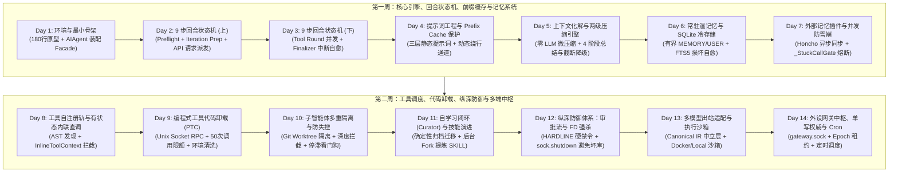

# Hermes Agent 源码逐日精读计划表（Day-by-Day Reading Roadmap）

> **文档定位**：本计划表以《[Harness 开发者实施手册 (`harness-developer-notes.md`)](./harness-developer-notes.md)》为架构蓝图，将 `hermes-agent-0.23.2` 核心源码拆解为 **14 天逐日精读指南**。每天明确规定**看什么代码（精确到文件名、关键符号与行号锚点）、重点学什么（核心机制、架构权衡与系统不变式）、当天跳过什么（防噪音）、断点与单测验证手段**，让源码学习成为确定性、可验证的工程进阶过程。

---

## 一、 源码精读三原则

`hermes-agent` 作为生产级 Agent Harness，拥有 300+ 源码文件与大量平台补丁。阅读前必须严格遵守三条工程准则：

1. **由内向外（Inside-Out），绝不从外围壳子切入**：
   - 核心生命线在“单核窄腰（Layer 2）”：先搞懂单个回合状态机流转（`run_agent.py` $\rightarrow$ `agent/conversation_loop.py` $\rightarrow$ `agent/turn_*.py`）；
   - 再横向展开看四层记忆体系与提示词冻结（Layer 4）以及工具调度/沙箱执行（Layer 3）；
   - 最后才看外围接入端（CLI / Gateway / 25+ IM 平台 / Cron，Layer 1 & 5）。
2. **“15% 主干原则”，跳过外围噪音**：
   - 每个子系统仅由 1~3 个主干文件构成骨架，其余 85% 代码多为特定厂商兼容（如 `anthropic_oauth`、`bedrock_reasoning`）、各 IM 平台格式胶水或历史补丁；
   - 第一遍通读只看主干符号，遇到边角 helper 直接信任函数名跳过。
3. **“断点单步 + 契约测试”双轮验证**：
   - 拒绝“纯眼看”，必须通过断点单步追踪内存中状态对象（如 `_LoopState`、`messages`、`ToolRoundVerdict`）；
   - 每天精读后必须运行配套的**窄范围契约测试**（`./scripts/run_tests.sh <test_path>`），以测试断言反推架构红线。

---

## 二、 14 天全局学习路线图



### 14 天学习计划日程概览

| 天数 | 核心主题 | 精读源码文件 | 核心掌握的不变量 / 机制 |
|---|---|---|---|
| **Day 1** | 环境就绪与最小骨架 | `01_core_loop_and_quickstart.md`, `run_agent.py`, `agent/agent_init.py` | 180 行原型；`AIAgent` Facade 依赖注入装配链；沙箱隔离 |
| **Day 2** | 9 步回合状态机 (上) | `agent/conversation_loop.py`, `agent/turn_preflight.py`, `turn_iteration_prep.py`, `turn_request_assembly.py`, `turn_api_call.py` | `_LoopState` 状态流转；70%/90% 迭代预算旁路注入；流式中断监听 |
| **Day 3** | 9 步回合状态机 (下) | `agent/turn_response_intake.py`, `turn_response_check.py`, `turn_tool_round.py`, `turn_finalizer.py` | **Persist-Before-Execute**；工具并发执行与结果对齐；**Discard-on-Interrupt** 闭合 |
| **Day 4** | 提示词与 Prefix Cache | `agent/prompt_builder.py`, `agent/prompt_cache_boundary.py`, `agent/turn_iteration_prep.py` | 三层提示词拼装；全生命周期 `system_prompt` 字节级不变；动态事实旁路注入 |
| **Day 5** | 两级上下文压缩引擎 | `agent/micro_compaction.py`, `agent/context_compressor.py`, `agent/turn_context_compaction.py` | 零 LLM 微压缩；Head/Middle/Tail 4 阶段压缩；超时降级确定性截断；孤儿 ToolCall 清洗 |
| **Day 6** | 常驻温记忆与冷存储 | `tools/memory_tool.py`, `tools/memory_tool_store.py`, `hermes_state.py`, `tools/session_search_tool.py` | 有界字符硬限（2200/1375）；写盘与当前缓存分离；SQLite WAL + FTS5 + 损坏自愈救援 |
| **Day 7** | 外部记忆与防雪崩门禁 | `agent/memory_manager.py` | 异步出站递归脱敏；`_StuckCallGate`（8s/30s/4/60s/16）防 Python 线程池钉死 |
| **Day 8** | 双轨工具系统 | `tools/registry.py`, `model_tools.py`, `agent/inline_tool_executors.py` | AST 自注册与 30s/60s 依赖防抖；有状态工具（todo/memory/delegate）内联拦截 |
| **Day 9** | 编程式代码卸载 (PTC) | `tools/code_execution_tool.py`, `tools/code_execution_rpc.py`, `tools/code_kernel.py`, `tools/code_execution_env.py` | 50 轮工具折叠为 1 轮 Python 脚本；Unix Socket RPC 通信；子进程环境变量清洗防泄密 |
| **Day 10** | 子智能体四重隔离 | `tools/delegate_tool.py`, `tools/delegate_tool_child_run.py`, `tools/async_delegation.py` | 独立实例 + Git Worktree 隔离 + 权限裁剪 + 递归深度熔断；停滞心跳看门狗 |
| **Day 11** | 自学习闭环 (Curator) | `agent/background_review.py`, `agent/curator.py` | 零 LLM 的 Active $\rightarrow$ Stale (14d) $\rightarrow$ Archived (30d) 迁移；后台 Fork 提炼技能 |
| **Day 12** | 纵深防御与 FD 强杀 | `tools/approval_detection.py`, `tools/approval.py`, `tools/approval_yolo.py`, `agent/chat_completion_helpers.py` | YOLO 下不可绕过的 `HARDLINE` 硬禁令；中断时调 `shutdown(SHUT_RDWR)` 严禁调 `close()` |
| **Day 13** | 多模型适配与执行沙箱 | `agent/think_scrubber.py`, `agent/anthropic_adapter.py`, `tools/environments/base.py`, `local.py`, `docker.py` | Canonical IR 中立表示；会话中途无缝切换模型；沙箱生命周期管理 |
| **Day 14** | 外设中枢与单写权威 | `hermes_constants.py`, `hermes_cli/config.py`, `gateway/session_authority.py`, `gateway/run.py`, `cron/scheduler.py` | 严禁硬编码 `~/.hermes`；`gateway.sock` 解决多端并发锁库；Epoch 租约；Cron 引擎 |

> **⚡ 3 天极速通关选择**：若时间极度有限，仅精读 **Day 1**（装配骨架）、**Day 2 + Day 3**（9 步状态机）、**Day 4 + Day 5**（前缀缓存与压缩）即可掌握 80% 核心运行机制。

---

## 三、 14 天逐日精读详细计划

---

### Day 1：环境就绪、最小骨架与入口装配 Facade

- **对应手册**：`harness-developer-notes.md` 第一章（§1.1–§1.3）与第四章（§4.1）
- **核心目标**：建立开发隔离沙箱，通读 180 行原型，搞透 `AIAgent` 门面装配机制。

#### 1. 今日必读源码
1. [docs/harness/01_core_loop_and_quickstart.md](./01_core_loop_and_quickstart.md#L45-L225)：精读 180 行 Minimal Viable Harness。
2. [run_agent.py](../../run_agent.py#L215)：`class AIAgent` 类的声明与类属性。
3. [agent/agent_init.py](../../agent/agent_init.py#L2055)：`def init_agent()` 函数实现。

#### 2. 今日重点学什么
- **“单核窄腰”在代码中的物理体现**：`AIAgent` 本身不实现 LLM 通信或循环，它只是一个组装 Facade，通过组合数十个 Mixin（如 `AgentStateMixin`, `MicroCompactionMixin`）构建完整能力。
- **组装期依赖注入顺序**：观察 `agent_init.py` 内部如何按序初始化：日志 $\rightarrow$ 回调钩子 $\rightarrow$ LLM 客户端与 Fallback 链 $\rightarrow$ 工具加载 $\rightarrow$ SessionDB 挂载 $\rightarrow$ 记忆引擎 $\rightarrow$ 上下文压缩器。
- **运行环境强隔离**：如何通过环境变量 `HERMES_HOME` 与 `HERMES_DEBUG` 做到与宿主机默认 `~/.hermes` 完全解耦。

#### 3. 今日跳过清单
- 跳过 `agent/agent_init.py` 中针对具体厂商凭据池（`credential_pool`）以及历史计费（`billing`）的特殊处理逻辑。

#### 4. 动手实战与验证
```bash
# 1. 隔离环境设置
source ./activate
export HERMES_HOME="$PWD/.hermes_dev"
export HERMES_DEBUG=1

# 2. 运行环境与上下文单测
./scripts/run_tests.sh tests/agent/test_turn_context.py
```
- **通关思考**：为什么不能在 `AIAgent.__init__` 中直接启动大模型循环，而必须分离出显式的 `run_conversation()` 方法？

---

### Day 2：9 步回合状态机（上）：前置安全阀、迭代预算与请求派发

- **对应手册**：`harness-developer-notes.md` §2.2 & §4.2 #1, #2, #5
- **核心目标**：彻底理解单回合前 4 个步骤的流转逻辑与控制流不变量。

#### 1. 今日必读源码
1. [agent/conversation_loop.py](../../agent/conversation_loop.py#L1463)：`class _LoopState` 结构体定义；[L1520](../../agent/conversation_loop.py#L1520) `_run_phase` 反射驱动器；[L1810](../../agent/conversation_loop.py#L1810) `run_conversation` 入口。
2. [agent/turn_preflight.py](../../agent/turn_preflight.py#L57)：`run_preflight_compression()`，Turn Lease 租约与中断检查。
3. [agent/turn_iteration_prep.py](../../agent/turn_iteration_prep.py#L48)：`_maybe_inject_iteration_budget_warning()`；[L144](../../agent/turn_iteration_prep.py#L144) `prepare_iteration()`。
4. [agent/turn_request_assembly.py](../../agent/turn_request_assembly.py#L107)：`assemble_api_request()`。
5. [agent/turn_api_call.py](../../agent/turn_api_call.py#L75)：`perform_api_call()` 与 [L180](../../agent/turn_api_call.py#L180) `handle_api_interrupt()`。

#### 2. 今日重点学什么
- **`_LoopState` 上下文贯通**：`_LoopState` 对象如何作为单一事实来源，穿越整个 9 步生命周期并在步骤间无锁传递数据。
- **迭代预算安全阀与提示词保护**：当迭代轮次耗尽 70% 或 90% 时，系统如何将收敛警告注入到最新的临时 `user` 消息通道中，而**绝对不修改系统提示词**，从而保护前缀缓存。
- **后台流式调用与打断监控**：大模型调用运行在后台守护线程中，主线程如何通过事件标志监听用户中断信号并触发套接字熔断。

#### 3. 今日跳过清单
- 跳过 `agent/turn_request_assembly.py` 内部的 `moa_config`（Mixture of Agents）与特定端点自定义重试分支。

#### 4. 动手实战与验证
```bash
./scripts/run_tests.sh tests/agent/test_turn_iteration_prep.py tests/agent/test_turn_api_call_interrupt.py
```
- **通关思考**：如果大模型在流式输出中途卡死，`perform_api_call` 的超时守护计时器是如何防止主线程永久挂起的？

---

### Day 3：9 步回合状态机（下）：工具并发执行、消息对齐与中断自愈

- **对应手册**：`harness-developer-notes.md` §2.2 & §4.2 #1, #5
- **核心目标**：吃透工具执行不变量（Persist-Before-Execute）与严格角色交替自愈机制。

#### 1. 今日必读源码
1. [agent/turn_response_intake.py](../../agent/turn_response_intake.py#L173)：`normalize_model_response()` 统一出站封装。
2. [agent/turn_response_check.py](../../agent/turn_response_check.py#L92)：`check_api_response()` 空响应与纯思维链死循环自愈。
3. [agent/turn_tool_round.py](../../agent/turn_tool_round.py#L53)：`run_tool_round()`；[L247](../../agent/turn_tool_round.py#L247) `stage_tool_call_message()`。
4. [agent/turn_finalizer.py](../../agent/turn_finalizer.py#L119)：`_guarded_cleanup()`；[L651](../../agent/turn_finalizer.py#L651) `finalize_turn()`。

#### 2. 今日重点学什么
- **Persist-Before-Execute 铁律**：在执行任何工具之前，必须先将包含大模型原始 `tool_calls` 的 assistant 消息写入持久化存储（`stage_tool_call_message`）。若反过来，工具执行产生副作用后断电崩溃，将导致会话日志状态破坏且不可重放。
- **工具并发执行与结果对齐**：工具通过 `ThreadPoolExecutor` 并发跑，但写回 `messages` 列表时，必须严格按照模型最初返回的 `tool_call_id` 顺序重排，禁止乱序写入。
- **Discard-on-Interrupt 与消息角色交替不变式**：用户按 `Ctrl+C` 打断时，丢弃不完整的残缺回复；若大模型已发出部分工具调用，必须为悬挂的调用合成虚拟错误取消块，保证 `user -> assistant -> tool -> user` 角色序列永远闭合。

#### 3. 今日跳过清单
- 跳过 `turn_finalizer.py` 中用于看板统计（kanban）和特定平台 UI 动效渲染的清理函数。

#### 4. 动手实战与验证
```bash
./scripts/run_tests.sh tests/agent/test_turn_finalizer_interrupt_alternation.py tests/agent/test_turn_finalizer_cleanup_guard.py
```
- **通关思考**：为什么所有收尾动作都必须包裹在 `_guarded_cleanup` 中执行？单个动作报错会导致后续清理中断吗？

---

### Day 4：提示词工程与 Prefix Cache 保护

- **对应手册**：`harness-developer-notes.md` §3.1 & §4.2 #3
- **核心目标**：理解静态提示词三层拼装逻辑，以及全生命周期字节级不变的防线设计。

#### 1. 今日必读源码
1. [agent/prompt_builder.py](../../agent/prompt_builder.py#L42)：常量定义、守护线程带超时读取 `_read_text_with_timeout`、规则注入 `build_context_files_prompt`。
2. [agent/prompt_cache_boundary.py](../../agent/prompt_cache_boundary.py)：前缀缓存断点与边界标记注入。
3. [agent/turn_iteration_prep.py](../../agent/turn_iteration_prep.py#L144)：动态上下文（目录树、电池、时间戳）的旁路注入路径。

#### 2. 今日重点学什么
- **三层静态提示词体系**：
  1. 基础系统骨架：`DEFAULT_AGENT_IDENTITY`；
  2. 角色灵魂注入：`load_soul_md()`；
  3. 项目规则上下文：`.hermes.md` $\rightarrow$ `AGENTS.md` $\rightarrow$ `CLAUDE.md` $\rightarrow$ `.cursorrules` 按优先级覆盖。
- **冷读挂死防护**：网络驱动器（NFS / iCloud Drive）可能在读取规则文件时因离线产生无响应挂起，系统如何用 5.0 秒守护线程硬超时切断风险。
- **Prompt Caching 绝对冻结契约**：系统提示词在会话启动后**逐字节不变**；动态信息（时间戳、电量、工作目录变化）只能通过临时 user 消息或 tool 结果注入，严禁污染前缀缓存。

#### 3. 今日跳过清单
- 跳过 `prompt_builder.py` 底部针对特定模型（如部分开源微调小模型）的简化语法兼容函数。

#### 4. 动手实战与验证
```bash
./scripts/run_tests.sh tests/agent/test_prompt_builder.py tests/agent/test_prompt_cache_prefix_contract.py
```
- **通关思考**：如果用户在中途修改了本地的 `AGENTS.md`，当前活跃会话会立即热加载它吗？为什么？

---

### Day 5：上下文化解与两级压缩引擎

- **对应手册**：`harness-developer-notes.md` §3.2 & §4.2 #4
- **核心目标**：掌握低成本零 LLM 微压缩与高保真 4 阶段长文本上下文压缩机制。

#### 1. 今日必读源码
1. [agent/micro_compaction.py](../../agent/micro_compaction.py)：`MicroCompactionMixin`，就地折叠逻辑。
2. [agent/context_compressor.py](../../agent/context_compressor.py)：`ContextCompressor` 核心类，`compress()` 方法。
3. [agent/turn_context_compaction.py](../../agent/turn_context_compaction.py)：步骤 7 压缩触发逻辑。

#### 2. 今日重点学什么
- **两级降温压缩架构**：
  - **第一级：微压缩（Micro-Compaction）**：完全零 LLM 调用、零网络开销。检测历史回合中超过长度阈值的巨大工具输出（如大文件读取、编译大日志），就地替换为截断指纹。
  - **第二级：4 阶段宏观压缩**：划分为 Head 保留区（首轮系统指令）、Tail 活跃区（最新未结回合上下文）、Middle 衰减区（提取结构化状态与摘要）。
- **确定性截断降级策略**：当调用 LLM 辅助摘要生成超时或失败时，如何平滑降级为基于滑动窗口的确定性截断，且绝对不损坏消息的工具配对关系（清理孤儿 `tool_call_id`）。

#### 3. 今日跳过清单
- 跳过 `context_compressor.py` 中针对多模型分块 Token 估算的特殊语言（C++ / Go）语法分词器特化代码。

#### 4. 动手实战与验证
```bash
./scripts/run_tests.sh tests/agent/test_micro_compaction.py tests/agent/test_turn_context_compaction.py
```
- **通关思考**：若宏观压缩删除了某条 assistant 消息里的某一个工具调用结果，为什么必须把对应的整对 tool call 和 tool result 一并摘除？

---

### Day 6：常驻有界温记忆（MEMORY.md / USER.md）与 SQLite 冷存储（FTS5）

- **对应手册**：`harness-developer-notes.md` §3.3, §3.4 & §4.2 #8
- **核心目标**：理解放弃臃肿向量库的有界记忆哲学，以及两级损坏自愈状态存储。

#### 1. 今日必读源码
1. [tools/memory_tool_store.py](../../tools/memory_tool_store.py#L188)：`MemoryStore` 类，字符预算硬限与条目锚定。
2. [tools/memory_tool.py](../../tools/memory_tool.py#L64)：`memory_tool` 实现与跨平台文件锁（`fcntl` / `msvcrt`）。
3. [hermes_state.py](../../hermes_state.py#L440)：`SessionDB` 与 `AsyncSessionDB` 实现；SQLite WAL 模式配置；损坏自愈转储 `divert_session_transcript_jsonl`。
4. [tools/session_search_tool.py](../../tools/session_search_tool.py)：`session_search` 基于 FTS5 BM25 的检索与摘要。

#### 2. 今日重点学什么
- **有界记忆设计哲学**：为什么拒绝无限膨胀的向量库？硬性限制 `MEMORY.md`（2200 字符）与 `USER.md`（1375 字符），逼迫大模型在更新记忆时必须做信息压缩与旧条目淘汰。
- **启动冻结与写盘分离契约**：在当前会话中写记忆时，内容立即刷盘，但**当前会话的系统提示词绝不重新装载**（保证 Prefix Cache 不丢）；新记忆在下一个新会话中自然生效。
- **两级损坏自愈状态库**：
  - 第一级：关闭损坏库时配置 `SQLITE_DBCONFIG_NO_CKPT_ON_CLOSE`，防止退出时 Checkpoint 二次污染文件；
  - 第二级：内存会话日志紧急脱机导出为 `.jsonl` 救援文件。

#### 3. 今日跳过清单
- 跳过 `hermes_state.py` 内部历史版本的全量 schema migration 脚本（V1 到 V30 的逐版本升级细节）。

#### 4. 动手实战与验证
```bash
./scripts/run_tests.sh tests/tools/test_memory_tool.py tests/tools/test_session_search.py
```
- **通关思考**：为什么 `memory_tool_store.py` 在执行记忆更新时必须先加跨进程文件排他锁？如果多个并发子 Agent 同时写会怎样？

---

### Day 7：外部记忆插件与 `_StuckCallGate` 防雪崩门禁

- **对应手册**：`harness-developer-notes.md` §3.5 & §3.6
- **核心目标**：掌握与不可靠第三方网络服务交互时的防御性工程典范。

#### 1. 今日必读源码
1. [agent/memory_manager.py](../../agent/memory_manager.py#L41)：常量参数组（`8.0s / 30.0s / 4 / 60.0s / 16`）、`_redact_for_provider`、`_StuckCallGate` 熔断网关类、`MemoryManager` 协调器。

#### 2. 今日重点学什么
- **出站数据严格脱敏**：在将会话上下文发送至外部记忆供应商（如 Honcho / Mem0）之前，如何通过递归字典过滤清除所有已知的认证密钥、临时凭证与敏感字段。
- **`_StuckCallGate` 线程卡死防御网关**：
  - 核心痛点：Python 标准线程池无法在外部网络挂死时强制 `kill` 线程；
  - 5 参数熔断矩阵：`8s` 预取硬超时、`30s` 判定为卡死调用、连续卡死超过 `4` 次即自动闭锁、闭锁后每隔 `60s` 仅放行 1 次探测调用、最大允许挂起线程为 `16`。超过阈值立刻跳过外部记忆，确保主会话永不阻塞。

#### 3. 今日跳过清单
- 跳过 `memory_manager.py` 内部与特定外部厂商私有 SDK 对齐的细节序列化代码。

#### 4. 动手实战与验证
```bash
./scripts/run_tests.sh tests/agent/test_memory_manager_fork_scope.py tests/agent/test_memory_stalled_background_call.py
```
- **通关思考**：如果去掉 `_StuckCallGate`，网络波动时多轮长对话会导致 Agent 进程出现什么现象？

---

### Day 8：双轨工具系统：AST 自注册轨与有状态内联直调

- **对应手册**：`harness-developer-notes.md` §2.3 & §4.2 #6
- **核心目标**：理解标准扩展工具与核心系统工具在调度架构上的分流原理。

#### 1. 今日必读源码
1. [tools/registry.py](../../tools/registry.py#L121)：`discover_builtin_tools()`、`ToolRegistry` 类、`_check_fn_cached()` 状态防抖逻辑。
2. [model_tools.py](../../model_tools.py)：`ToolEntry` 与大模型 Function Calling Schema 自动化生成。
3. [agent/inline_tool_executors.py](../../agent/inline_tool_executors.py#L299)：`InlineToolContext` 与表驱动分发 `_RAW_INLINE_TOOL_EXECUTORS`。

#### 2. 今日重点学什么
- **无状态通用工具自注册轨**：
  - 通过 AST 与模块自省动态收集工具；
  - 依赖检查防抖（`_CHECK_FN_TTL_SECONDS = 30.0`, `_CHECK_FN_FAILURE_GRACE_SECONDS = 60.0`）：防止底层环境（如 `docker`）偶发抖动导致整个工具集被瞬间剔除。
- **有状态核心工具内联拦截轨**：
  - 为什么 `todo_list`、`memory`、`session_search`、`delegate_task` 坚决不走普通注册表？
  - 因为它们直接依赖 `AIAgent` 内部会话状态、需要写回 SessionDB、或需要触发宿主终端 UI 弹窗（如 `clarify` 询问），必须走内联表驱动拦截。

#### 3. 今日跳过清单
- 跳过各业务能力插件的具体实现（如 `tools/browser_*`、`tools/web_search_tool.py`），把精力放在注册与分发主轴。

#### 4. 动手实战与验证
```bash
./scripts/run_tests.sh tests/tools/test_registry.py
```
- **通关思考**：如果给 Hermes 新增一个单纯计算数学公式的无状态工具，它应该接入哪一条轨？为什么？

---

### Day 9：编程式代码卸载（PTC）：长工具链折叠与 IPC 隔离沙箱

- **对应手册**：`harness-developer-notes.md` §2.3
- **核心目标**：吃透如何通过本地 Python 解释器将数十轮网络工具往返压减为单轮执行。

#### 1. 今日必读源码
1. [tools/code_execution_tool.py](../../tools/code_execution_tool.py)：`execute_code` 入口。
2. [tools/code_execution_rpc.py](../../tools/code_execution_rpc.py)：Unix Domain Socket / 本地回环 RPC 通信协议。
3. [tools/code_kernel.py](../../tools/code_kernel.py)：长生命周期子进程执行内核。
4. [tools/code_execution_env.py](../../tools/code_execution_env.py)：`clean_env()` 环境变量洗涤逻辑。

#### 2. 今日重点学什么
- **Programmatic Tool Calling (PTC) 架构**：
  - 传统模式：50 个文件批量修改需要大模型与系统进行 50 轮网络往返；
  - PTC 模式：大模型输出一段包含循环调用的 Python 脚本，由宿主本地执行沙箱直接批量调用，仅将最终运行结果返回大模型，极大降低延迟与 Token 账单。
- **执行安全与环境变量洗涤**：
  - 子进程内核环境变量必须通过 `clean_env()` 清洗，剥离父进程持有的各类云厂商 API Key；
  - 单次脚本最多允许 50 次子工具调用限额，防止模型编写无限死循环耗尽资源。

#### 3. 今日跳过清单
- 跳过 Windows 命名管道特化的兼容代码分支，只聚焦 Unix Domain Socket 主干链路。

#### 4. 动手实战与验证
```bash
./scripts/run_tests.sh tests/tools/test_code_execution_rpc.py tests/tools/test_code_execution_hermes_home.py
```
- **通关思考**：为什么代码执行沙箱与父进程通信选择 Unix Domain Socket 而不是简单的标准输入输出（stdin/stdout）管道重定向？

---

### Day 10：子智能体（Subagents）四重隔离与防失控机制

- **对应手册**：`harness-developer-notes.md` §2.3
- **核心目标**：理解复杂多任务拆分中的子智能体多重隔离边界与心跳看门狗。

#### 1. 今日必读源码
1. [tools/delegate_tool.py](../../tools/delegate_tool.py)：`delegate_task` 入口参数校验与深度控制。
2. [tools/delegate_tool_child_run.py](../../tools/delegate_tool_child_run.py)：子代理独立上下文与工作目录装配。
3. [tools/async_delegation.py](../../tools/async_delegation.py)：异步子代理轮询与看门狗。

#### 2. 今日重点学什么
- **子智能体四重隔离体系**：
  1. **上下文隔离**：子代理创建全新的空白 `AIAgent`，不继承父代理的庞大历史消息，完成任务后仅将高密度摘要交还父代理；
  2. **文件系统隔离**：支持独立的 Git Worktree 工作区，避免子任务的代码修改与主分支产生写冲突；
  3. **工具权限裁剪**：子代理被剥离二次派生（`delegate`）权限，防止产生无限递归任务爆炸；
  4. **递归深度硬拦截**：`max_depth` 限制最大嵌套层级（默认禁止深度超过 2 层）。
- **停滞心跳看门狗（Stall Watchdog）**：对长时间无任何活动产出的子进程进行超时判定并安全终止。

#### 3. 今日跳过清单
- 跳过 Kanban 看板视图实时同步状态相关的辅助更新函数。

#### 4. 动手实战与验证
```bash
./scripts/run_tests.sh tests/tools/test_delegate.py tests/tools/test_delegate_depth_prompt.py
```
- **通关思考**：为什么子智能体在执行完任务后，不能直接把完整的对话 `messages` 列表追加到父代理的上下文中？

---

### Day 11：自学习闭环（Curator）：确定性归档与技能自动演进

- **对应手册**：`harness-developer-notes.md` §2.5
- **核心目标**：理解 Agent 如何从历史任务中全自动提取、沉淀与淘汰可复用技能（Skills）。

#### 1. 今日必读源码
1. [agent/background_review.py](../../agent/background_review.py)：回合结束后的后台异步审查发起器。
2. [agent/curator.py](../../agent/curator.py#L30)：常量 `DEFAULT_STALE_AFTER_DAYS = 14`, `DEFAULT_ARCHIVE_AFTER_DAYS = 30`；`apply_automatic_transitions()` 状态机；`run_curator_review()` 整合逻辑。

#### 2. 今日重点学什么
- **两段式自学习机制（Hermes 灵魂机制）**：
  - **前半段：确定性状态机（零 LLM 调用）**：基于技能最后命中时间戳，全自动执行生命周期流转：`Active -> Stale (14 天无使用) -> Archived (30 天无使用)`；
  - **后半段：后台辅助模型 Fork 审查**：仅在主会话全部结束、主会话锁完全释放后，后台克隆一份消息只读快照，由辅助轻量模型提取沉淀并格式化为 `SKILL.md`。
- **静态系统提示词解耦**：新沉淀的 Skill 并不全量塞入系统提示词，而只以 L0 级轻量目录清单的形式按需暴露，绝不破坏 Prefix Cache。

#### 3. 今日跳过清单
- 跳过 Curator 在生成 Markdown 格式报告时的历史统计表格排版代码。

#### 4. 动手实战与验证
```bash
./scripts/run_tests.sh tests/agent/test_curator.py tests/agent/test_curator_run_hygiene.py
```
- **通关思考**：为什么技能自动提炼审查必须异步运行在主任务之外，而不能内联在主任务的回合终结阶段？

---

### Day 12：纵深防御体系：硬禁令（HARDLINE）、分级审批与套接字 FD 强杀

- **对应手册**：`harness-developer-notes.md` §2.3, §2.4 & §4.2 #9, #12
- **核心目标**：吃透生产级防越权、防注入体系与套接字并发安全强杀。

#### 1. 今日必读源码
1. [tools/approval_detection.py](../../tools/approval_detection.py#L176)：`HARDLINE_PATTERNS` 正则防线；`detect_approval_requirements()`。
2. [tools/approval.py](../../tools/approval.py)：三级审批状态机；Fail-Closed 默认拒绝策略。
3. [tools/approval_yolo.py](../../tools/approval_yolo.py)：YOLO 全自动执行模式下的红线边界。
4. [agent/chat_completion_helpers.py](../../agent/chat_completion_helpers.py#L3746)：`_shutdown_stale_attempt_socket()` 函数及行间核心注释。

#### 2. 今日重点学什么
- **HARDLINE 硬禁令铁律**：即使用户在命令行传入了 `--yolo`（全免审批模式），`HARDLINE_PATTERNS` 中预定义的毁灭性系统命令（如全盘删除、覆盖只读目录）依然**绝对不可绕过**，强制弹出阻断式审批。
- **Fail-Closed 审批契约**：任何审批请求若由于超时、通道断开或异常未获得明确授权，系统一律按“拒绝”判定，杜绝默认放行隐患。
- **FD 安全强杀套接字（极度经典底层 Bug 修复）**：
  - 核心场景：当主线程要打断超时的后台流式网络连接时，**严禁跨线程直接调用 `sock.close()`**；
  - 灾难机理：若直接 `close()` 释放了文件描述符编号（FD），同一进程内的 SQLite 随后打开新文件并复用了该 FD，原网络线程残留的迟滞写入会直接将网络脏数据写坏 SQLite 数据库文件！
  - 正确做法：必须调用 `sock.shutdown(socket.SHUT_RDWR)` 关闭读写信道，唤醒阻塞线程，将 `close()` 的权利交还给拥有该套接字的原始工作线程。

#### 3. 今日跳过清单
- 跳过 `tools/approval_detection.py` 中针对各类小众 Linux 发行版包管理器的非核心特征词匹配。

#### 4. 动手实战与验证
```bash
./scripts/run_tests.sh tests/tools/test_approval.py tests/tools/test_approval_yolo.py
```
- **通关思考**：请用你自己的话复述，为什么跨线程调用 `sock.close()` 是严重危险的并发反模式？

---

### Day 13：多模型出站适配、Canonical IR 中立层与环境执行沙箱

- **对应手册**：`harness-developer-notes.md` §2.4 & §4.2 #9
- **核心目标**：理解大模型中立消息格式设计以及可拔插沙箱环境抽象。

#### 1. 今日必读源码
1. [agent/think_scrubber.py](../../agent/think_scrubber.py)：思维链安全剥离。
2. [agent/anthropic_adapter.py](../../agent/anthropic_adapter.py) 与 [agent/bedrock_adapter.py](../../agent/bedrock_adapter.py)：厂商出站参数转译。
3. [tools/environments/base.py](../../tools/environments/base.py)：`BaseEnvironment` 统一沙箱抽象接口。
4. [tools/environments/local.py](../../tools/environments/local.py) 与 [tools/environments/docker.py](../../tools/environments/docker.py)：本地与容器沙箱实现对比。

#### 2. 今日重点学什么
- **Canonical IR 架构**：内部状态机与持久化数据库只记录中立、通用的消息结构；在请求真实发出前，由特定适配器转译为厂商私有格式（如 Anthropic 的 `thinking` 参数、Bedrock 的 Converse 结构）。这使得用户在同一会话中中途无缝切换不同厂商大模型成为可能。
- **环境沙箱抽象**：所有操作系统交互（命令执行、文件读写）均隔离在 `BaseEnvironment` 的接口契约之后，可透明切换为 `local`（本地子进程）或 `docker`（容器沙箱隔离）。

#### 3. 今日跳过清单
- 跳过云端沙箱驱动（如 `tools/environments/modal.py`、`daytona.py`）的私有 API 请求细节，只关注 `base.py` 接口契约。

#### 4. 动手实战与验证
```bash
./scripts/run_tests.sh tests/agent/test_anthropic_adapter.py
```
- **通关思考**：如果某个大模型原生返回带有 `<think>...</think>` 的思维链标签，入库保存和发给下一个不支持思维链的模型时分别应该怎么处理？

---

### Day 14：外设网关中枢、单写权威（Single-Writer）与 Cron 调度引擎

- **对应手册**：`harness-developer-notes.md` §2.1, §2.4 & §4.2 #10, #11
- **核心目标**：掌握多端架构共享单核的核心模式，吃透单写权威与无头自动化调度。

#### 1. 今日必读源码
1. [hermes_constants.py](../../hermes_constants.py)：`get_hermes_home()` 与多 Profile 动态路径解析。
2. [hermes_cli/config.py](../../hermes_cli/config.py)：6 级配置合并逻辑。
3. [gateway/session_authority.py](../../gateway/session_authority.py)：`gateway.sock` 仲裁、Epoch 纪元租约与状态锁。
4. [gateway/run.py](../../gateway/run.py) 与 [gateway/session_ingress.py](../../gateway/session_ingress.py)：多平台消息统一收归中枢。
5. [cron/scheduler.py](../../cron/scheduler.py) 与 [cron/jobs.py](../../cron/jobs.py)：定时调度器实现。

#### 2. 今日重点学什么
- **全仓严禁硬编码 `~/.hermes`**：必须通过 `get_hermes_home()` 获取路径，严格支持用户通过 `--profile` 参数启动完全并行的多租户环境。
- **单写权威（Single-Writer Authority）与 Epoch 栅栏**：
  - 核心痛点：CLI、桌面端、Web 端、25+ IM 平台可能同时对同一个 SQLite 库发起写操作，必然导致 `database is locked`；
  - 解决方案：所有外围端必须通过本地套接字 `gateway.sock` 与单一权威进程通信；通过单调递增的 Epoch 纪元标识实现租约隔离，彻底消灭脑裂并发写。
- **Cron 调度与无头回递**：后台周期任务在独立的静默无头环境中执行，任务产出结果可精确回递给创建该任务的原平台聊天频道。

#### 3. 今日跳过清单
- 跳过 `gateway/platforms/` 下非关注平台的代码，通读 `base.py` 后选择 1 个熟悉平台（如 `telegram.py` 或 `feishu.py`）扫读即可。

#### 4. 动手实战与验证
```bash
./scripts/run_tests.sh tests/gateway/test_session_authority.py tests/test_state_config_contention.py
```
- **通关思考**：如果网关守护进程发生异常重启，未完成的 Epoch 租约是如何安全过期的？

---

## 四、 按目标“精准选读”速查矩阵

若你带着具体的生产改造需求切入代码库，可直接按照目标路径阅读以下核心主干：

| 你最想解决的工程问题 | 必读核心源码路径（3~4 个文件） | 配套手册章节 |
|---|---|---|
| **保护大模型 Prefix Cache、大幅降低长对话成本** | `agent/prompt_builder.py` $\rightarrow$ `agent/prompt_cache_boundary.py` $\rightarrow$ `agent/turn_iteration_prep.py` | 手册 §3.1 & §4.2 #3 |
| **高保真、低幻觉的长上下文自适应压缩** | `agent/micro_compaction.py` $\rightarrow$ `agent/context_compressor.py` $\rightarrow$ `agent/turn_context_compaction.py` | 手册 §3.2 & §4.2 #4 |
| **纯文本有界跨会话记忆（不依赖昂贵向量库）** | `tools/memory_tool_store.py` $\rightarrow$ `tools/memory_tool.py` $\rightarrow$ `tools/session_search_tool.py` | 手册 §3.3 & §3.4 |
| **Agent 从任务中全自动提取与演进技能 (Skills)** | `agent/background_review.py` $\rightarrow$ `agent/curator.py` $\rightarrow$ `agent/prompt_builder.py` | 手册 §2.5 |
| **安全执行大模型生成的 Python 代码与终端命令** | `tools/approval_detection.py` $\rightarrow$ `tools/approval.py` $\rightarrow$ `tools/code_execution_rpc.py` | 手册 §2.3 & §4.2 #12 |
| **防止多客户端并发写坏 SQLite 数据库** | `hermes_state.py` $\rightarrow$ `gateway/session_authority.py` $\rightarrow$ `gateway/run.py` | 手册 §4.2 #10 & #11 |

---

## 五、 四个动手实战微实验（Hands-On Labs）

在隔离环境（`export HERMES_HOME="$PWD/.hermes_dev"`）中动手完成这 4 个微实验，将理论转化为工程直觉：

### Lab 1：单步追踪一次真实回合的 9 步轨迹
- **操作**：复制 [01_core_loop_and_quickstart.md](./01_core_loop_and_quickstart.md#L346-L377) 中的 `debug_harness.py` 驱动脚本，用 `python -m pdb debug_harness.py` 在 `agent/conversation_loop.py` 的 `_run_conversation_turn` 打断点逐轮观察：
  1. 第 1 轮大模型返回 `tool_calls` 时，`s.messages` 的消息格式；
  2. `run_tool_round` 返回的 `ToolRoundVerdict.action`；
  3. 第 2 轮调用前发送给大模型的 `active_system_prompt` 哈希值是否保持完全一致。

### Lab 2：验证常驻温记忆的“启动冻结与写盘分离契约”
- **操作**：启动交互会话，诱导模型执行记忆写入工具：`memory(action="add", target="memory", content="项目全部契约测试必须通过 scripts/run_tests.sh 运行")`：
  1. 检查 `$HERMES_HOME/memories/MEMORY.md`，确认物理磁盘文件已更新；
  2. 在调试器中检查当前 `agent` 内存实例的缓存系统提示词，确认其**未被更新**（Prefix Cache 维持命中）；
  3. 退出后新开会话，确认新启动的 `AIAgent` 已经加载了该条新记忆。

### Lab 3：编写并加载一个只读自定义工具
- **操作**：参考 `tools/` 目录规范编写一个返回系统负载状态的轻量只读函数，并使用 `registry.register(...)` 注册：
  1. 观察 `ToolRegistry` 如何通过类型提示自动生成 OpenAPI 风格的 Schema；
  2. 运行 `./scripts/run_tests.sh tests/tools/test_registry.py` 验证注册契约。

### Lab 4：研读生产级“中断闭合与角色交替”契约测试
- **操作**：通读 `tests/agent/test_turn_finalizer_interrupt_alternation.py` 源码，学习生产级工程如何编写**不依赖脆性文本快照、只验证角色序列合法性等严格系统不变量**的高稳定性契约测试。

---

## 六、 架构健康检查与排障参考

1. **日常代码健康防线**：
   在进行任何核心或外围代码修改后，随时运行项目严苛的代码健康扫描：
   ```bash
   # 运行全套代码健康检查（包含 ruff、类型检查、分层边界隔离 lint、复杂度上限校验）
   python scripts/check
   ```
2. **生产高频故障速查**：
   在调试中若遇到记忆写入满额、搜索索引损坏、外部插件卡死等异常，直接对照查阅 [harness-developer-notes.md 第五章：高频故障排查手册](./harness-developer-notes.md#L453-L508)。

---

## 七、 配套权威文档全景导航

- 🛠️ **[Harness 开发者实施手册 (`harness-developer-notes.md`)](./harness-developer-notes.md)**：本计划表的理论体系依据（五层缰绳工程、四层温度记忆、12 大工程决策与排障手册）。
- 🌐 **[AI Agent Harness 架构与工程实现全景总纲 (`harness-deep-dive.md`)](./harness-deep-dive.md)**：ALU vs Agent OS Kernel 对照矩阵、端到端拓扑图与 20 大模块映射总表。
- 📘 **[卷一：核心编排回路与快速上手指南 (`01_core_loop_and_quickstart.md`)](./01_core_loop_and_quickstart.md)**（对应 **Day 1 ~ Day 3**）
- 📗 **[卷二：提示词工程、上下文压缩与多层记忆体系 (`02_prompt_context_and_memory.md`)](./02_prompt_context_and_memory.md)**（对应 **Day 4 ~ Day 7**）
- 📙 **[卷三：工具系统、编程式代码卸载与子智能体编排 (`03_tools_execution_and_subagents.md`)](./03_tools_execution_and_subagents.md)**（对应 **Day 8 ~ Day 11**）
- 📕 **[卷四：多模型适配、网关单写权威、容灾自愈与纵深防御 (`04_providers_gateway_disaster_recovery_and_security.md`)](./04_providers_gateway_disaster_recovery_and_security.md)**（对应 **Day 12 ~ Day 14**）
