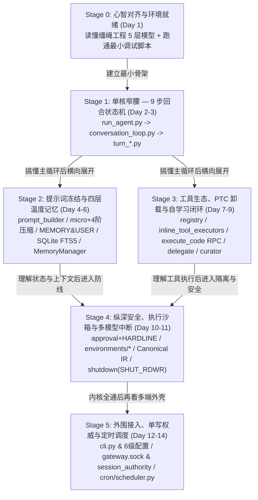

# Hermes Agent 源码学习与阅读规划指南（基于 `harness-developer-notes.md`）

> **文档定位**：本指南以《[Harness 开发者实施手册 (`harness-developer-notes.md`)](./harness-developer-notes.md)》为理论骨架，将 `hermes-agent-0.23.2` 仓库中数百个 Python 文件拆解为**可执行的 6 阶段源码精读路线**。每一阶段都明确给出**对应手册章节、阅读顺序（先读什么 / 跳过什么）、精准符号与断点锚点、窄范围验证测试命令与通关自测题**，帮助你避开“从入口一头扎进细节迷宫”的常见陷阱。

---

## 一、 阅读总心法：如何不被 300+ 文件淹没？

`hermes-agent` 是一个生产级多端 Agent Harness（仅 `agent/`、`tools/`、`gateway/` 目录下就有数百个模块与边角补丁）。读源码前先确立三条铁律：

1. **由内向外（Inside-Out），绝不从 `cli.py` 或 `gateway/run.py` 切入**：
   按照 `harness-developer-notes.md` 的五层垂直架构，**核心永远在“单核窄腰（Layer 2）”**。先看懂一个回合怎么跑完（`run_agent.py` + `agent/conversation_loop.py`），再向两侧展开看“提示词与四层记忆（Layer 4）”和“工具调度/沙箱/子智能体（Layer 3）”，最后再看外围壳子（CLI / Gateway / 25+ IM 平台 / Cron，Layer 1 & 5）。
2. **“15% 主干代码法”**：
   每个子系统都有 1~3 个主干文件（Core Spine）和大量历史回归补丁/厂商特例文件（如 `anthropic_*`、`auxiliary_*`、`approval_*` 细分规则）。**第一遍精读只啃主干文件**，看到边角 helper 直接信任函数名跳过，第二遍按需下钻。
3. **“断点 + 契约测试”双轮驱动**：
   只用眼睛“干看”很容易产生“看懂了”的错觉。每读完一个小节，立刻做两件事之一：
   - 运行本指南列出的**窄范围契约测试**（`./scripts/run_tests.sh <test_file>`），通过测试断言反推系统必须守住的不变量；
   - 在 `debug_harness.py` 中打下指定断点，亲眼观察 `_LoopState`、`messages`、`active_system_prompt`、`ToolRoundVerdict` 在内存里的真实形态。

---

## 二、 全局源码学习路线图（Stage 0 $\rightarrow$ Stage 5）



### 双节奏时间规划（按你的可用时间二选一）

| 学习模式 | 适用人群 | 覆盖范围 | 产出目标 |
|---|---|---|---|
| **⚡ 3 天速通模式** | 架构师 / 技术选型 / 急需二开 | Stage 0（半天）+ Stage 1 主干（1 天）+ Stage 2 & 3 核心文件（1.5 天） | 能独立画出 9 步回合流、讲清 Prefix Cache 保护与四层记忆、能写自定义工具 |
| **🔬 14 天深度精读** | 核心贡献者 / 自研 Harness 开发者 | Stage 0 ~ Stage 5 全覆盖 + 全部 4 个动手 Lab + 对应契约测试 | 吃透生产级容灾、安全红线、并发单写权威与自学习演进闭环，具备独立改造能力 |

---

## 三、 分阶段源码精读规划（严格映射 `harness-developer-notes.md`）

---

### Stage 0：环境准备、心智对齐与最小可运行抓手（Day 1）

- **对应手册章节**：`harness-developer-notes.md` **第一章（§1.1–§1.3 范式演进与缰绳工程）** & **第四章（§4.1 六条核心开发公理）**
- **学习目标**：先把“为什么这么设计”装进脑子，再搭好**绝对不污染主机 `~/.hermes`** 的隔离调试环境。

#### 1. 必读预热文档（约 1 小时）
1. 精读 [harness-developer-notes.md](./harness-developer-notes.md#L7-L85) 第一章：记住**缰绳工程 5 层（指令/约束/反馈/记忆/编排）**和**四大哲学**。
2. 速读 [01_core_loop_and_quickstart.md](./01_core_loop_and_quickstart.md) 中的 **180 行 Minimal Viable Harness 原型**——这是整个 300 文件仓库的“骨骼 X 光片”，先看懂 180 行再看真源码会事半功倍。

#### 2. 动手准备调试沙盒（约 30 分钟）
```bash
# 1. 激活项目 PM 虚拟环境
source ./activate

# 2. 强制隔离运行状态目录（绝不污染宿主机 ~/.hermes）
export HERMES_HOME="$PWD/.hermes_dev"
export HERMES_DEBUG=1

# 3. 跑一条最轻量的契约测试，验证测试框架正常
./scripts/run_tests.sh tests/agent/test_turn_context.py
```

#### 3. Stage 0 通关标志
- [ ] 能口述“为什么 Harness 不是死板工作流，也不是裸循环”。
- [ ] `./scripts/run_tests.sh tests/agent/test_turn_context.py` 绿灯通过。

---

### Stage 1：攻克“单核窄腰”——9 步回合状态机与入口装配（Day 2–3）

- **对应手册章节**：`harness-developer-notes.md` **§2.2 Layer 2 Agent 核心层（预算安全阀、错误恢复、Fallback 链）** & **§4.2 #1/#2/#5**
- **配套参考**：[harness-deep-dive.md](./harness-deep-dive.md) 第 3 章（9 步状态机总图）

#### 1. 必读源码清单（按严格调用顺序）

| 阅读次序 | 源码文件 | 必看符号 / 函数 | 阅读重点（带着问题看） |
|---|---|---|---|
| **1** | [run_agent.py](../../run_agent.py#L215) | `AIAgent`, `_MAX_TOOL_WORKERS` | `AIAgent` 如何作为 Facade 组合各 Mixin？它本身不做复杂循环，真正执行委托给谁？ |
| **2** | [agent/agent_init.py](../../agent/agent_init.py) | 初始化装配函数 | 启动时按什么顺序挂载 Prompt、MemoryManager、ToolRegistry、SessionDB、Fallback 模型？ |
| **3** | [agent/conversation_loop.py](../../agent/conversation_loop.py#L1463) | `_LoopState`, `_run_phase`, `_run_api_retry_loop`, `_run_conversation_turn`, `run_conversation` | **全仓库最核心文件！**看懂 `_LoopState` 如何贯通 9 个阶段，以及 `_run_phase` 如何通过参数名反射回写状态字段。 |
| **4** | [agent/turn_preflight.py](../../agent/turn_preflight.py) + [agent/turn_iteration_prep.py](../../agent/turn_iteration_prep.py) | 预检与迭代准备函数 | **Step 1 & 2**：Turn Lease 租约怎么拿？达到 **70% / 90% 迭代预算**时，收敛提示是如何旁路注入而不碰 `system_prompt` 的？ |
| **5** | [agent/turn_request_assembly.py](../../agent/turn_request_assembly.py) + [agent/turn_api_call.py](../../agent/turn_api_call.py) | `perform_api_call`, `handle_api_interrupt` | **Step 3 & 4**：Canonical IR 如何组装出站参数？后台流式调用如何响应用户打断？ |
| **6** | [agent/turn_response_intake.py](../../agent/turn_response_intake.py) + [agent/turn_response_check.py](../../agent/turn_response_check.py) | 响应接入与空响/截断检查 | **Step 5**：模型返回空文本、纯 `<think>` 死循环或 `tool_calls` 截断时如何拦截与自救？ |
| **7** | [agent/turn_tool_round.py](../../agent/turn_tool_round.py#L49) | `ToolRoundVerdict`, `run_tool_round`, `stage_tool_call_message` | **Step 6**：重点看 **Persist-Before-Execute**（先持久化 `tool_calls` 再执行工具），以及工具结果如何按原始 `tool_call_id` 顺序写回。 |
| **8** | [agent/turn_finalizer.py](../../agent/turn_finalizer.py#L645) | `finalize_turn`, `_close_transcript_tail`, `_mirror_turn_to_memory`, `_guarded_cleanup` | **Step 8 & 9**：中断时如何执行 **Discard-on-Interrupt** 维护角色交替？为什么每步清理都包在 `_guarded_cleanup` 里？ |

> **本阶段跳过清单（Skip on Pass 1）**：`agent/codex_*`、`agent/moa_*`、`agent/billing_*`、`agent/account_usage*`（这些是特定后端或计费逻辑，先别碰）。

#### 2. 推荐断点位置
- `agent/conversation_loop.py` 的 `_run_conversation_turn` 主 `while` 循环入口：每轮迭代打印 `s.api_call_count`、`len(s.messages)`、`len(s.active_system_prompt)`。
- `agent/turn_tool_round.py` 的 `run_tool_round`：观察 `stage_tool_call_message` 在工具真正执行前做了什么。

#### 3. 配套窄范围测试验证
```bash
./scripts/run_tests.sh \
  tests/agent/test_turn_context.py \
  tests/agent/test_turn_iteration_prep.py \
  tests/agent/test_turn_api_call_interrupt.py \
  tests/agent/test_turn_finalizer_interrupt_alternation.py
```

#### 4. Stage 1 通关自测题
1. 为什么 `turn_tool_round.py` 必须坚持 **Persist-Before-Execute**（在执行工具前先把带 `tool_calls` 的 assistant 消息落盘）？如果反过来会出什么灾难？
2. 当用户在工具执行中途按下 `Ctrl+C` 中断，`turn_finalizer.py` 如何保证下次发给大模型不会报 `HTTP 400 Bad Request`？
3. `_run_phase` 的 `_LATCHED_VERDICT_FIELDS` 解决的是什么并发/状态覆盖问题？

---

### Stage 2：吃透提示词冻结、上下文化解与四层温度记忆（Day 4–6）

- **对应手册章节**：`harness-developer-notes.md` **第三章（§3.1–§3.6 四层温度记忆体系、有界记忆哲学、Honcho、`_StuckCallGate`、`SOUL.md` 协同）** & **§4.2 #3/#4/#8**
- **配套参考**：[02_prompt_context_and_memory.md](./02_prompt_context_and_memory.md)

#### 1. 必读源码清单（按“热 $\rightarrow$ 温 $\rightarrow$ 冷 $\rightarrow$ 外部”四层温度推进）

| 温度层 | 源码文件 | 必看符号 / 常量 | 阅读重点 |
|---|---|---|---|
| **前缀缓存与热记忆** | [agent/prompt_builder.py](../../agent/prompt_builder.py#L42) | `_CONTEXT_FILE_READ_TIMEOUT_SECS = 5.0`, `_read_text_with_timeout`, `_scan_context_content`, `DEFAULT_AGENT_IDENTITY`, `load_soul_md`, `build_context_files_prompt` | 看三层静态提示词如何组装；如何用守护线程 5 秒超时防 iCloud/NFS 冷读卡死；`_CONTEXT_FILE_CANDIDATES` 的优先级覆盖链（`.hermes.md` $\rightarrow$ `AGENTS.md` $\rightarrow$ `CLAUDE.md` $\rightarrow$ `.cursorrules`）。 |
| **前缀缓存边界** | [agent/prompt_cache_boundary.py](../../agent/prompt_cache_boundary.py) | 缓存断点标记逻辑 | 理解系统如何保证会话全周期 `system_prompt` 逐字节不变以保活厂商 KV Prefix Cache。 |
| **热记忆降温** | [agent/micro_compaction.py](../../agent/micro_compaction.py) + [agent/context_compressor.py](../../agent/context_compressor.py) + [agent/turn_context_compaction.py](../../agent/turn_context_compaction.py) | `MicroCompactionMixin`, `ContextCompressor.compress()` | 对比两级降温：**微压缩**（零 LLM 调用就地折叠旧工具大输出）vs **4 阶段压缩**（Head/Middle/Tail 划分、单次辅助总结、超时无缝降级确定性滑动窗口、孤儿 `tool_call_id` 清理）。 |
| **温记忆（有界常驻）** | [tools/memory_tool.py](../../tools/memory_tool.py#L64) + [tools/memory_tool_store.py](../../tools/memory_tool_store.py#L188) | `MemoryStore(memory_char_limit=2200, user_char_limit=1375)`, `memory_tool`, `_pin_matched_entries`, `_gate_or_stage`, `_scan_memory_content`, `fcntl`/`msvcrt` | 重点验证**有界记忆哲学**（`2200` / `1375` 字符硬限）、**启动冻结与写盘分离契约**、审批暂存防覆盖的条目锚定 `_pin_matched_entries`，以及记忆投毒扫描 `_scan_memory_content`。 |
| **冷记忆（SQLite + FTS5）** | [hermes_state.py](../../hermes_state.py#L440) + [tools/session_search_tool.py](../../tools/session_search_tool.py) | `SessionDB`, `AsyncSessionDB`, `_default_db_path`, `_close_time_checkpoint_configurable`, `divert_session_transcript_jsonl`, `session_search` | 看 `state.db` 的 WAL 并发模型、FTS5 BM25 检索与摘要闭环，以及最硬核的**两级损坏自愈**（`SQLITE_DBCONFIG_NO_CKPT_ON_CLOSE` 防止关库时二次破坏 + `.jsonl` 内存救援）。 |
| **外部记忆与安全熔断** | [agent/memory_manager.py](../../agent/memory_manager.py#L41) | `_EXTERNAL_PREFETCH_TIMEOUT_S = 8.0`, `_BACKGROUND_CALL_STALL_S = 30.0`, `_MAX_STUCK_CALLS = 4`, `_PROBE_INTERVAL_S = 60.0`, `_MAX_INFLIGHT_CALLS = 16`, `_redact_for_provider`, `_StuckCallGate`, `MemoryManager` | **生产工程教科书级代码！**看它如何在调用 Honcho/Mem0 等外部插件前强制做全递归出站脱敏，以及如何用 `_StuckCallGate` 防止慢外部 API 把整个 Python 进程线程池钉死。 |

#### 2. 配套窄范围测试验证
```bash
./scripts/run_tests.sh \
  tests/agent/test_prompt_cache_prefix_contract.py \
  tests/agent/test_micro_compaction.py \
  tests/tools/test_memory_tool.py \
  tests/tools/test_session_search.py \
  tests/agent/test_memory_manager_fork_scope.py
```

#### 3. Stage 2 通关自测题
1. 为什么在对话中途调用 `memory(action="add", ...)` 后，文件已经落盘了，但当前会话的 `active_system_prompt` 却刻意不更新？那模型在当前会话后续轮次怎么知道自己刚记了什么？
2. 为什么外部记忆插件（如 Honcho）一旦卡死，Python 无法直接杀掉线程？`_StuckCallGate` 是怎样用 `8s / 30s / 4 / 60s / 16` 这五个数字把风险关进笼子的？
3. 关闭已损坏的 SQLite 主库前，为什么要检查 `SQLITE_DBCONFIG_NO_CKPT_ON_CLOSE`？

---

### Stage 3：掌握工具生态、PTC 代码卸载、子智能体与自学习闭环（Day 7–9）

- **对应手册章节**：`harness-developer-notes.md` **§2.3 Layer 3 工具与调度层**、**§2.5 自学习闭环（灵魂机制）** & **§4.2 #6/#7/#8**
- **配套参考**：[03_tools_execution_and_subagents.md](./03_tools_execution_and_subagents.md)

#### 1. 必读源码清单

| 子系统 | 源码文件 | 必看符号 / 逻辑 | 阅读重点 |
|---|---|---|---|
| **工具自注册轨** | [tools/registry.py](../../tools/registry.py#L121) + [model_tools.py](../../model_tools.py) | `discover_builtin_tools`, `ToolEntry`, `ToolRegistry`, `_check_fn_cached`, `_CHECK_FN_TTL_SECONDS = 30.0`, `_CHECK_FN_FAILURE_GRACE_SECONDS = 60.0`, `tool_error` | 看 AST 扫描发现自注册工具模块、`_check_fn_cached` 如何防止 `docker version` 抖动误把整个工具集摘掉，以及 `tool_error` 为什么把错误信息截断在 `2048` 字符内。 |
| **有状态内联轨** | [agent/inline_tool_executors.py](../../agent/inline_tool_executors.py#L299) | `InlineToolContext`, `_RAW_INLINE_TOOL_EXECUTORS`, `INVOKE_TOOL_PRE_MEMORY_MANAGER_NAMES`, `resolve_invoke_tool_executor`, `pre_registry_route` | 理解**为什么 `todo_list` / `memory` / `session_search` / `delegate_task` 不走普通注册表直调**，而是用表驱动拦截注入 `agent` 实例与 GUI 回调。 |
| **编程式工具卸载 (PTC)** | [tools/code_execution_tool.py](../../tools/code_execution_tool.py) + [tools/code_execution_rpc.py](../../tools/code_execution_rpc.py) + [tools/code_kernel.py](../../tools/code_kernel.py) + [tools/code_execution_env.py](../../tools/code_execution_env.py) | Unix Socket / Loopback RPC Server、50 次调用预算、`clean_env()` | 看清“把 N 轮工具循环压成 1 轮本地 Python 脚本”的真实通信协议，以及子进程环境变量如何剥离父进程密钥。 |
| **子智能体四重隔离** | [tools/delegate_tool.py](../../tools/delegate_tool.py) + [tools/delegate_tool_child_run.py](../../tools/delegate_tool_child_run.py) + [tools/async_delegation.py](../../tools/async_delegation.py) | `delegate_task`, 深度熔断、工具权限裁剪、停滞心跳看门狗 | 看父智能体如何派生独立 `AIAgent` 实例、禁止无限递归套娃、并只把精炼摘要回传给主上下文。 |
| **自学习闭环 (Curator)** | [agent/background_review.py](../../agent/background_review.py) + [agent/curator.py](../../agent/curator.py#L30) | `DEFAULT_STALE_AFTER_DAYS = 14`, `DEFAULT_ARCHIVE_AFTER_DAYS = 30`, `apply_automatic_transitions`, `run_curator_review`, `maybe_run_curator`, `_claim_run` | **Hermes 灵魂机制！**看清两段式设计：① 确定性零 LLM 的 `Active -> Stale (14d) -> Archived (30d)` 状态迁移；② 后台克隆历史快照、通过辅助模型 fork 提炼/整合 `SKILL.md`，且绝不污染主会话 Prefix Cache。 |

> **本阶段跳过清单（Skip on Pass 1）**：`tools/browser_*`、`tools/computer_use_tool.py`、`tools/bot_*`（都是具体能力插件，待需要做浏览器/桌面自动化再读）。

#### 2. 配套窄范围测试验证
```bash
./scripts/run_tests.sh \
  tests/tools/test_registry.py \
  tests/tools/test_code_execution_rpc.py \
  tests/tools/test_delegate.py \
  tests/agent/test_curator.py
```

#### 3. Stage 3 通关自测题
1. 既然工具可以并发执行，为什么 `clarify` 工具会成为串行屏障，且所有并发工具的结果必须按模型最初返回的顺序写回 `messages`？
2. `agent/curator.py` 默认配置下 `DEFAULT_CONSOLIDATE = False`，那它自动执行的是哪一半逻辑？在什么条件下才会派生 LLM fork 做技能整合？
3. 在 `tools/registry.py` 中，如果某个 `check_fn`（比如探测 Docker）卡住不返回，为什么不会把整个 Agent 启动卡死？

---

### Stage 4：打通纵深安全、执行沙箱与多模型适配（Day 10–11）

- **对应手册章节**：`harness-developer-notes.md` **§2.3 三级审批流**、**§2.4 6 种执行沙箱** & **§4.2 #9（多模型与 FD 安全强杀）/#12（8 层纵深防御）**
- **配套参考**：[04_providers_gateway_disaster_recovery_and_security.md](./04_providers_gateway_disaster_recovery_and_security.md)

#### 1. 必读源码清单

| 防线 / 适配模块 | 源码文件 | 必看符号 / 逻辑 | 阅读重点 |
|---|---|---|---|
| **硬禁令与分级审批** | [tools/approval_detection.py](../../tools/approval_detection.py#L176) + [tools/approval.py](../../tools/approval.py) + [tools/approval_yolo.py](../../tools/approval_yolo.py) | `HARDLINE_PATTERNS`, `HARDLINE_PATTERNS_COMPILED`, 审批挂起与 Fail-Closed | 亲眼确认哪怕开启 YOLO 模式，`HARDLINE_PATTERNS` 依然不可绕过；看审批超时为什么默认拒绝（Fail-Closed）。 |
| **6 类执行沙箱** | [tools/environments/base.py](../../tools/environments/base.py) $\rightarrow$ [local.py](../../tools/environments/local.py) $\rightarrow$ [docker.py](../../tools/environments/docker.py) | `BaseEnvironment` 抽象基类 | 先读懂 `BaseEnvironment` 接口契约，再对比 `local.py` 与 `docker.py` 实现差异（其余 `ssh.py`/`modal.py`/`daytona.py`/`vercel_sandbox.py` 按需查阅即可）。 |
| **Canonical IR 与出站适配** | [agent/think_scrubber.py](../../agent/think_scrubber.py) + [agent/anthropic_adapter.py](../../agent/anthropic_adapter.py) + [agent/bedrock_adapter.py](../../agent/bedrock_adapter.py) | 思维链清洗、出站格式转换 | 理解为什么入库永远只存中立 Canonical IR，出站前才动态适配不同厂商，从而实现**会话中途无损切换模型**。 |
| **FD 安全套接字强杀** | [agent/chat_completion_helpers.py](../../agent/chat_completion_helpers.py#L3746) | `_shutdown_stale_attempt_socket` | 精读第 3746 行附近代码与注释：理解为何监控线程只能调 `sock.shutdown(SHUT_RDWR)` 而严禁跨线程直接 `sock.close()`！ |

#### 2. 配套窄范围测试验证
```bash
./scripts/run_tests.sh \
  tests/tools/test_approval.py \
  tests/tools/test_approval_yolo.py \
  tests/agent/test_anthropic_adapter.py
```

#### 3. Stage 4 通关自测题
1. 如果监控线程在打断流式响应时直接调用了 `sock.close()` 而不是 `sock.shutdown(SHUT_RDWR)`，为什么有可能把同一进程里的 SQLite 数据库写坏？
2. `tools/approval_detection.py` 里 `HARDLINE_PATTERNS` 拦截在整条命令执行链路的哪一层？

---

### Stage 5：外延扩展——多端接入、Gateway 单写权威与 Cron 调度（Day 12–14）

- **对应手册章节**：`harness-developer-notes.md` **§2.1 Layer 1（三入口共存与 6 级配置优先级）**、**§2.4（Cron 调度与 25+ 平台适配）** & **§4.2 #10（单写权威与 Epoch 栅栏）**

#### 1. 必读源码清单

| 外围子系统 | 源码文件 | 必看符号 / 逻辑 | 阅读重点 |
|---|---|---|---|
| **多 Profile 路径与配置** | [hermes_constants.py](../../hermes_constants.py) + [hermes_cli/config.py](../../hermes_cli/config.py) + [cli.py](../../cli.py) | `get_hermes_home()`, `display_hermes_home()`, 配置合并逻辑 | 理解**为什么全仓严禁硬编码 `~/.hermes`**，以及 6 级配置优先级的真实落地方式。 |
| **单写权威与网关中枢** | [gateway/run.py](../../gateway/run.py) + [gateway/session_authority.py](../../gateway/session_authority.py) + [gateway/session_ingress.py](../../gateway/session_ingress.py) | `gateway.sock`、Epoch 纪元租约、入站忙碌仲裁 | 看 CLI、Desktop、IM 平台如何共享同一个 `gateway.sock` 写中枢，防止多端同时裸写 SQLite 引发 `database is locked` 与状态脑裂。 |
| **平台适配器抽象** | [gateway/platforms/base.py](../../gateway/platforms/base.py) | 入站归一化信封 + 出站格式化抽象 | 读完 `base.py` 后，**只选读 1 个你最熟悉的平台**（如 `telegram.py` / `slack.py` / `feishu.py`）看懂套路即可，切忌把 25 个平台逐一通读。 |
| **Cron 定时任务引擎** | [cron/scheduler.py](../../cron/scheduler.py) + [cron/jobs.py](../../cron/jobs.py) | 独立执行上下文与原渠道结果回递 | 看定时任务如何避免阻塞调度主线程，并在执行完把结果送回创建任务的聊天室。 |

#### 2. 配套窄范围测试验证
```bash
./scripts/run_tests.sh \
  tests/gateway/test_session_authority.py \
  tests/gateway/test_authority_connection.py \
  tests/test_state_config_contention.py
```

#### 3. Stage 5 通关自测题
1. 当本地 `gateway` 守护进程已经在运行时，你又在终端打开了 `cli.py`，两者是如何避免抢着写同一个 `state.db` 的？
2. 如果要在 Hermes 中接入一个新的企业内部 IM 平台，最小改动面需要实现哪些接口？

---

## 四、 按目标“精准选读”速查矩阵

如果你不是为了通读全仓，而是带着具体工程问题来“抄作业”，直接按需切入：

| 你当前最想解决的工程问题 | 直达源码路径（建议只看这 3~4 个文件） | 配套手册章节 |
|---|---|---|
| **如何保护 LLM Prefix Cache、降低长对话成本？** | `agent/prompt_builder.py` $\rightarrow$ `agent/prompt_cache_boundary.py` $\rightarrow$ `agent/turn_iteration_prep.py` | 手册 §3.2 & §4.2 #3 |
| **如何做高信噪比、低幻觉的长上下文压缩？** | `agent/micro_compaction.py` $\rightarrow$ `agent/context_compressor.py` $\rightarrow$ `agent/turn_context_compaction.py` | 手册 §3.2 & §4.2 #4 |
| **如何不用向量库也能做出精准跨会话记忆？** | `tools/memory_tool_store.py` $\rightarrow$ `tools/memory_tool.py` $\rightarrow$ `tools/session_search_tool.py` $\rightarrow$ `agent/memory_manager.py` | 手册 第三章全文 |
| **如何让 Agent 从任务中自动沉淀可复用 Skill？** | `agent/background_review.py` $\rightarrow$ `agent/curator.py` $\rightarrow$ `agent/prompt_builder.py`（L0 目录注入） | 手册 §2.5 |
| **如何安全执行 AI 生成的代码与终端命令？** | `tools/approval_detection.py` $\rightarrow$ `tools/approval.py` $\rightarrow$ `tools/environments/docker.py` $\rightarrow$ `tools/code_execution_rpc.py` | 手册 §2.3 & §2.4 & §4.2 #12 |
| **如何防止多端/多子进程写坏 SQLite 状态库？** | `hermes_state.py` $\rightarrow$ `gateway/session_authority.py` $\rightarrow$ `gateway/run.py` | 手册 §4.2 #10 & #11 |

---

## 五、 四个动手实战微实验（Hands-On Labs）

纸上得来终觉浅，在隔离目录（`export HERMES_HOME="$PWD/.hermes_dev"`）完成以下 4 个小实验，每项仅需 15~30 分钟，能让架构彻底内化为工程直觉：

### Lab 1：单步追踪一次真实回合的 9 步轨迹
- **做法**：复制 [README.md](../../README.md#L68-L90) 中的 `debug_harness.py`（放到临时目录或在用完后删除），用 `python -m pdb debug_harness.py` 或 IDE 断点，在 `agent/conversation_loop.py` 的 `_run_conversation_turn` 逐轮观察：
  1. 第 1 轮 LLM 返回 `tool_calls` 后，`s.messages` 的角色序列；
  2. `run_tool_round` 返回的 `ToolRoundVerdict.action`；
  3. 第 2 轮发给模型的 `active_system_prompt` 是否与第 1 轮哈希完全一致（`hash(prompt1) == hash(prompt2)`）。

### Lab 2：亲眼验证温记忆的“启动冻结与写盘分离契约”
- **做法**：在隔离 `HERMES_HOME` 下启动一次会话，诱导模型调用 `memory(action="add", target="memory", content="本仓库所有测试必须通过 scripts/run_tests.sh 运行")`：
  1. 立刻查看 `$HERMES_HOME/memories/MEMORY.md`，确认内容已落盘；
  2. 在断点中检查当前 `agent` 实例的缓存系统提示词，确认其**未发生变化**（Prefix Cache 保持 100% 命中）；
  3. 实例化一个新的 `AIAgent`，确认新会话的 `system_prompt` 已包含刚刚写入的记忆条目。

### Lab 3：照着 `tools/registry.py` 规范写一个只读自定义工具
- **做法**：仿照 `tools/` 下的轻量工具，临时编写一个返回系统时间或目录统计的只读函数并用 `registry.register(...)` 注册：
  1. 观察 `ToolRegistry` 如何通过类型签名/Schema 暴露给模型；
  2. 跑 `./scripts/run_tests.sh tests/tools/test_registry.py` 验证注册与 Schema 契约。

### Lab 4：读懂一个“故障自愈”或“中断闭合”契约测试
- **做法**：完整通读 `tests/agent/test_turn_finalizer_interrupt_alternation.py` 和 `tests/tools/test_approval_yolo.py` 的源码，看生产项目如何编写**不依赖脆性文本快照、专测行为不变量**的契约测试。

---

## 六、 源码阅读避坑指南与日常检查工具

1. **千万别从头到尾按字母顺序读目录**：`agent/` 目录下有大量针对特定模型厂商（Anthropic OAuth / Bedrock / Codex / Ollama）的兼容补丁文件，按字母读会在第 10 分钟劝退；严格按本指南的 **Stage 1 $\rightarrow$ Stage 5 主干表** 读。
2. **善用代码健康与边界检查反推架构红线**：
   如果你开始尝试改代码，随时运行：
   ```bash
   # 运行全部 21 项阻塞式代码健康检查（ruff、格式、类型、核心-插件边界、复杂度上限）
   python scripts/check
   ```
   仓库对代码健康有硬约束（单函数圈复杂度 CC $\le 20$、$\le 300$ 行、嵌套 $\le 6$、单文件 $\le 2000$ 行、严禁绕过边界导入），通过 `scripts/check` 的报错能最快理解项目的架构分层红线。
3. **遇到运行时异常，直接对照排障手册**：
   如果在调试过程中遇到温记忆写满、`session_search` 搜不到或 `malformed`、外部记忆插件卡顿等问题，直接查阅 [harness-developer-notes.md 第五章：高频故障排查手册](./harness-developer-notes.md#L453-L508)。

---

## 七、 配套文档全景导航

- 🛠️ **[Harness 开发者实施手册 (`harness-developer-notes.md`)](./harness-developer-notes.md)**：本学习规划的理论总依据（缰绳工程五层、五层垂直架构、四层温度记忆、12 大工程决策与排障手册）。
- 🌐 **[AI Agent Harness 架构与工程实现全景总纲 (`harness-deep-dive.md`)](./harness-deep-dive.md)**：CPU ALU vs Agent OS Kernel 对照矩阵、端到端拓扑图与 20 大模块映射总表。
- 📘 **[卷一：核心编排回路与快速上手指南 (`01_core_loop_and_quickstart.md`)](./01_core_loop_and_quickstart.md)**（对应 **Stage 0 & Stage 1**）
- 📗 **[卷二：提示词工程、上下文压缩与多层记忆体系 (`02_prompt_context_and_memory.md`)](./02_prompt_context_and_memory.md)**（对应 **Stage 2**）
- 📙 **[卷三：工具系统、编程式代码卸载与子智能体编排 (`03_tools_execution_and_subagents.md`)](./03_tools_execution_and_subagents.md)**（对应 **Stage 3**）
- 📕 **[卷四：多模型适配、网关单写权威、容灾自愈与纵深防御 (`04_providers_gateway_disaster_recovery_and_security.md`)](./04_providers_gateway_disaster_recovery_and_security.md)**（对应 **Stage 4 & Stage 5**）
